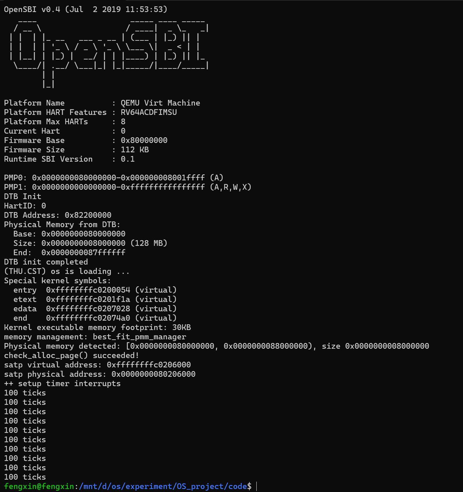
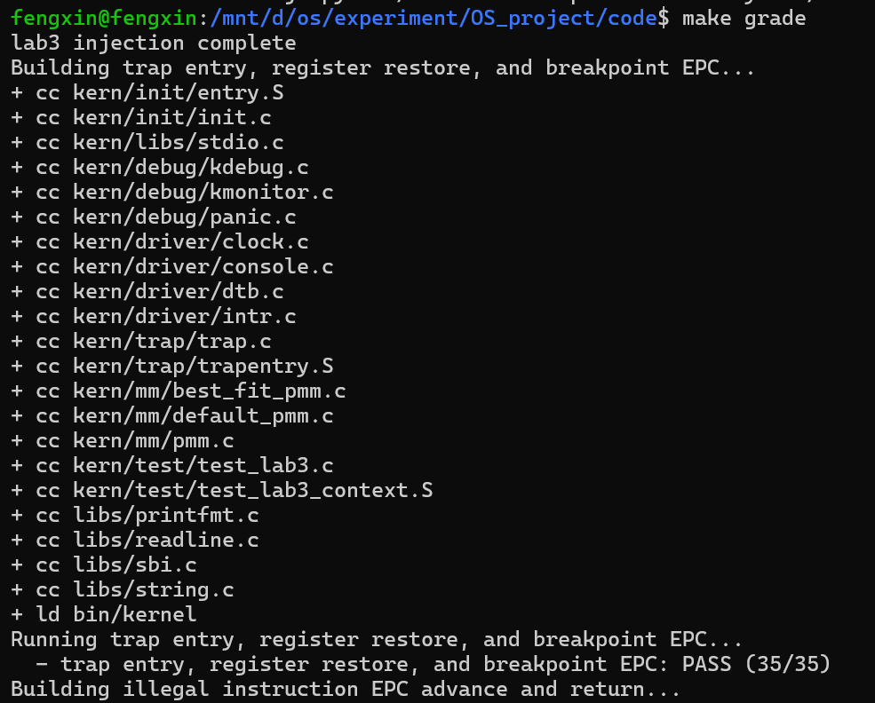
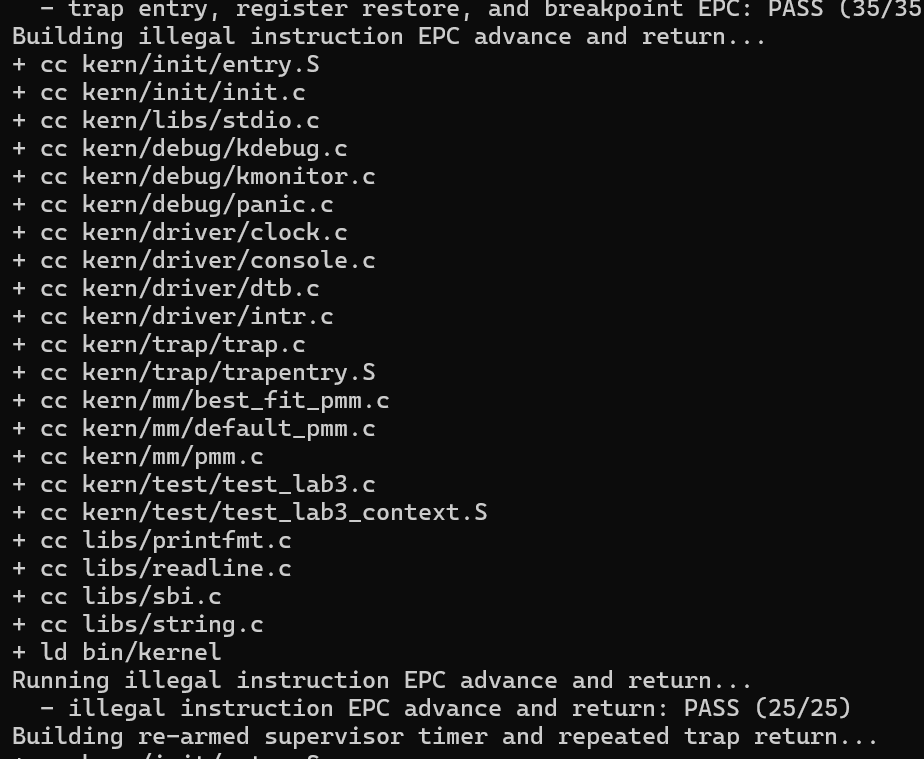
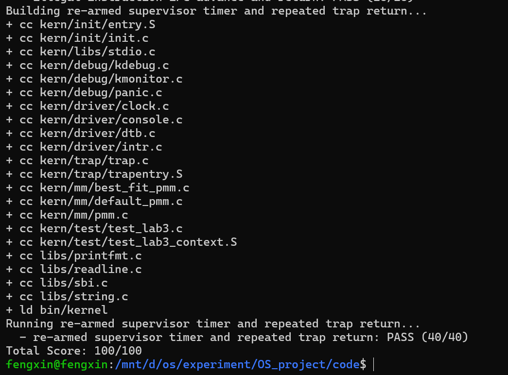

# 操作系统实验报告

## 实验基本信息

| 项目 | 内容 |
|------|------|
| **实验名称** | Lab 3: 中断处理机制 |
| **小组成员** |  2413396-范珂祎、2413406-黄婉文、2413671-吕旭婧 |
| **完成日期** | 2026-11-04 |

### 小组分工

练习如何分工？

| 成员 | 负责的练习/模块 |
|------|----------------|
| 2413406-黄婉文 | 统筹分工，梳理实验逻辑，迁移lab2的代码，最终测试与验证 |
| 2413671-吕旭婧 | 功能模块一：Trap 上下文恢复与入口 |
| 2413396-范珂祎 | 功能模块二：中断与异常处理（interrupt_handler / exception_handler） |

实验报告如何分工？

| 成员 | 负责的练习/模块 |
|------|----------------|
| 2413406-黄婉文 | 实验逻辑分析，测试与验证，实验总结与收获，修改报告 |
| 2413671-吕旭婧 | 模块一实现与验证、提示词，实验收获 |
| 2413396-范珂祎 | 模块二实现与验证、提示词，实验收获 |

---

## 一、实验目的

<!-- 说明本次实验的主要目标和预期成果 -->

本实验的主要目的是：

1. 学习riscv的中断相关知识，以及中断处理的完整流程；
2. 理解中断前后如何进行上下文环境的保存与恢复；
3. 掌握断点异常和时钟中断的处理方法。

---

## 二、实验环境

你们使用的 AI 工具

| 成员 | AI 编程工具 | 底层模型 | 备注 |
|------|------------|---------|------|
| 2413396-范珂祎 | Claude Code（VS Code 扩展） | DeepSeek-V4-Pro | |
| 2413671-吕旭婧 | Codex 桌面应用 | GPT-6 | |
| 2413406-黄婉文 | DeepSeek Harness | DeepSeek-flash | |

**说明：**
- **AI 编程工具**：指具体使用的终端工具、编辑器插件、桌面应用或浏览器界面
- **底层模型**：指该工具使用的大语言模型及版本


---

## 三、实验整体逻辑分析

### 3.1 本章节的逻辑主线

本章围绕RISC-V架构下的 Trap 中断与异常机制展开，核心是实现异常与中断实现、正确保存现场、分类处理、恢复原执行流这一流程。主要包含三部分内容：实现 Trap 上下文的保存与恢复（SAVE_ALL/RESTORE_ALL），建立汇编入口 __alltraps 与 C 处理函数 trap() 之间的调用与返回，以及完成时钟中断的周期性触发与重设、非法指令和断点异常的处理与 epc 修正，从而使内核具备完整的中断处理能力。


### 3.2 功能的逐步实现

本章实验按照"底层上下文管理 → 入口与返回闭环 → 高层分类处理"的顺序逐步推进，每一层都为下一层提供必要前提：

1. 首先实现上下文恢复 RESTORE_ALL: SAVE_ALL 已经把 Trap 发生时的 32 个通用寄存器与 4 个 CSR 按约定布局压入内核栈形成 trapframe，需要在 trapentry.S 中实现相对应的恢复逻辑 RESTORE_ALL，保证后续处理完成后无缝回到原执行流，且必须严格对齐 SAVE_ALL 的偏移。

2. 接着补全 __alltraps 入口调用逻辑：汇编入口必须按 RISC-V 调用约定把当前 sp（即 trapframe 基址）作为 a0 传给 C 函数 trap(struct trapframe *tf)，让高层拿到完整的 Trap 现场，从而进行中断处理。

3. 然后实现 interrupt_handler 与 exception_handler 的中断/异常分类处理：trap() 收到 trapframe 并按 scause 最高位分发后，在 trap.c 中实现具体处理，包括时钟中断、非法指令与断点异常，其他类型走 print_trapframe 兜底。

---

## 四、实验内容与实现

<!-- 
说明：本部分按照 exercises 文档中的练习顺序组织
每个功能模块或者练习中可能包含多项任务，请根据实际情况调整
-->

### 环境配置：lab2代码迁移

**负责人：** 2413406-黄婉文

在开始lab3的实验之前，首先需要将lab2分页以及best-fit分配管理器相关代码迁移到lab3的代码框架中。主要包括pmm.c中page_init()的实现，以及best_fit_pmm.c中补全相关实现。使用lab2设计的提示词生成相应实验代码，填写到标有“lab2”注释的对应位置。

**实现/修改的函数：**

```c
// kern/mm/pmm.c
static void page_init(void);
static void init_pmm_manager(void);   // 让 pmm_manager 指向 best_fit_pmm_manager

// kern/mm/best_fit_pmm.c
static void best_fit_init(void);
static void best_fit_init_memmap(struct Page *base, size_t n);
static struct Page *best_fit_alloc_pages(size_t n);
static void best_fit_free_pages(struct Page *base, size_t n);
static size_t best_fit_nr_free_pages(void);
```


### 功能模块一：Trap 上下文恢复与 Trap 入口功能

**负责人：** 2413671-吕旭婧

#### 模块功能描述

在 trapentry.S 的两个标记处补全 RESTORE_ALL 宏及 __alltraps 中的 C 调用。`idt_init()`、`SAVE_ALL`、`struct trapframe`、`trap()/trap_dispatch()` 和 `__trapret` 都由框架提供。

RESTORE_ALL 宏与 SAVE_ALL 对称，负责从内核栈上的 trapframe 中恢复 4 个 CSR（sstatus、sepc、sbadaddr、scause）和通用寄存器 x1、x3..x31，其中 x0 无需恢复、x2(sp) 必须放在最后一条 LOAD 恢复（否则后续 LOAD 基址错误）；__alltraps在 SAVE_ALL 之后把当前 sp 按 RISC-V 调用约定放入 a0，通过 call trap 进入 C 语言处理函数，返回后自然落入框架提供的 __trapret 执行 sret 返回原执行流。


**需要实现/修改的函数：**

```c
// kern/trap/trapentry.S
RESTORE_ALL    // 汇编宏：与 SAVE_ALL 对称，从 trapframe 恢复 CSR 与通用寄存器（sp 最后恢复）
__alltraps     // 汇编入口：SAVE_ALL 之后补全 mv a0, sp; call trap（4 字节对齐）
```

**功能说明：**

以下为主要相关函数功能：

| 指令/函数 | 作用 |
|---|---|
| `__alltraps` | 中断处理程序的入口点。 `idt_init()` 让 stvec 寄存器的值指向这里，入口先执行 `SAVE_ALL`，再用 `mv a0, sp` 将帧地址作为第一个参数，通过 `call trap` 调用 C 函数。 |
| `SAVE_ALL` | 将原 sp 暂存在 sscratch 寄存器，然后在当前内核栈上分配帧，保存寄存器并把原 sp 写到 x2 槽。 |
| `trap(struct trapframe *tf)` | 调用 `trap_dispatch()`，将 trapframe 分发给对应函数处理具体中断或异常。 |
| `__trapret` | C 函数按调用约定返回到 `__trapret`，此时 sp 仍指向陷阱帧。 |
| `RESTORE_ALL` | 与 `SAVE_ALL` 对应，读取帧中的 status 和 epc 写回 CSR，再恢复通用寄存器。 |
| `sret` | 硬件用 sepc 设置下一条指令地址，并根据 sstatus.SPP 决定返回特权级，将 SPIE 的旧值复制到 SIE。 |


#### 最终提示词

本模块实现设计了工程检查、实现和运行验证三轮用户提示词，以下为工程实现主要部分的提示词。

````text
[PROMPT：任务与操作要求]

现在实现 Lab3 模块一：Trap 上下文恢复与入口。

请在独立的 Lab3 目录开发：
D:\lvxujing\Download\CodexHomework\操作系统\lab3\OS_project-lab3

小组仓库为 https://github.com/fky-1029/OS_project.git。先核对远端 lab3 的最新提交；上一轮检查基于 a4916fa。保留组员后续提交，不切换或覆盖现有 Lab1、Lab2 工作目录。如果模块一标记处已有别人新增的实现，先说明差异，不直接覆盖。

只补齐 code/kern/trap/trapentry.S 中 RESTORE_ALL 和 __alltraps 对应的两处标记。保留 lab3 标记，把本模块的 YOUR CODE 替换为我的学号 2413671。

本轮不修改模块二、构建配置或报告，不提交、不推送。

[RELY：已有接口与约束]

以实际工程中的 SAVE_ALL、struct trapframe、REGBYTES、LOAD/STORE 宏、trap(struct trapframe *tf)、__trapret 和 sret 为依据。

上一轮核对的 RV64 Trap frame 为 288 字节：x2 槽保存入 Trap 前的 sp，status 和 epc 分别位于 256、264 字节偏移。实现前再与当前源码核对，不能另定一套布局。

遵守 RISC-V 调用约定，保留现有 SAVE_ALL、结构体布局、trap() 签名和 __trapret。cause、badvaddr 是供处理与诊断使用的记录，不需要把它们当成 sret 的返回状态来恢复。

[GUARANTEE：交付内容]

1. 完成 RESTORE_ALL 与 __alltraps 的待实现部分。
2. 给出模块一的修改差异、单独汇编命令和反汇编检查结果。
3. 简要解释参数怎样传入 C 函数、C 函数返回到哪里，以及原 sp 和返回地址怎样恢复。
4. 明确列出尚未进行的运行验证。

[SPECIFICATION：行为与验收]

一、入口

SAVE_ALL 完成后，trap() 的第一个参数应指向当前 Trap frame。调用时保持栈对齐和帧的完整性。trap() 正常返回后，应进入现有 __trapret，且 sp 仍指向同一份帧。

二、恢复

恢复内容与 SAVE_ALL 的实际保存布局对应。将帧中当前的 status、epc 恢复到 sstatus、sepc；允许 epc 已由 C 处理函数更新。模块一不自行判断异常类型，不额外调整 epc，也不强制设置返回特权级。

恢复通用寄存器时，不能让写 CSR 使用的临时值覆盖最终寄存器状态。读取帧内其余内容完成后，再恢复帧中记录的原 sp。最终通过现有 sret 返回。

三、本轮验证

在 Ubuntu 中核对已有工具链。使用工程适用的包含路径和编译参数单独汇编 trapentry.S，将产物放在新验证目录，再用 objdump -dr 检查：

- 对 trap 的调用或对应重定位；
- 调用返回位置与 __trapret 的衔接；
- status、epc 槽与 CSR 写回；
- 最后恢复原 sp，再执行 sret。

保存实际命令和结果。单独汇编成功只说明模块一能汇编且产物符合上述检查，不能据此声称整核运行通过。

模块二尚未完成时，不为整核链接临时改写正式 handler。运行时 GDB 检查和评分用例留到下一轮。

如果 Ubuntu 尚未启动，先完成源码实现与静态核对，如实说明汇编验证待运行。不安装软件，不改环境，不执行含批量删除的清理或评分流程。
````

#### 实现迭代过程

模块一在验证过程中处理了以下问题：

旧 CSR 名称不被汇编器识别。GNU 汇编器报告 unknown CSR（sbadaddr），原因是当前工具链按较新的 RISC-V 特权级规范使用 stval，而框架代码仍使用旧名 sbadaddr。

问题解决策略：

在汇编层面引入兼容宏——单独汇编时加 -Dsbadaddr=stval，整核测试副本通过 DEFS=-Dsbadaddr=stval 传入同一宏，使旧名映射到新名。


### 功能模块二：中断与异常处理功能

**负责人：** 2413396-范珂祎

#### 模块功能描述

模块二位于 Trap 处理的 C 语言分发层。`trap_dispatch()` 已经按 `(intptr_t)tf->cause < 0`（即 scause 最高位）把 Trap 分为中断与异常，分别交给 `interrupt_handler()` 和 `exception_handler()`。本模块在 trap.c的标记处补全这两个函数，完成具体的中断/异常分类与处理，并保证处理结束后能正确衔接 `__trapret`/`sret` 并返回原执行流。

**需要实现/修改的函数：**

```c
// kern/trap/trap.c
void interrupt_handler(struct trapframe *tf);
void exception_handler(struct trapframe *tf);
```

**功能说明：**

| 函数 | 作用 |
|---|---|
| `interrupt_handler` | 先屏蔽 tf->cause 最高位得到真实中断号，再按 IRQ_S_TIMER、IRQ_S_SOFT 等类型分发。时钟中断必须重设下一次时钟事件，未知中断打印 `Unknown interrupt` 并由 `print_trapframe` 兜底。 |
| `exception_handler` | 按 tf->cause 处理 `CAUSE_ILLEGAL_INSTRUCTION` 与 `CAUSE_BREAKPOINT`，输出规定格式信息后把 tf->epc 向后移动到下一条指令，其余异常走 `print_trapframe` 兜底。 |
| 与模块一的衔接 | tf->cause、tf->epc 都来自模块一 `SAVE_ALL` 保存的现场。本模块对 tf->epc 的修改由模块一 RESTORE_ALL 写回 sepc，最终由 sret 决定恢复位置。 |


#### 最终提示词

提示词在 [RELY] 中给出 trapframe 布局与全部依赖的常量/函数定义，在 [SPECIFICATION] 中明确时钟中断的重设、`ticks % TICK_NUM` 的统计输出与 `SHUTDOWN_AFTER` 次后关机、epc 按指令长度前进等约束，并以 `tools/grade.sh` 三个用例的输出要求作为验收标准。

````text
[PROMPT：任务与操作要求]

我负责操作系统 Lab3 的模块二：中断与异常处理功能。组员已完成模块一（trapentry.S 的 RESTORE_ALL 与 __alltraps）与统筹，请以小组仓库当前 lab3 分支为基础，实现 kern/trap/trap.c 中的 interrupt_handler 与 exception_handler 两个函数。

小组仓库：
https://github.com/fky-1029/OS_project.git

只修改 code/kern/trap/trap.c 中 "lab3 function2 YOUR CODE" 标记处。保留 lab3 标记，把 YOUR CODE 替换为我的学号 2413396。不修改 trapentry.S、struct trapframe、trap()/trap_dispatch() 等框架与组员已有代码，不修改函数签名，不把两个函数改成 static（tools/test_lab3.c 会 extern 引用它们）。

[RELY：已有条件]

以实际工程源码为准，不要凭记忆描述：

- struct trapframe 布局见 kern/trap/trap.h：gpr（32 个通用寄存器）+ status + epc + badvaddr + cause。中断/异常分发入口 trap_dispatch() 已按 (intptr_t)tf->cause < 0 区分中断与异常，分别调用 interrupt_handler / exception_handler。
- libs/riscv.h 定义 IRQ_U_SOFT=0、IRQ_S_SOFT=1、IRQ_H_SOFT=2、IRQ_M_SOFT=3、IRQ_U_TIMER=4、IRQ_S_TIMER=5、IRQ_H_TIMER=6、IRQ_M_TIMER=7、IRQ_U_EXT=8、IRQ_S_EXT=9、IRQ_H_EXT=10、IRQ_M_EXT=11，以及 CAUSE_ILLEGAL_INSTRUCTION=0x2、CAUSE_BREAKPOINT=0x3。
- kern/driver/clock.h 提供 volatile size_t ticks 与 void clock_set_next_event(void)。
- libs/sbi.h 提供 void sbi_shutdown(void)。注意 trap.c 需要 #include <sbi.h>，否则编译报隐式声明错误。
- trap.c 顶部已定义 #define TICK_NUM 100 与 static void print_ticks()（打印 "100 ticks"）。
- kern/debug/kdebug.h 提供 void print_trapframe(struct trapframe *tf)。
- 新工具链需要 make DEFS=-Dsbadaddr=stval 编译（模块一同样如此）。

[GUARANTEE：本轮交付]

1. 实现 interrupt_handler 与 exception_handler，且能通过 make DEFS=-Dsbadaddr=stval 编译。
2. 给出 tools/grade.sh 三个测试用例（GRADE_LAB3_CONTEXT / GRADE_LAB3_ILLEGAL / GRADE_LAB3_TIMER）对应的输出要求，并说明实现如何满足。
3. 说明时钟中断、非法指令、断点各自的处理流程，以及 tf->epc 如何更新。

[SPECIFICATION：行为与验收]

一、interrupt_handler

- 先屏蔽 tf->cause 的最高位得到真实中断号（用 (tf->cause << 1) >> 1）。
- IRQ_S_TIMER：先 clock_set_next_event() 重设下一次时钟事件；ticks 每次加一；ticks % TICK_NUM == 0 时调用 print_ticks()；累计输出达到 SHUTDOWN_AFTER 次后调用 sbi_shutdown() 关机。SHUTDOWN_AFTER 本实验取 10，保证评分用例的 ticks 能跑到 200 而不会提前关机。
- IRQ_S_SOFT：输出包含 "Supervisor software interrupt" 的信息；其余软中断/定时器中断做类型区分提示。
- 无法识别的中断：输出包含 "Unknown interrupt: cause <号>" 的信息，并调用 print_trapframe(tf)。

二、exception_handler

- CAUSE_ILLEGAL_INSTRUCTION：输出包含 "Illegal instruction at" 的信息；CAUSE_BREAKPOINT：输出包含 "Breakpoint at" 的信息。
- 两者都要把 tf->epc 移动到下一条指令：读 tf->epc 处的 16 位指令，低两位 == 0b11 说明是 32 位指令则 epc += 4，否则是 16 位压缩指令则 epc += 2。
- 其余异常调用 print_trapframe(tf) 兜底。

三、验收

- 三个评分用例分别以 DEFS=-DGRADE_LAB3_CONTEXT / -DGRADE_LAB3_ILLEGAL / -DGRADE_LAB3_TIMER 编译运行，通过 tools/grade.sh 中全部 grep 检查（关键输出串：Breakpoint at、Illegal instruction at、Supervisor software interrupt、Unknown interrupt: cause 15、cause 0x00000014、100 ticks、ticks=200）。
````


#### 实现迭代过程

本模块的实现经历了 2 次迭代，过程如下：

---

##### 第一次迭代

**遇到的问题：**
- 问题1：make 编译报错 `implicit declaration of function 'sbi_shutdown'`。原因是 `trap.c` 只 include 了 `clock.h`、`trap.h` 等头文件，没有 include 声明 `sbi_shutdown` 的 `sbi.h`。

**问题解决策略：**
- 针对问题1：在 `trap.c` 顶部补充 `#include <sbi.h>`，让 `sbi_shutdown` 的声明可见。

---

##### 第二次迭代

**遇到的问题：**

完整构建时 GNU 汇编器报告 `unknown CSR 'sbadaddr'`，与模块一相同，这是因为在新版 binutils（2.45）下 CSR 名称已改为 `stval`。为解决sbadaddr与stval的重命名，方便起见直接在 libs/riscv.h 中添加宏定义 #define sbadaddr stval。
  

**最终结果：**

经过 2 次迭代，该模块最终：
- ✅ 编译通过
- ✅ 三个评分用例全部通过（见第五节）
- ✅ 功能符合预期


## 五、测试与验证

<!-- 根据该实验的具体情况，提供完整的测试运行截图，应包含：
- 编译及运行成功的输出（make qemu），可能有多个
- 测试通过的结果（make grade），只有一个
-->

首先运行make qemu，成功输出初始化信息与时钟中断，并且计时器达到SHUTDOWN_AFTER = 10条件时主动退出。



然后运行make grade。发现报错set: Illegal option - ，原因是 tools/grade.sh 文件使用了 Windows 的换行符（CRLF）。当脚本在Linux环境下运行时，每一行末尾的\r会被当作命令的一部分，导致 set 命令无法识别紧随其后的选项。在 code 目录下执行以下命令，将 grade.sh 的换行符从 CRLF 转换为 LF：

```bash
sed -i 's/\r$//' tools/grade.sh
```

再次执行make grade，编译执行三个测试用例：中断入口、寄存器恢复、断点；非法指令异常处理与返回；时钟中断测试与返回。三个测试全部满分通过，总分100/100。

**测试截图：** 





## 六、实验总结与收获

### 对操作系统的理解

1. 列出你们认为本实验中重要的知识点，以及与对应的 OS 原理中的知识点，并简要说明二者的含义、关系和差异.

（1） 本实验中的 Trap 对应OS原理的中断与异常。OS原理中中断一般指由外部设备触发、与当前执行的指令无关的事件，如时钟中断、外设中断；异常指由当前执行的指令触发的事件，如非法指令、缺页异常、系统调用等。而RISCV中Trap是一个总称，指代任何导致控制权从当前执行流转移到陷阱处理程序的事件，用 scause 最高位区分中断与异常。

（2） 实验中的 stvec + __alltraps 入口对应OS原理中的中断向量表与中断入口。OS 原理中，中断向量表按中断号索引不同处理程序；本实验采用 Direct 模式，stvec 直接指向唯一入口 __alltraps，再由 C 层按 scause 分发。

（3） 实验中的 SAVE_ALL / RESTORE_ALL 对应OS原理中的上下文切换与现场保护。SAVE_ALL / RESTORE_ALL的作用是保存被打断程序的 CPU 状态并在处理后恢复，本实验具体处理方式为构建 trapframe + 严格偏移对齐，以及对 x2(sp) 的特殊处理。

（4） 实验中的特权指令 ecall / sret / mret / ebreak 对应OS原理中的特权级切换。用户态/内核态切换需要通过特权级提升指令实现；比如 RISC-V 用 sret 从 S 返回 U、mret 从 M 返回 S，ecall 在用户态下是系统调用，内核态下是请求固件服务。


2. 列出你们认为 OS 原理中很重要、但在本实验中没有对应上的知识点。

（1） 中断优先级与中断嵌套：本实验在 sstatus.SIE 清零后处理中断，不允许嵌套；实际 OS 需按优先级处理多重中断。
（2） 外设中断：本实验只处理时钟中断，外部设备中断需要配置 PLIC 的使能、优先级、claim/complete 流程，本实验未涉及。
（3） 缺页异常：本实验 exception_handler 对缺页只做 print_trapframe 兜底，没有实现具体的缺页处理和页面置换算法。
（4） 系统调用：本实验只实现了对 ecall 指令的识别，没有具体的系统调用分发和实现。


### AI 协作开发的经验

#### 模块一

先让检查仓库布局和分工，再给出明确的接口及修改范围，最后要求用实际指令地址和寄存器值验证结果。反汇编适合逐槽检查，GDB 适合验证状态在具体执行路径中的变化。遇到工具链、构建参数或模拟器行为差异时，先核对报错发生的位置和日志，再决定应调整验证命令、测试脚本还是源码。

#### 模块二

写提示词时，先让AI读仓库和评分脚本，把 `grade.sh` 要求的输出字符串当成验收标准写进 [SPECIFICATION]，把依赖的常量/函数定义和验收输出原样放进提示词，让AI以真实代码和评分脚本为准，而不是凭记忆猜测。

