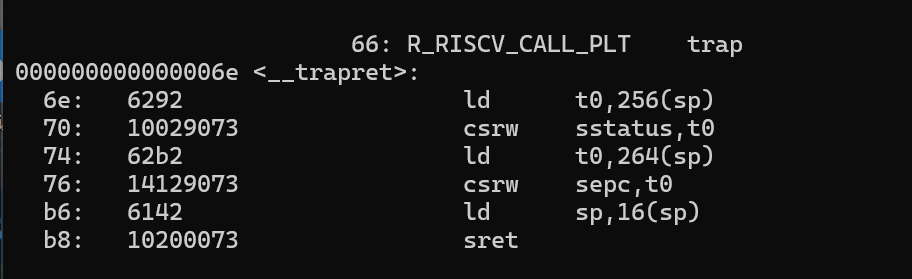
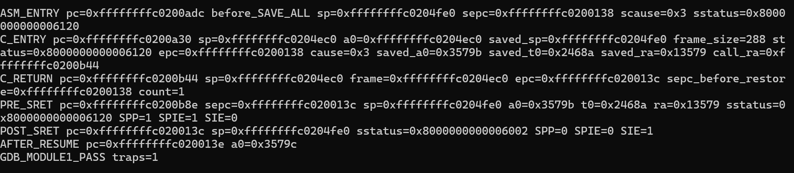

# 操作系统实验报告

## 实验基本信息

| 项目 | 内容 |
|------|------|
| **实验名称** | Lab 3: 中断处理机制 |
| **小组成员** |  2413396-范珂祎、2413406-黄婉文、2413671-吕旭婧 |
| **完成日期** | YYYY-MM-DD |

### 小组分工

练习如何分工？

| 成员 | 负责的练习/模块 |
|------|----------------|
| 2413406-黄婉文 | 统筹分工，梳理实验逻辑，迁移lab2的代码，测试验证 |
| 2413671-吕旭婧 | 功能模块一：Trap 上下文恢复与入口 |
| 2413396-范珂祎 | [练习或模块名称] |

实验报告如何分工？

| 成员 | 负责的练习/模块 |
|------|----------------|
| 2413406-黄婉文 | 实验逻辑分析，测试与验证，实验总结与收获 |
| 2413671-吕旭婧 | 模块一的环境、实现与验证记录，实际提示词及个人心得 |
| 2413396-范珂祎 | [练习或模块名称] |

---

## 一、实验目的

<!-- 说明本次实验的主要目标和预期成果 -->

本实验的主要目的是：

1. 学习riscv的中断相关知识，以及中断处理的完整流程；
2. 理解中断前后如何进行上下文环境的保存与恢复；
3. 掌握断点中断和时钟中断的处理方法。

---

## 二、实验环境

你们使用的 AI 工具

| 成员 | AI 编程工具 | 底层模型 | 备注 |
|------|------------|---------|------|
| 2413396-范珂祎 | [例如：Cline（VS Code插件） / Claude Code（终端 Agent） / DeepSeek Harness等] | [例如：Claude Sonnet 4.5 / GPT-5.5 / DeepSeek-V4-Flash等] | [可选：特殊配置等] |
| 2413671-吕旭婧 | Codex 桌面应用 | GPT-6 系列 | 具体型号未核实 |
| 2413406-黄婉文 | DeepSeek Harness | DeepSeek-flash | 无 |

**说明：**
- **AI 编程工具**：指具体使用的终端工具、编辑器插件、桌面应用或浏览器界面
- **底层模型**：指该工具使用的大语言模型及版本

### 模块一实验环境（2413671-吕旭婧）

- 在 Windows 的独立 Lab3 目录开发，远端基线为 `a4916faec6fdbe1b0def3297b631994ace1e4c43`。
- 通过 `ssh ubuntu-vm` 使用已有 Ubuntu 环境和 `~/compiler-lab/env.sh`。交叉编译器为 `riscv64-unknown-elf-gcc` 15.1.0，GNU objdump 为 2.45。
- 运行验证使用 QEMU 4.1.1 与 `riscv64-unknown-elf-gdb` 16.3.90.20250610-git。 [汇编日志](./verification/module1/assembly/verification.log) · [运行记录](./verification/module1/runtime/run.log)


---

## 三、实验整体逻辑分析

### 2.1 本章节的逻辑主线

本章围绕RISC-V架构下的 Trap 中断与异常机制展开，核心是实现异常与中断实现、正确保存现场、分类处理、恢复原执行流这一流程。主要包含三部分内容：实现 Trap 上下文的保存与恢复（SAVE_ALL/RESTORE_ALL），建立汇编入口 __alltraps 与 C 处理函数 trap() 之间的调用与返回，以及完成时钟中断的周期性触发与重设、非法指令和断点异常的处理与 epc 修正，从而使内核具备完整的中断处理能力。


### 2.2 功能的逐步实现

本章实验按照"底层上下文管理 → 入口与返回闭环 → 高层分类处理"的顺序逐步推进，每一层都为下一层提供必要前提：

1. 首先实现上下文恢复 RESTORE_ALL: SAVE_ALL 已经把 Trap 发生时的 32 个通用寄存器与 4 个 CSR 按约定布局压入内核栈形成 trapframe，需要在 trapentry.S 中实现相对应的恢复逻辑 RESTORE_ALL，保证后续处理完成后无缝回到原执行流，且必须严格对齐 SAVE_ALL 的偏移。

2. 接着补全 __alltraps 入口调用逻辑：汇编入口必须按 RISC-V 调用约定把当前 sp（即 trapframe 基址）作为 a0 传给 C 函数 trap(struct trapframe *tf)，让高层拿到完整的 Trap 现场，从而进行中断处理。

3. 然后实现 interrupt_handler 与 exception_handler 的中断/异常分类处理：trap() 收到 trapframe 并按 scause 最高位分发后，在 trap.c 中实现具体处理，包括时钟中断、非法指令与断点异常，其他类型走 print_trapframe 兜底。

---

## 四、实验内容与实现

<!-- 
说明：本部分按照 exercises 文档中的练习顺序组织
每个功能模块或者练习中可能包含多项任务，请根据实际情况调整
-->

### 环境配置：lab2代码迁移

**负责人：** 2413406-黄婉文

在开始lab3的实验之前，首先需要将lab2分页以及best-fit分配管理器相关代码迁移到lab3的代码框架中。主要包括pmm.c中page_init()的实现，以及best_fit_pmm.c中补全相关实现。使用lab2设计的提示词生成相应实验代码，填写到标有“lab2”注释的对应位置。

**需要实现/修改的函数：**

```c
// kern/mm/pmm.c
static void page_init(void);
static void init_pmm_manager(void);   // 让 pmm_manager 指向 best_fit_pmm_manager

// kern/mm/best_fit_pmm.c
static void best_fit_init(void);
static void best_fit_init_memmap(struct Page *base, size_t n);
static struct Page *best_fit_alloc_pages(size_t n);
static void best_fit_free_pages(struct Page *base, size_t n);
static size_t best_fit_nr_free_pages(void);
```


### 功能模块一：Trap 上下文恢复与 Trap 入口功能

**负责人：** 2413671-吕旭婧

#### 模块功能描述

在 [trapentry.S](../code/kern/trap/trapentry.S) 的两个 `lab3 function1 2413671` 标记处补全 `RESTORE_ALL` 宏及 `__alltraps` 中的 C 调用。`idt_init()`、`SAVE_ALL`、`struct trapframe`、`trap()/trap_dispatch()` 和 `__trapret` 都由框架提供。

| 环节 | 作用 |
|---|---|
| `__alltraps` | `idt_init()` 将 `stvec` 指到这里。入口先执行 `SAVE_ALL`，再用 `mv a0, sp` 将帧地址作为第一个参数，通过 `call trap` 调用 C 函数。 |
| `SAVE_ALL` | 将原 `sp` 暂存在 `sscratch`，然后在当前内核栈上分配帧，保存寄存器并把原 `sp` 写到 x2 槽。 |
| `trap(struct trapframe *tf)` | 正式框架把同一帧交给 `trap_dispatch()`，由模块二处理具体中断或异常。异常处理可更新帧中的 `tf->epc`。 |
| `__trapret` 与 `RESTORE_ALL` | C 函数按调用约定返回到 `__trapret`，此时 `sp` 仍指向帧。`RESTORE_ALL` 读取帧中当前的 `status` 和 `epc` 写回 CSR，再恢复通用寄存器。 |
| `sret` | 硬件用 `sepc` 设置下一条指令地址，并根据 `sstatus.SPP` 决定返回特权级，将 `SPIE` 的旧值复制到 `SIE`。 |

RV64 下 `REGBYTES = 8`。帧有 32 个通用寄存器槽和 4 个 CSR 槽，共 288 字节，保持原有的 16 字节栈对齐。[trap.h](../code/kern/trap/trap.h) 中的字段顺序与汇编对应。

| 字节偏移 | 内容 |
|---:|---|
| `8 × n`，`n = 0…31` | `xn`，其中 `+8` 是原 `ra`，`+16` 是原 `sp`。`x0` 恒为零，无需加载。 |
| `+256`、`+264` | `status` 和 `epc`，返回前分别写回 `sstatus` 和 `sepc`。 |
| `+272`、`+280` | `badvaddr` 和 `cause`，供诊断与分发使用。 |

先用 `t0` 写回两个 CSR，再从帧中加载原 `t0`。恢复期间，`sp` 仍用于寻址帧中其他字段，所以最后一条加载才用 `+16` 的值恢复原 `sp`。这里有两个返回地址。`call trap` 把 `__trapret` 的地址放进 `ra`，供 C 函数返回。原执行流的 `ra` 在 `SAVE_ALL` 时已经存入帧，随后由 `RESTORE_ALL` 恢复。最后执行的 `sret` 使用的是 `sepc`，所以模块二更新的 `tf->epc` 会决定异常处理后的恢复位置。

#### 最终提示词

[提示词原文](./prompt.md) 按工程检查、模块一实现、运行验证的顺序归档。实现提示词规定沿用实际帧布局和接口，只改两个标记。运行验证提示词要求在独立副本中观察 C 入口的第一条指令、C 返回和 `sret` 前后。

#### 实现迭代过程

模块一的汇编实现在单独汇编和运行验证阶段保持一致。验证过程中处理了三个问题。

1. **旧 CSR 名称。** GNU 汇编器报告 `unknown CSR`（`sbadaddr`）。单独汇编时加 `-Dsbadaddr=stval`，整核测试副本通过 `DEFS=-Dsbadaddr=stval` 传入同一兼容宏。已有 `SAVE_ALL` 和 Makefile 保持原样。 [首次汇编日志](./verification/module1/assembly/verification-default.log) · [成功日志](./verification/module1/assembly/verification.log)
2. **构建参数。** 首次构建误用 `V=1`，Makefile 把 `1` 拼到了编译器命令前。改用 `V=` 后，测试副本成功编译、链接并生成 `bin/ucore.img`。 [首次构建日志](./verification/module1/runtime/build-initial.log) · [成功构建日志](./verification/module1/runtime/build.log)
3. **GDB 对状态位的预期。** 初版脚本期望 `sret` 后 `SPIE=1`。日志显示当前 QEMU 4.1.1 将旧 `SPIE` 复制给 `SIE` 后清零 `SPIE`。核对模拟器实现后修正了独立测试脚本的预期。`sret` 前的 `sstatus` 仍按帧内保存值逐项比较。 [首次状态检查](./verification/module1/runtime/gdb-initial-spie.log) · [QEMU 4.1.1 的 helper_sret](https://github.com/qemu/qemu/blob/v4.1.1/target/riscv/op_helper.c#L90-L101)


### 功能模块二：中断与异常处理功能

**负责人：** 2413396-范珂祎

#### 模块功能描述

**需要实现/修改的函数：**

```c
// 列出本模块涉及的所有函数签名
void example_function(void);
int another_function(int arg);
```

**功能说明：**

[简要描述该模块的功能，包括：
- 该模块在整个系统中的作用
- 需要处理的主要场景
- 与其他模块的交互关系]

#### 最终提示词

以下是经过迭代优化后，最终成功实现该功能的提示词：

````markdown

[按照提示词模板，给出具体的提示词]

````

#### 实现迭代过程

本模块的实现经历了 [N] 次迭代，过程如下：

---

##### 第一次迭代

如果设计的prompt生成代码后出现问题：

**遇到的问题：**
- 问题1：问题描述、错误信息和原因分析
- 问题2：问题描述、错误信息和原因分析

**问题解决策略：**
- 针对问题1：[说明如何修改提示词]
- 针对问题2：[说明如何修改提示词]

如果没有问题：

**最终结果：**

经过 [N] 次迭代，该模块最终：
- ✅ 编译通过
- ✅ 所有相关测试通过
- ✅ 功能符合预期

**关键改进点总结（如有）：**
1. [改进点1：例如，在 [RELY] 中补充了完整的系统调用号定义]
2. [改进点2：例如，在 [SPECIFICATION] 中明确了异常处理的边界条件]
3. [改进点3：例如，增加了对用户指针合法性检查的要求]

---

##### 第二次迭代（如有）

[按照和第一次迭代相同的格式]

---

##### 第三次迭代（如有）

[按照和第一次迭代相同的格式]

---


## 五、测试与验证

<!-- 根据该实验的具体情况，提供完整的测试运行截图，应包含：
- 编译及运行成功的输出（make qemu），可能有多个
- 测试通过的结果（make grade），只有一个
-->

**测试截图：** 小组集成截图待补。

### 模块一验证（2413671-吕旭婧）

#### 单独汇编和反汇编

在 Ubuntu 中单独汇编 `trapentry.S`，生成 RV64 ELF 对象。`objdump -dr` 显示对 `trap` 的调用重定位，且调用序列之后紧接 `__trapret`。逐项核对了 31 个可写通用寄存器的恢复槽位、`256(sp)` 和 `264(sp)` 写回的 CSR，以及最后的 `ld sp,16(sp)` 和 `sret`。这是对目标文件的静态检查。 [反汇编](./verification/module1/assembly/trapentry.objdump.txt) · [实际汇编命令](./verification/module1/assembly/verify.sh)



#### QEMU/GDB 断点返回

在 Ubuntu 独立副本中加入测试入口及只处理这条断点的最小 `trap()`，跳过时钟初始化并将 `sie` 清零以屏蔽中断源。通过 `cmp` 和 SHA-256 核对测试副本与正式版的 `trapentry.S` 逐字节一致。副本实际完成构建，并在 QEMU 4.1.1 下运行。 [副本差异](./verification/module1/runtime/fixture.diff) · [运行记录](./verification/module1/runtime/run.log)

本次用指令字 `0x00100073` 触发 **4 字节 `ebreak`**。反汇编和 GDB 都记录了断点地址 `0xffffffffc0200138` 与下一条指令地址 `0xffffffffc020013c`。 [测试指令反汇编](./verification/module1/runtime/disassembly.txt)

| 检查位置 | 实测结果 |
|---|---|
| `__alltraps` 第一条指令 | `SAVE_ALL` 前原 `sp` 为 `0xffffffffc0204fe0`，`scause=3`。 |
| `trap()` 第一条指令 | `a0 = sp = 0xffffffffc0204ec0`，比原栈指针低 288 字节。帧的 x2 槽为 `0xffffffffc0204fe0`。 |
| C 返回到 `__trapret` | `sp` 仍为 `0xffffffffc0204ec0`。`tf->epc` 已从 `0xffffffffc0200138` 改为 `0xffffffffc020013c`，硬件 `sepc` 此时仍为断点地址。 |
| `sret` 执行前 | `sepc` 已写为 `0xffffffffc020013c`，原 `sp` 已恢复。`a0=0x3579b`、`t0=0x2468a`、`ra=0x13579` 与触发前一致。 |
| 单步执行 `sret` 后 | PC 到达 `0xffffffffc020013c`。下一条 `addi a0,a0,1` 执行后，`a0=0x3579c`。 |

`sret` 前 `sstatus=0x8000000000006120`，与帧中保存值相等。单步后为 `0x8000000000006002`，其中 `SPP/SPIE/SIE` 由 `1/1/0` 变成 `0/0/1`，这是本次 QEMU 的 `sret` 行为。GDB 和串口分别记录 `GDB_MODULE1_PASS traps=1` 与 `LAB3_MODULE1_PROBE_PASS traps=1 result=0x3579c`。运行时核对的是 `sp` 及代表性寄存器 `a0`、`t0`、`ra`。 [GDB 日志](./verification/module1/runtime/gdb.log) · [串口日志](./verification/module1/runtime/qemu-serial.log)




#### 验证范围

以上截图来自已保存的实际验证日志。本节的运行结果仅覆盖模块一在独立测试副本中的 4 字节断点返回路径。模块二合入后，再使用正式处理函数验证 2 字节和 4 字节断点、非法指令及兜底分发、持续时钟中断和普通启动的自动关机，并运行完整集成用例。 [证据索引与复现命令](./verification/module1/README.md)

---

## 六、实验总结与收获

### 对操作系统的理解

1. 列出你们认为本实验中重要的知识点，以及与对应的 OS 原理中的知识点，并简要说明二者的含义、关系和差异.

（1） 本实验中的 Trap 对应OS原理的中断与异常。OS原理中中断一般指由外部设备触发、与当前执行的指令无关的事件，如时钟中断、外设中断；异常指由当前执行的指令触发的事件，如非法指令、缺页异常、系统调用等。而RISCV中Trap是一个总称，指代任何导致控制权从当前执行流转移到陷阱处理程序的事件，用 scause 最高位区分中断与异常。

（2） 实验中的 stvec + __alltraps 入口对应OS原理中的中断向量表与中断入口。OS 原理中，中断向量表按中断号索引不同处理程序；本实验采用 Direct 模式，stvec 直接指向唯一入口 __alltraps，再由 C 层按 scause 分发。

（3） 实验中的 SAVE_ALL / RESTORE_ALL 对应OS原理中的上下文切换与现场保护。SAVE_ALL / RESTORE_ALL的作用是保存被打断程序的 CPU 状态并在处理后恢复，本实验具体处理方式为构建 trapframe + 严格偏移对齐，以及对 x2(sp) 的特殊处理。

（4） 实验中的特权指令 ecall / sret / mret / ebreak 对应OS原理中的特权级切换。用户态/内核态切换需要通过特权级提升指令实现；比如 RISC-V 用 sret 从 S 返回 U、mret 从 M 返回 S，ecall 在用户态下是系统调用，内核态下是请求固件服务。


2. 列出你们认为 OS 原理中很重要、但在本实验中没有对应上的知识点。

（1） 中断优先级与中断嵌套：本实验在 sstatus.SIE 清零后处理中断，不允许嵌套；实际 OS 需按优先级处理多重中断。
（2） 外设中断：本实验只处理时钟中断，外部设备中断需要配置 PLIC 的使能、优先级、claim/complete 流程，本实验未涉及。
（3） 缺页异常：本实验 exception_handler 对缺页只做 print_trapframe 兜底，没有实现具体的缺页处理和页面置换算法。
（4） 系统调用：本实验只实现了对 ecall 指令的识别，没有具体的系统调用分发和实现。


### AI 协作开发的经验

1. 提示词的[RELY]部分要保证准确性，上下文信息不能凭记忆描述，最好从代码中复制工程实际定义，以真实代码为准是提示词有效的前提。
2. [SPECIFICATION] 中描述约束而非罗列步骤，涉及执行顺序、状态一致性、返回值语义等容易被忽略的约束需要单独列出，生成结果的完整性更高。
3. 出错时不要直接重写 prompt，先按错误类型定位问题来源，避免无效迭代。编译错误多与 [RELY] 不一致相关，运行错误多与 [SPECIFICATION] 遗漏情形相关。
4. AI 生成结果需要人工复核，包括函数接口、关键约束、实现效果等，必须完全理解框架以及AI生成代码的逻辑。

### 模块一心得（2413671-吕旭婧）

这次我把陷阱帧理解为汇编和 C 共同遵守的内存布局。最容易混淆的是两个 `sp` 和两个返回地址。帧上的 x2 槽保存被打断代码的栈指针，处理时的 `sp` 用来访问这份帧。C 返回地址只负责到达 `__trapret`，真正恢复执行的位置由 `sepc` 决定。GDB 在两个位置分别停下来后，我能直接看到 `tf->epc` 先在内存中变化，随后才写入硬件 CSR。

设计提示词时，我先让 Codex 检查仓库布局和分工，再给出明确的接口及修改范围，最后要求用实际指令地址和寄存器值验证结果。反汇编适合逐槽检查，GDB 适合验证状态在具体执行路径中的变化。遇到工具链、构建参数或模拟器行为差异时，先核对报错发生的位置和日志，再决定应调整验证命令、测试脚本还是源码。

---

