操作系统实验报告

实验基本信息

实验名称： Lab 1: 最小可执行内核
小组成员： 2413396-范珂祎、2413406-黄婉文、2413671-吕旭婧 
完成日期： 2026-10-10

小组分工

练习分工：

2413396-范珂祎： 构建链与 OS 原理对照 
2413406-黄婉文： 练习2 
2413671-吕旭婧： 启动代码、练习1与 make qemu 验证 

实验报告分工：
范珂祎： 构建链说明、报告框架与统一排版 
黄婉文： 实验内容练习2，测试与验证，实验总结与收获 
吕旭婧： 启动流程逻辑、练习1解答与运行验证 

一、实验目的

本实验的主要目的是：

1. 理解 RISC-V 虚拟机从复位、MROM、OpenSBI 到 uCore 内核入口的控制权转移。
2. 掌握最小内核的构建、加载与启动：生成 ucore.img，由 QEMU 加载到 0x80200000，并进入 kern_entry 和 kern_init。
3. 学会使用 QEMU 与 RISC-V GDB 观察启动过程，并将代码中的栈、链接脚本、特权级与 OS 原理建立对应关系。

二、实验环境

范珂祎：  AI 编程工具：Claude Code（终端 Agent） 
        底层模型：Claude 
黄婉文：  AI 编程工具： VS Code + codex CLI    
        底层模型：DeepSeek-V4-flash
吕旭婧：  AI 编程工具： Codex Desktop
        底层模型： GPT-5 
（备注）通过 SSH 操作 Ubuntu 22.04 虚拟机 

说明：
1.AI 编程工具：指具体使用的终端工具、编辑器插件、桌面应用或浏览器界面
2.底层模型：指该工具使用的大语言模型及版本

三、实验整体逻辑分析

3.1 本章节的逻辑主线

Lab1 的重点不是实现进程或内存管理，而是让一个最小内核真正运行起来。构建时，entry.S、init.c 和库函数会被编译、链接为入口是 kern_entry 的 RISC-V ELF 文件，再转换成裸二进制镜像 ucore.img。

虚拟机上电后，先从复位地址附近的 MROM 开始执行；MROM 将控制权交给运行在 M 模式下的 OpenSBI；OpenSBI 再跳转到 0x80200000，也就是链接脚本规定的内核入口。到达 kern_entry 后，入口汇编先准备内核栈，再进入 C 语言函数 kern_init。kern_init 清零 .bss、调用 cprintf 打印启动信息，并保持运行。练习 1 关注的就是从入口汇编过渡到 C 代码的这一步。

3.2 功能的逐步实现

1. 确定内核布局与入口：链接脚本将 .text 起始位置设为 0x80200000，并以 kern_entry 为 ELF 入口，保证固件跳转地址、符号地址和实际镜像布局一致。
2. 构建内核镜像：Makefile 调用 RISC-V 交叉工具链产生 bin/kernel，再使用 objcopy 得到供 QEMU 加载的 bin/ucore.img。
3. 由固件转交内核：QEMU 的 MROM 从复位地址启动 OpenSBI；OpenSBI 完成机器态初始化后，以 S 模式跳转到 QEMU 指定的内核加载地址 0x80200000。
4. 建立 C 运行前提：kern_entry 把 sp 指向静态内核栈顶 bootstacktop，使后续 C 函数调用拥有可用栈帧。
5. 执行最小内核初始化：kern_entry 尾调用 kern_init；后者完成 .bss 清零、打印 (THU.CST) os is loading ...，从而给出最小内核已运行的可观察证据。

四、实验内容与实现

功能模块：构建链（最小内核的构建与加载）

负责人：范珂祎

本模块负责 Lab1 最小内核从源码到可运行镜像的构建链，以及把它加载到 QEMU 的过程：
1. Makefile 调用 riscv64-unknown-elf-gcc 交叉编译 entry.S、init.c 等源文件；
2. 链接脚本 tools/kernel.ld 指定入口 kern_entry 和加载地址 0x80200000；
3. ld 链接生成 ELF（bin/kernel），再用 objcopy 转成裸二进制镜像 bin/ucore.img；
4. QEMU 通过 -device loader 把 ucore.img 加载到 0x80200000，OpenSBI 跳转过去转交控制权。

详细分析见“三、实验整体逻辑分析”，构建与启动验证见“五、测试与验证”，OS 原理对照见“六、实验总结与收获的构建链”相关。

练习1：理解内核启动中的程序入口操作

负责人： 吕旭婧

tools/kernel.ld 将内核的起始地址设为 0x80200000，并通过 ENTRY(kern_entry) 指定入口。实际构建结果中，kern_entry 位于 0x80200000，bootstack 位于 0x80201000，bootstacktop 位于 0x80203000；栈空间为 KSTACKPAGE = 2 页，即 8 KiB。

kern/init/entry.S 的两条关键伪指令如下：

la sp, bootstacktop
tail kern_init

la sp, bootstacktop

la（load address）把符号 bootstacktop 的地址放入寄存器 sp（x2），并不是读取该地址中的数据。实际反汇编中，它会展开为 auipc 等真实指令，最终使 sp = 0x80203000。

这一步是在建立内核最开始使用的栈。bootstack 是 entry.S 中一段按页对齐的静态空间，bootstacktop 是它的高地址端。RISC-V 的栈向低地址增长，因此将 sp 放在栈顶后，后续 C 函数的栈帧和局部变量才有位置可用。此时还没有进入 C 代码，不能假设栈已经由硬件或固件准备好，所以需要由入口汇编主动完成。

tail kern_init

tail 是尾调用伪指令：它跳转到 kern_init，但不会把返回地址写入 ra。本次构建的反汇编中，它展开为跳转指令 j 0x8020000a <kern_init>。因此，这里不是一次普通的“调用后再返回”，而是把启动控制权直接交给 C 语言的内核初始化函数。

这种写法与 kern_init 的 noreturn 属性相符合：该函数完成 .bss 清零、打印启动信息后进入无限循环，不会返回 kern_entry。因此不需要保存返回地址；tail 也清楚地表示了“汇编引导结束，内核初始化开始”。

下图是实际构建得到的符号地址和 kern_entry 的反汇编。可以看到，入口地址为 0x80200000，设置 sp 后跳转到 kern_init。

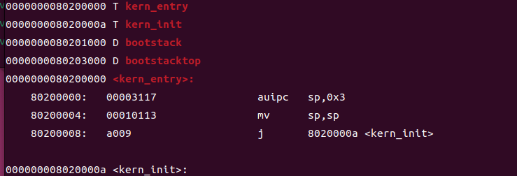

练习2：使用GDB验证启动流程

负责人：黄婉文

练习内容：

使用 GDB 跟踪 QEMU 模拟的 RISC-V 从加电开始直到执行内核第一条指令（跳转到 0x80200000）的整个过程，说明 RISC-V 硬件加电后最初执行的几条指令的地址以及主要功能。

调试过程：

1. 准备调试

启动qemu： 使用tmux分屏，终端1输入以下命令启动被调试目标 QEMU；执行后 QEMU 会暂停，等待 GDB 连接。

make debug QEMU="$HOME/os-lab/tools/qemu-4.1.1/bin/qemu-system-riscv64"

如图，在Makefile的TARGETS部分里定义了debug和gdb目标，debug中的-s参数表示打开 GDB 调试服务，监听 1234 端口；-S表示CPU 动后立即暂停，等待gdb连接后再继续。

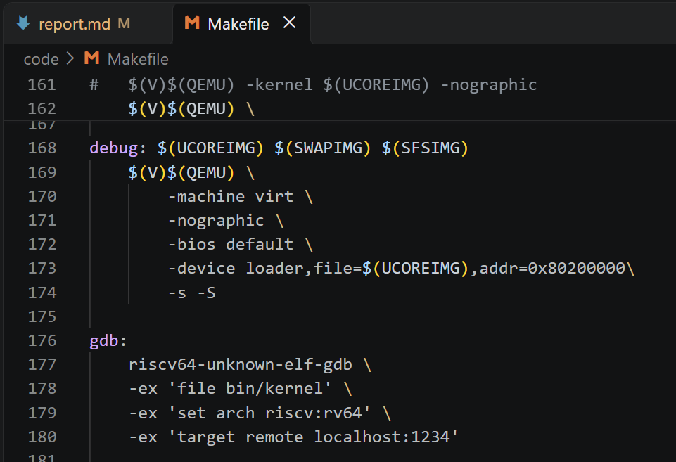

启动gdb： 终端2输入make gdb，启动gdb调试器。

file bin/kernel表示让GDB加载编译好的内核文件，包含函数名、变量名等调试符号；set arch riscv:rv64 表示目标架构为 RISC-V 64 位程序；target remote localhost:1234 表示让GDB连接localhost的1234端口，也就是QEMU监听的端口。

如图，GDB成功连上QEMU后，提示程序停在了0x0000000000001000地址。

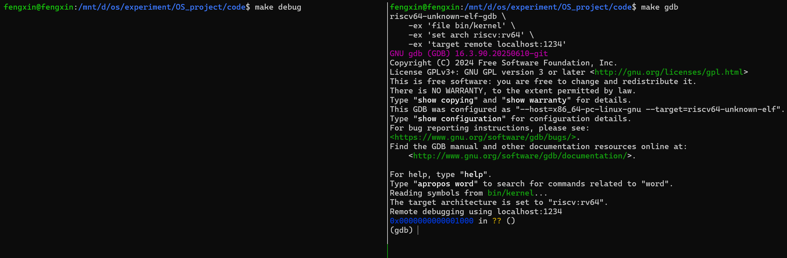

2. 硬件初始化和固件启动

加电复位： 在gdb中使用i r pc指令查看程序计数器pc，发现此时pc=0x1000，这是qemu模拟的 RISC-V 的复位地址。下一步程序会从这里开始执行固件代码MROM。MROM是QEMU 模拟的 RISC-V 处理器在加电后最先执行的一小段内置固件代码，它会完成最基本的环境准备，并将控制权交给OpenSBI（跳转到0x80000000）。

加载OpenSBI： 接下来OpenSBI会被加载到物理内存 0x80000000 处。使用b *0x80000000指令在该地址打断点，然后使用si指令单步调试观察MROM的执行过程，验证 MROM 跳转到 OpenSBI。

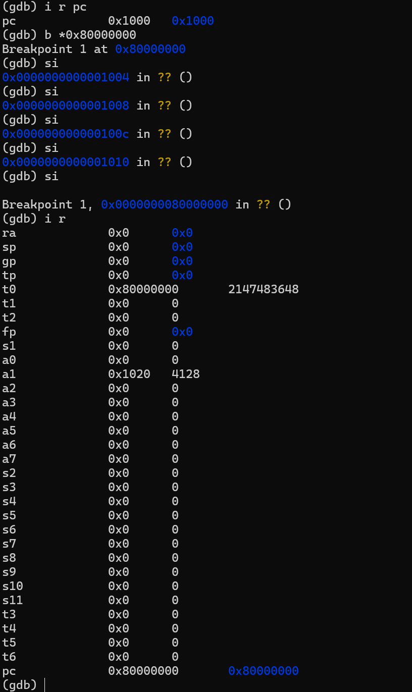

3. OpenSBI 初始化与内核加载

OpenSBI 运行在 RISC-V 的最高特权级（M 模式），负责初始化处理器的运行环境。完成初始化工作后，OpenSBI开始加载并启动操作系统内核，将编译生成的内核镜像文件加载到物理内存的0x80200000地址处。

跟踪验证 OpenSBI 把内核加载到 0x80200000，并跳转过去执行 kern_entry。使用watch *0x80200000观察内核加载瞬间，并用b *kern_entry在内核入口打断点。使用c指令继续执行程序，直到运行到断点处停止。此时终端1也打印了OpenSBI的信息。

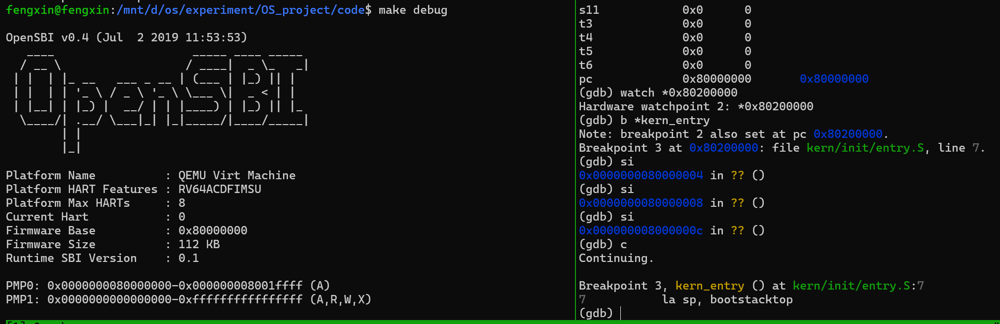

使用i r指令检查寄存器状态，发现pc=0x80200000 <kern_entry>，成功到达内核入口。

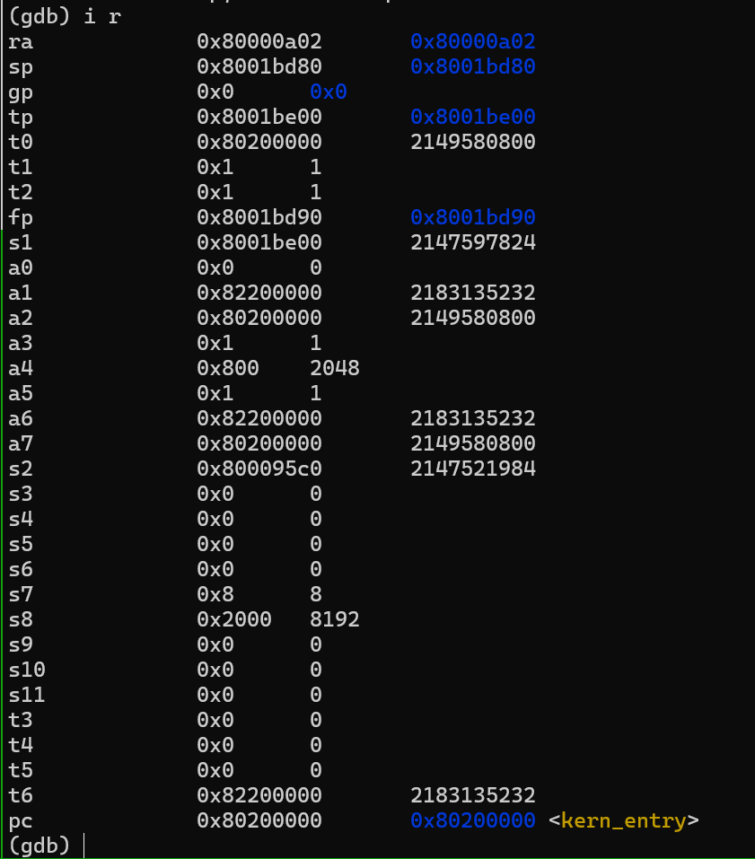
   
4. 内核启动执行

OpenSBI 完成相关工作后，跳转到了0x80200000地址，到这一步控制权已由OpenSBI移交给内核，准备执行第一条指令，我们可以继续观察内核的执行。

由于链接脚本将entry.S中的代码段放在内核镜像的最开始位置，0x80200000这个地址上存放的是kern/init/entry.S文件编译后的机器码，因此开始执行entry.S。entry.S设置内核栈指针，为C语言函数调用分配栈空间，准备C语言运行环境，然后按照RISC-V的调用约定跳转到kern_init()函数。最后，kern_init()调用cprintf()输出一行信息，表示内核启动成功，然后进入死循环。

如图，首先查看0x80200000地址下sp的值，然后单步执行后再次查看，观察到sp更新为0x80203000，即 bootstacktop 的地址，验证了entry.S 通过 la sp, bootstacktop 把栈指针设置为内核栈顶。

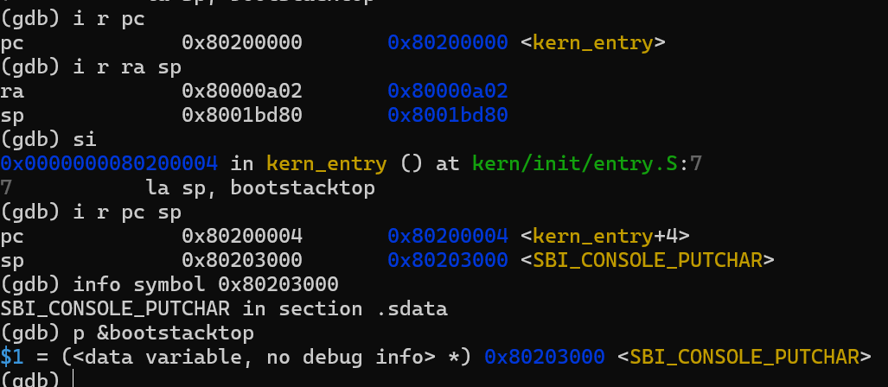

然后在kern_init打断点，继续执行程序，停止后执行bt查看调用栈，发现确实跳转到了kern_init()。最后在cprintf打断点，执行发现终端1输出os is loading ... ，程序最终停在 kern_init 的 while(1)死循环。

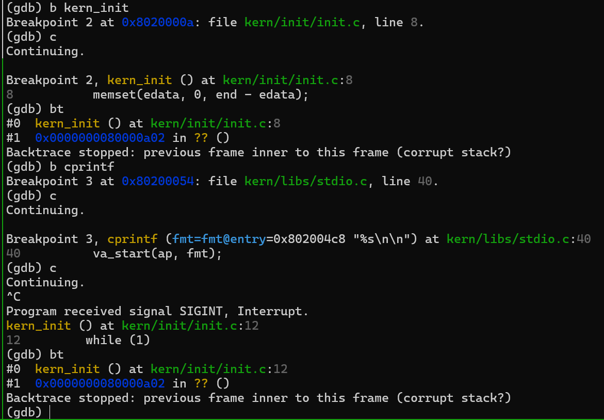

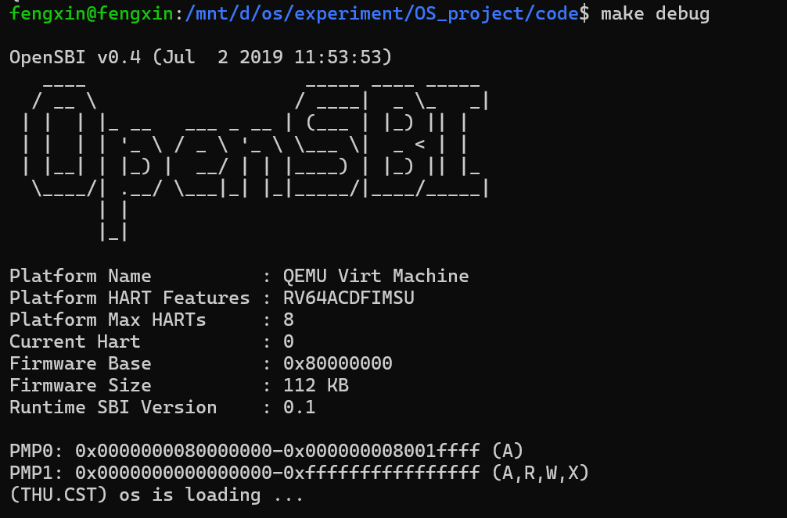

问题解答：
RISC-V 硬件加电后最初执行的几条指令位于什么地址？它们主要完成了哪些功能？

答：RISC-V 硬件加电后，PC 被初始化为复位地址 0x1000。最初执行的几条指令位于 0x1000 附近（0x1004、0x1008、0x100c、0x1010），是 QEMU 内置的 MROM 固件代码。MROM会完成基本的环境准备，将 CPU 及必要组件置于初始状态，然后跳转到 0x80000000，把控制权交给 OpenSBI。

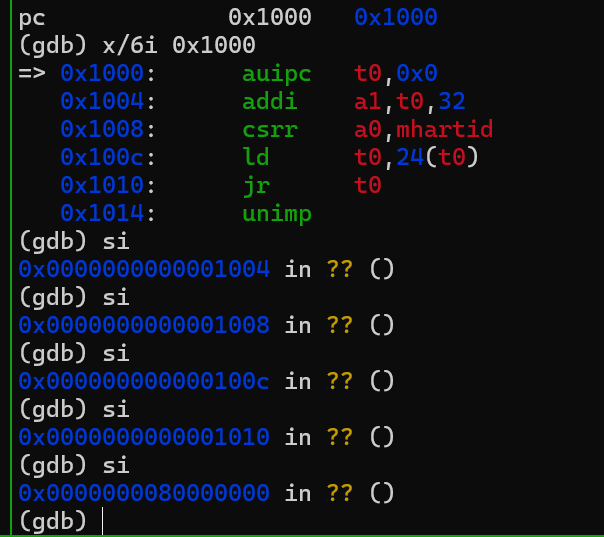

如图，具体分析反汇编指令，0x1004把 0x1000 + 32 = 0x1020存入a1，作为参数传给 OpenSBI；0x1008读取 CSR 寄存器mhartid存入 a0；0x100c从 t0(0x1000)+24 加载8字节到 t0，即读取 0x1018 处的内容，这里存放的是 OpenSBI 的入口地址；最后0x1010跳转到 t0 中保存的地址，即0x80000000。  

五、测试与验证

- 成员A：构建与启动验证。 在 Ubuntu 22.04 虚拟机中加载 RISC-V 工具链后执行：

  source ~/compiler-lab/env.sh
  cd ~/os-lab/OS_project/code
  make -B
  make qemu QEMU="$HOME/os-lab/tools/qemu-4.1.1/bin/qemu-system-riscv64"
  

  使用课程要求的 QEMU 4.1.1 进行验证。交叉编译、链接和 objcopy 均成功完成；启动后可以看到 OpenSBI v0.4 的信息，以及 (THU.CST) os is loading ...。这说明内核已经到达 kern_entry，并继续执行了 kern_init。kern_init 最后是无限循环，因此 QEMU 不会自行退出，这是正常现象。

  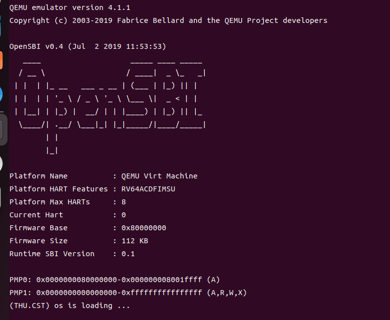

  Makefile 使用课程提供的启动参数：-bios default -device loader,file=$(UCOREIMG),addr=0x80200000。其中 loader 将裸二进制镜像放到链接脚本约定的 0x80200000；在 QEMU 4.1.1 下，OpenSBI 可以正常将控制权交给内核。运行命令中显式指定 QEMU 4.1.1，保证实验使用的版本符合要求。

练习2测试截图：

以下为内核启动执行后的qemu以及调试截图：

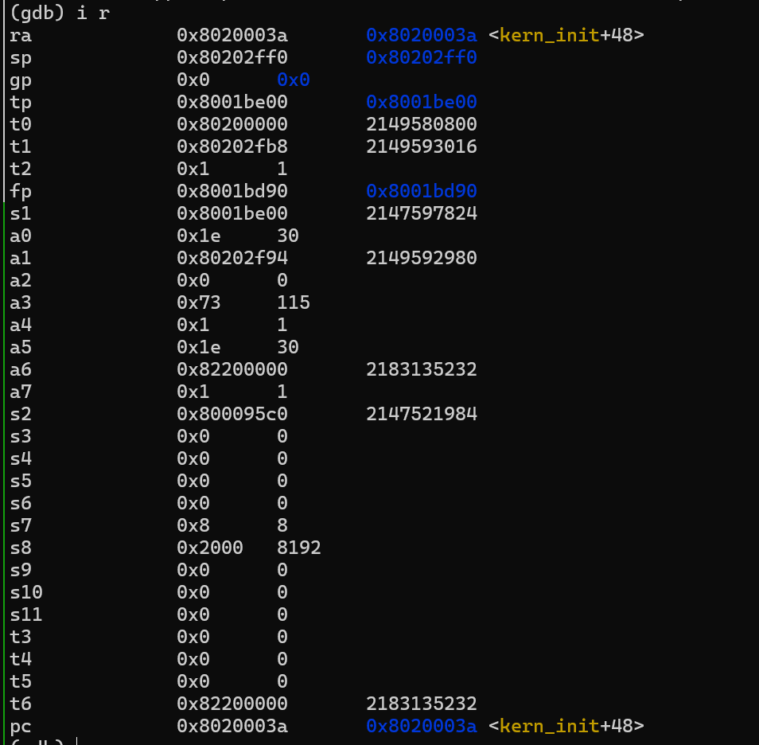

六、实验总结与收获

对操作系统的理解

1. 列出你们认为本实验中重要的知识点，以及与对应的 OS 原理中的知识点，并简要说明二者的含义、关系和差异
练习1相关：

（1）程序入口与可执行文件加载：练习1 中 tools/kernel.ld 用 ENTRY(kern_entry) 指定内核入口，并把内核链接到固定地址 0x80200000，OpenSBI 跳转到这里开始执行内核。对应 OS 原理中的「程序装载与执行」「可执行文件（ELF）的入口点与地址空间布局」。关系：OS 原理讲的是操作系统如何把一个可执行文件加载进内存、从其入口地址开始执行；本实验里被加载执行的「程序」就是内核本身。差异在于：真实 OS 中用户程序通常采用动态链接、虚拟地址甚至地址随机化（ASLR），而本实验的内核是地址相关代码，必须加载到链接脚本规定的固定物理地址，不做重定位。

（2）内核栈的建立与调用约定（栈帧）：练习1 中 la sp, bootstacktop 把栈指针 sp 指向静态分配的 bootstack 数组顶端，为后续 C 函数调用准备栈空间。对应 OS 原理中的「函数调用机制 / 调用约定」和「栈帧（stack frame）」概念。关系：C 语言函数调用依赖栈来保存返回地址、局部变量和被保存的寄存器，OS 原理中每个进程/线程都拥有自己独立的栈。差异在于：本实验是内核启动阶段的「第一个栈」，由入口汇编用一段按页对齐的静态数组显式建立；而用户进程的栈是 OS 在创建进程时动态分配并初始化的。

（3）汇编到 C 的过渡与尾调用：练习1 中 tail kern_init 以尾调用方式跳转到 C 函数 kern_init，不把返回地址写入 ra。对应 OS 原理中的「汇编语言与高级语言的接口」和「RISC-V 调用约定（ra/x2 寄存器）」。关系：任何操作系统的引导代码都要从汇编过渡到 C，遵循统一的调用约定；本实验里 kern_entry 就是那个汇编入口。差异在于：普通调用用 call/jal 保存返回地址，而这里用 tail 不保存，是因为 kern_init 是 noreturn 函数、进入死循环后不会再返回，这是对调用约定的合理省略（也是尾调用优化。

练习2相关：

（1）CPU 特权级与内核态/用户态：RISC-V 用 M/S/U 三级特权级表示，OpenSBI 运行在 M 模式，内核运行在 S 模式，用户程序将来运行在 U 模式，对应OS原理中的特权级与内核态/用户态知识点。本实验中 OpenSBI 跳转到内核涉及 M 模式到 S 模式的切换，但是尚未涉及 U 模式。

（2）ecall调用：对应 OS 中的系统调用机制。在 S 模式执行 ecall 会陷入 M 模式，调用 OpenSBI 服务；在 U 模式执行 ecall 会陷入 S 模式，实现用户程序到内核的系统调用。本实验通过 ecall 调用 OpenSBI 的字符输出服务，最终实现了 cprintf。差异在于本实验是内核调用固件服务，而不是用户程序调用内核服务，但底层陷入机制相同，都是通过 ecall 实现特权级提升。

（3）内核加载地址与链接脚本：内核被加载到 0x80200000并从该地址开始执行，对应 OS 原理中的可执行文件加载与地址空间布局。链接脚本 tools/kernel.ld 通过 ENTRY(kern_entry) 指定入口点、BASE_ADDRESS = 0x80200000 指定加载地址。差异在于本实验的内核是地址相关代码，必须加载到固定地址。

2. 列出你们认为；OS原理中很重要、但在本实验中没有对应上的知识点

（1）进程管理：进程创建、进程切换、分时复用、调度算法等，本实验尚未涉及。

（2）内存管理与分页：内存管理、虚拟内存、页表、TLB等。

AI 协作开发的经验

1.提示词决定产出质量：问得模糊（"帮我看看这段代码"）AI 答得也泛；根据实验手册，我们后来学着把界线和任务写清楚，答案才准。正好对应课程的四段式——"以工程真实代码为准，不要引入无关功能"。

2.AI 不能替代理解：AI 能帮你读反汇编、解释 la/tail、整理报告语言，但“为什么要这么写”“启动流程的因果链”必须自己真读懂，否则报告写不出、答辩答不上。AI 是加速器，不是替考。

3.AI 的答案要校验：AI 偶尔给出看似合理的地址/命令/结论，必须用真实运行结果核对——比如 0x80200000、sp=0x80203000 这些，都以 gdb 的 i r pc、make qemu 实际输出为准，不盲信。

4.在调试场景的时候AI尤其好用：GDB 单步、反汇编解读、寄存器分析这类要反复查上下文、记大量细节的活，丢给 AI 能快速定位，省很多时间。

5.迭代式提问：很少有一次问对的，都是先问 → 发现理解偏差 → 追问细化 → 收敛到正确结论

