# 操作系统实验报告

## 实验基本信息

| 项目 | 内容 |
|------|------|
| **实验名称** | Lab 2: 物理内存和页表 |
| **小组成员** | 2413396-范珂祎、2413406-黄婉文、2413671-吕旭婧 |
| **完成日期** | 2026-10-21 |


### 小组分工

实验任务分工：

| 成员 | 负责的练习/模块 |
|------|----------------|
| 2413396-范珂祎 | 功能模块二任务一（First-Fit 理解）、任务二（Best-Fit 实现） |
| 2413406-黄婉文 | 功能模块二任务三，模块二扩展任务challenge，分支任务gdb调试 |
| 2413671-吕旭婧 | 模块一物理内存初始化以及后续报告整合 |

实验报告分工：

| 成员 | 负责的部分 |
|------|----------------|
| 2413396-范珂祎 | 模块二任务一，任务二的说明、规格与提示词、验证 |
| 2413406-黄婉文 | 实验目的，模块二任务三、扩展任务，分支任务，实验报告修改 |
| 2413671-吕旭婧 | 模块一说明、规格与提示词、验证、模块一 Challenge，材料整合 |

---

## 一、实验目的

<!-- 说明本次实验的主要目标和预期成果 -->

本实验的主要目的是：

1. 目的1：理解页表的建立和使用方法
2. 目的2：理解物理内存的管理方法
3. 目的3：理解页面分配算法

---

## 二、实验环境

你们使用的 AI 工具

| 成员 | AI 编程工具 | 底层模型 | 备注 |
|------|------------|---------|------|
| 2413396-范珂祎 | Claude Code（终端 Agent） | Claude Fable 5 | |
| 2413406-黄婉文 | DeepSeek Harness | DeepSeek-V4.1-Flash | |
| 2413671-吕旭婧 | Codex Desktop | GPT-6 | |

**说明：**
- **AI 编程工具**：指具体使用的终端工具、编辑器插件、桌面应用或浏览器界面
- **底层模型**：指该工具使用的大语言模型及版本

---

## 三、实验整体逻辑分析

### 3.1 本章节的逻辑主线

本实验围绕物理内存的探测、组织和分配管理展开。entry.S 里的启动页表先把内核映射到高虚拟地址，进入 kern_init() 后，pmm_init() 先选择并初始化分配器，再由 page_init() 建立页描述符布局并排除已用空间，最后通过 init_memmap() 把空闲页注册给当前分配器。本实验涉及的页分配器包括框架自带的 First-Fit、任务二实现的 Best-Fit、任务三实现的 Buddy System，三者共用同一套 struct pmm_manager 接口。

### 3.2 功能的逐步实现

1. 实现page_init()。内核首先要从设备树探测物理内存大小，再排除已经被OpenSBI、内核镜像和管理数据占用的部分，为空闲物理页建立描述信息，最后再把这些空闲页交给当前 pmm_manager 管理。
2. 理解First-Fit算法；实现Best-Fit的完整功能，将First-Fit算法切换为Best-Fit算法，运行qemu进行验证。
3. 参考现有物理内存管理框架实现Buddy System，设计相应测试函数并编译运行；另外实现slub分配算法并测试验证。
4. 使用gdb调试页表查询过程，理解地址转换和页表查询的完整流程。

---

## 四、实验内容与实现

<!-- 
说明：本部分按照 exercises 文档中的练习顺序组织
每个功能模块或者练习中可能包含多项任务，请根据实际情况调整
-->

### 功能模块一：物理内存初始化功能

**负责人：** 2413671-吕旭婧

#### 模块功能描述

**需要实现/修改的函数：**

```c
static void page_init(void);
```

**功能说明：**

page_init() 负责读取设备树接口保存的内存信息，安排物理页描述符的存放位置，排除包括OpenSBI、内核镜像、描述符等不能分配的区域，进行页对齐后再把空闲页交给当前分配器。调用关系为：

```text
kern_init() → dtb_init() → pmm_init()
                             ├─ init_pmm_manager()
                             ├─ page_init() → init_memmap()
                             └─ check_alloc_page()
```

框架的 dtb_init() 先解析内存节点并保存起点、大小，page_init() 再通过 get_memory_base()、get_memory_size() 读取结果。描述符数量为 npage - nbase，其中npage为可管理物理页号的上界，nbase为内存起点对应的物理页号。pages 为描述符数组的虚拟地址，pages[i] 描述物理页号 nbase + i 的页面，描述符所在的物理地址可以通过 PADDR(pages) 获取。另外注意page2pa(pages) 得到的是第一个描述符所描述的物理页地址，二者不能混用。

#### 核心实现说明

1. 检查起点、大小以及范围加法。计算末端前先判断溢出，避免先溢出再使用错误结果。
2. 使用工程已有偏移设置 va_pa_offset。可管理末端受实际 RAM 和0x88000000上界共同限制。
3. 将内核末端向上按页对齐，作为描述符数组的起点。数组大小为 `(npage - nbase) * sizeof(struct Page)`，在整体容量检查通过后才写入数组。
4. 描述符数组本身也存放在 RAM 中，不能分配，因此 OpenSBI、内核镜像、描述符数组及相关对齐空间均保持保留状态。
5. 把数组末端向上对齐，作为候选空闲区起点。只有它低于可管理末端时才调用 init_memmap()；末尾不足一页的空间不加入空闲区。

init_memmap() 是分配器接口的包装函数，会转交给当前 `pmm_manager->init_memmap()`。本轮使用原有 First-Fit，由它建立空闲链表并更新空闲页数量。后续切换其他分配器仍可复用模块一提供的初始化结果。

#### 最终提示词

````text
[PROMPT]

我的任务是实现物理内存初始化，为后续分配器提供正确的页描述符和初始空闲页。

请从远端最新 lab2 建立成员 A 的独立开发分支和工作目录。已有合适目录时可以复用。保留当前 lab1 的提交和文件，解压源码作为原始参考，后续以仓库中的 code/ 为开发版本。

在 code/kern/mm/pmm.c 的模块一标记位置实现 static void page_init(void)。保留 lab2 注释，只将本模块的 YOUR CODE 替换为我的学号 2413671。

本轮不实现 Best-Fit、Buddy，不切换当前的 default_pmm_manager，不修改已有测试函数、公共接口、结构体和地址宏。

[RELY]

请以指导书和当前工程定义为准，使用已有的：

- get_memory_base()、get_memory_size()；
- struct Page、pages、npage、nbase、va_pa_offset；
- 内存上界、映射偏移、页大小、地址转换和对齐宏；
- 链接符号 end、页面状态宏、init_memmap()；
- panic()、cprintf()。

dtb_init() 在 pmm_init() 之前执行。npage 表示物理页号上界，pages 是描述符数组的虚拟地址，每个描述符对应的物理页号从 nbase 开始。

[GUARANTEE]

交付可编译的 page_init() 实现。成功初始化后，内核能够查询物理内存布局，并使用现有 First-Fit 分配和回收页面。

只修改本模块所需的位置。若发现必须修改范围以外的文件，请说明原因，不要顺带修补其他成员的任务。

[SPECIFICATION]

1. 设备树内存信息必须有效。零大小、地址范围计算溢出，以及与本工程固定映射假设不兼容的范围，不能继续用于初始化，应给出明确的错误信息并终止。

2. va_pa_offset 与工程已有映射关系一致。可管理范围不能超过设备树报告的实际内存，也不能超过工程规定的物理内存上界，不把默认 128 MiB 当作探测结果写死。

3. pages 位于内核 end 之后并按页对齐，数组覆盖 [nbase, npage) 对应的物理页。应确认数组能够完整放入有效内存，避免在发现越界前就写入数组。

4. 尚未交给分配器的页面应保持保留状态。OpenSBI、内核镜像、描述符数组及相关对齐占用空间，不能进入空闲区。

5. 只把描述符数组之后、有效内存范围内的完整页面交给 init_memmap()。不足一页的尾部空间不能加入；没有完整空闲页时，不调用 init_memmap()。

6. 正确区分虚拟地址、物理地址、物理页号和描述符地址，保证地址转换不会产生越界描述符。

7. 输出探测到的物理内存范围，便于核对初始化结果。

````

#### 实现迭代过程

本模块的实现未经过迭代，使用初始提示词编写的代码即通过验证：

1. **工程检查。** 确认设备树接口、固定映射和已有测试，发现 Best-Fit 尚未完成，但默认构建会把它一起编译，因此需要隔离该编译单元。
2. **实现与qemu验证。** 完善 page_init()，使用命令行构建参数临时排除 best_fit_pmm.c，运行qemu，成功通过已有 First-Fit 检查并输出。

---

### 扩展任务 Challenge：硬件的可用物理内存范围的获取方法（思考题）

**负责人：** 2413671-吕旭婧

OS 可以通过启动时由固件或引导程序提供的硬件描述获取内存布局，而不必提前知道机器安装了多少 RAM。

本实验采用设备树：QEMU 准备 DTB，启动链通过参数传入其物理地址，框架的 `dtb_init()` 解析内存节点的 `reg` 属性并保存起点、大小；`page_init()` 使用这两个接口值，进一步排除已占用区域。设备树规范中的内存节点用于描述物理内存布局，`reg` 中包含地址和长度。[设备树规范：内存节点](https://devicetree-specification.readthedocs.io/en/v0.3/devicenodes.html)

其他平台也可以由固件或引导程序传递内存布局。例如，UEFI 平台可通过 `GetMemoryMap()` 将内存资源信息提供给 OS 加载器，再由启动过程交给内核。[UEFI GetMemoryMap 接口说明](https://uefi.org/htmlspecs/ACPI_Spec_6_4_html/15_System_Address_Map_Interfaces/uefi-getmemorymap-boot-services-function.html)

获取到 RAM 范围不等于其中每一页都可分配，内核还需要识别保留区和已占用区，检查范围有效性，并按页组织剩余内存。

---


### 功能模块二：物理内存分配功能

### 任务一：理解first-fit 连续物理内存分配算法

**负责人：** 2413396-范珂祎

本任务是理解题，不涉及代码修改与提示词生成。通过阅读 code/kern/mm/default_pmm.c，理解 First-Fit 分配器如何初始化空闲页、分配连续物理页、回收页面并合并相邻空闲块。

#### 模块功能描述

First-Fit 用一条按物理地址升序排列的双向链表 free_list 组织所有空闲块，并用 nr_free 记录空闲页总数。每个空闲块由地址最低的 Page（头页）代表：头页的 PG_property 标志位为 1，property 字段记录本块包含的页数；块内其余页的 property 恒为 0。链表按地址升序，是为了让回收时能在 O(1) 内定位相邻块进行合并。

#### 核心函数说明

**default_init：初始化分配器状态。**
`list_init(&free_list)` 将空闲链表初始化为空，`nr_free` 置 0。它由 `init_pmm_manager()` 在 `page_init()` 之前调用，让分配器处于「没有任何空闲页」的初始状态。

**default_init_memmap：登记一段连续空闲区。**
`page_init()` 建立页描述符后，把描述符数组之后的连续空闲页交给 `init_memmap(base, n)`。它逐页断言这些页已被标记为保留（这是 `page_init` 设置的），然后清空 `flags`、`property` 与 `ref`；只把头页的 `property` 设为 n 并打上 `PG_property`，其余页保持 `property = 0`；最后按地址升序插入 `free_list`，`nr_free += n`。

**default_alloc_pages：First-Fit 分配。**
这是「first」的体现。它先判断 `n > nr_free` 则返回 NULL；否则从头遍历 `free_list`，取第一个 `property >= n` 的空闲块，不比较哪个更合适。若块大小正好等于 n，整块从链表删除；若块比需求大，把低地址端 n 页分配出去，剩余 `property - n` 页在 `page + n` 处成为新块，插回原位置保持地址升序。最后 `nr_free -= n`、`ClearPageProperty(返回头页)`。

**default_free_pages：回收并合并相邻空闲块。**
它逐页断言非保留、非空闲块头后清空标志，把头页 `property` 设为 n 并插入链表，`nr_free += n`。随后先与低地址邻块合并（若 `p + p->property == base`，说明两段物理地址相邻），再与高地址邻块合并（若 `base + base->property == p`），被并进的头页 `ClearPageProperty` 并从链表删除。用指针差判断相邻利用了 `Page` 数组连续分配这一事实。


#### First-Fit 是否有进一步的改进空间？（思考题）

有，主要体现在以下几点：

1. **外部碎片**：每次从低地址端切割，反复分配与释放后，低地址区域堆积大量「切剩的小碎块」，导致后续大块分配需要扫描更远，甚至总量足够却找不到连续块。
2. **查找开销**：First-Fit 的查找是 O(n) 线性扫描，空闲块越多，分配越慢。可用按地址或大小索引的平衡树把查找降到 O(log n)，或采用分离空闲链表（segregated free lists）按大小分级。
3. **头部磨损与局部性差**：每次都从链表头开始找，头部区域被反复切割，碎片集中且缓存局部性不佳。

可选的改进方向包括 Best-Fit（选最贴合、剩余最小的块）、Next-Fit（从上次位置继续搜索）、Buddy System（按 2 的幂拆分与快速合并，从根本上控制外部碎片）以及 SLUB（对小对象单独管理，避免页级浪费）。

---

### 任务二：实现 Best-Fit 连续物理内存分配算法

**负责人：** 2413396-范珂祎

#### 模块功能描述

**需要实现/修改的函数：**

```c
static void best_fit_init(void);
static void best_fit_init_memmap(struct Page *base, size_t n);
static struct Page *best_fit_alloc_pages(size_t n);
static void best_fit_free_pages(struct Page *base, size_t n);
static size_t best_fit_nr_free_pages(void);
// 并在 pmm.c 的 init_pmm_manager() 中把 pmm_manager 切换为 best_fit_pmm_manager
```

**功能说明：**

Best-Fit 与任务一理解的 First-Fit 使用相同的数据结构：一条按物理地址升序的空闲块双向链表 free_list，以及空闲页总数 nr_free。两者的区别只在 alloc_pages 的选择策略：First-Fit 取第一个足够大的块，Best-Fit 遍历整条链表，取满足需求且剩余最小的块，从而减少切割后产生的碎块，提高大块内存的可利用率。

因此本模块只在 First-Fit 的基础上改写分配选择逻辑，初始化、登记空闲区、回收合并、空闲页计数均沿用 default_pmm.c 的结构。page_init() 建立空闲区后，check_alloc_page() 调用当前分配器的 best_fit_check()；其中断言 `p0 + 4 == p1` 能区分两种算法：只有真正选择最贴合的块时才能通过，从而验证实现的是 Best-Fit 而非 First-Fit。

**核心实现说明：**

1. `best_fit_init`：`list_init(&free_list)` 置空链表，`nr_free = 0`。
2. `best_fit_init_memmap`：与 First-Fit 一致，逐页断言保留状态后清空 `flags/property/ref`，头页 `property = n` 并置 `PG_property`，按地址升序插入，`nr_free += n`。
3. `best_fit_alloc_pages`：先判断 `n > nr_free` 返回 NULL；否则遍历 `free_list`，记录 `property >= n` 且 `property` 最小的块；切块与 First-Fit 相同——整块切走，或从低地址端切出剩余块并保持地址升序，`nr_free -= n`，返回头页并清除 `PG_property`。
4. `best_fit_free_pages`：与 First-Fit 一致，按地址升序插入后，先向后（低地址）再向前（高地址）合并相邻空闲块。
5. `best_fit_nr_free_pages`：返回 `nr_free`。
6. 在 `pmm.c` 的 `init_pmm_manager()` 中令 `pmm_manager = &best_fit_pmm_manager`，使 `page_init()`、`check_alloc_page()` 实际走 Best-Fit。


#### 最终提示词

以下是经过迭代优化后，最终成功实现该功能的提示词：

````text
[PROMPT]

我的任务是实现 Best-Fit 连续物理内存分配算法，并让系统切换到该分配器。

请基于当前仓库的 code/ 目录开发。保留 lab2 注释，在 code/kern/mm/best_fit_pmm.c 的模块二任务二标记位置实现 Best-Fit 分配器，并将标记改为我的学号 2413396。

完成实现后，在 code/kern/mm/pmm.c 的 init_pmm_manager() 中把 pmm_manager 切换为 best_fit_pmm_manager。

本轮不实现 Buddy、SLUB，不修改已有的 basic_check()、best_fit_check() 等测试函数、公共接口、结构体和地址宏。暂不推送 GitHub。

[RELY]

请以指导书和当前工程定义为准，使用已有的：

- struct pmm_manager、struct Page、free_area_t；
- free_list、nr_free、le2page 及 list_init、list_add、list_add_before、list_del、list_next、list_prev、list_empty 等链表操作；
- PageReserved、SetPageProperty、ClearPageProperty、PageProperty、set_page_ref 等页面状态宏；
- code/kern/mm/default_pmm.c 中的 First-Fit 实现作为参考；
- pmm.c 中的 init_pmm_manager() 用于切换分配器。

Best-Fit 与 First-Fit 的区别只在 alloc_pages 的选择策略；初始化、登记空闲区、回收合并和空闲页计数沿用 First-Fit 的结构。

[GUARANTEE]

交付可编译的 best_fit_pmm.c 实现，并完成分配器切换。成功初始化后，内核显示 memory management: best_fit_pmm_manager，best_fit_check() 通过并输出 check_alloc_page() succeeded!。

只修改本模块所需的位置。若发现必须修改范围以外的文件，请说明原因，不要顺带修补其他成员的任务。

[SPECIFICATION]

1. best_fit_init() 将空闲链表初始化为空，nr_free 置 0。

2. best_fit_init_memmap(base, n) 登记一段连续空闲区：逐页断言保留状态后清空 flags/property/ref，头页 property 记为 n 并置 PG_property，按物理地址升序插入空闲链表，nr_free += n。

3. best_fit_alloc_pages(n) 分配 n 个连续页：
   - n 非法或 n > nr_free 时返回 NULL；
   - 遍历空闲链表，选择 property >= n 且 property 最小的空闲块（Best-Fit 的核心）；
   - 若块大小恰等于 n，整块从链表删除；若大于 n，从低地址端切出 n 页，剩余 property - n 页在 page + n 处成为新块，插回原位置保持地址升序；
   - nr_free -= n，返回头页并清除其 PG_property。

4. best_fit_free_pages(base, n) 回收 n 个连续页：逐页断言非保留且非块头后清空标志，头页 property 记为 n 并置 PG_property，按地址升序插入，nr_free += n；随后先与低地址相邻块合并，再与高地址相邻块合并。

5. best_fit_nr_free_pages() 返回当前 nr_free。

6. best_fit_pmm_manager 的字段齐全，name 为 best_fit_pmm_manager。

7. 不改动 basic_check() 与 best_fit_check()，最终 best_fit_check() 通过。best_fit_check() 中的断言 p0 + 4 == p1 用于区分 Best-Fit 与 First-Fit，应原样通过。
````

#### 实现迭代过程

实际过程为一次实现、多轮验证。

1. 实现：在 `best_fit_pmm.c` 中实现 `best_fit_init`、`best_fit_init_memmap`、`best_fit_alloc_pages`、`best_fit_free_pages`、`best_fit_nr_free_pages` 五个函数并补齐 `best_fit_pmm_manager` 结构体；在 `pmm.c` 的 `init_pmm_manager()` 中把 `pmm_manager` 切换为 `best_fit_pmm_manager`。
   
2. 首次运行：`make qemu` 能完成交叉编译、链接和 objcopy，但内核停在 OpenSBI 横幅、没有任何内核输出。对照指导书发现教程按 QEMU 4.1.1 + OpenSBI v0.6（fw_jump）设计，本机是 QEMU 8.2.2 + OpenSBI v1.3（fw_dynamic）：原 Makefile 用 `-device loader,file=...,addr=0x80200000`，在 fw_dynamic 下 OpenSBI 的跳转地址为 0，直接跳到地址 0 卡死。
   
3. 第二轮：把 qemu/debug/test 目标的加载方式改为 `-kernel $(UCOREIMG)` 后，OpenSBI 能跳转，但切到 Sv39 后仍在物理地址 0x80200000 上取指，触发 `exec_page_fault`（cause 0x0c）。定位到 `entry.S` 的 `boot_page_table_sv39` 只映射了高半区（entry 511），缺少低地址恒等映射。
   
4. 第三轮：在 `boot_page_table_sv39` 增加 entry 2 的 0x80000000→0x80000000 恒等映射，并把 `boot_hartid`/`boot_dtb` 的保存挪到 `sfence.vma` 之后。内核正常进入 `kern_init`，输出 `memory management: best_fit_pmm_manager` 与 `check_alloc_page() succeeded!`，其中 `best_fit_check()` 里区分 Best-Fit 与 First-Fit 的断言 `p0 + 4 == p1` 通过。
   
5. 评分：`make clean` 后运行 `make test` ，出现 `grading: 1 / 6 points` 至 `6 / 6 points`，测试评分通过。


#### 改进方向

目前的Best-Fit仍有进一步改进空间：

1. 查找开销仍是 O(n)：Best-Fit 必须遍历完整条链表才能确认没有更贴合的块。可以改成按大小排序的平衡树、跳表，或分离空闲链表，把查找降到 O(log n)；TLSF 一类方案还能做到 O(1)。

2. 缺少最大可用块索引：现在只用 n > nr_free 做前置判断，一旦外部碎片化，总量够但没有连续块，仍要遍历全部空闲块才返回 NULL。可以维护一个 max_free_block，让这类请求在 O(1) 内失败。

3. Best-Fit 会制造不可用的剩余块：它最小化本次剩余，剩余块往往小于后续常见请求，且因为两侧相邻块被占用而无法合并，长期运行后小块越积越多。可以设置阈值，剩余页数小于阈值时整块给出；或把小于阈值的小块交给对象级分配器（SLUB）处理。

---


### 任务三：buddy system（伙伴系统）分配算法

**负责人：** 2413406-黄婉文

#### 模块功能描述

**需要实现/修改的函数：**

```c
// kern/mm/buddy_system_pmm.c —— 分配器主体
static void buddy_init(void);
static void buddy_init_memmap(struct Page *base, size_t n);
static struct Page *buddy_alloc_pages(size_t n);
static void buddy_free_pages(struct Page *base, size_t n);
static size_t buddy_nr_free_pages(void);

// kern/mm/buddy_system_pmm.c —— 模块内部辅助函数
static unsigned int buddy_order_of(size_t n);
static struct Page *buddy_page_of_ppn(uintptr_t ppn);
static void buddy_register_block(struct Page *block, unsigned int order);
static void buddy_register_range(struct Page *base, size_t n);

// kern/mm/buddy_system_pmm.c —— 启动自检
static void buddy_check(void);

// kern/mm/buddy_system_pmm.h —— 对外声明
extern const struct pmm_manager buddy_system_pmm_manager;

// kern/mm/pmm.c —— 切换当前管理器
static void init_pmm_manager(void);   // pmm_manager = &buddy_system_pmm_manager
```

**功能说明：**

Buddy System 是一个物理内存分配器，需要实现 struct pmm_manager 的六个成员，并与 First-Fit、Best-Fit 共用相同接口：alloc_pages() / free_pages() / nr_free_pages() 由 pmm.c 转发，qemu 启动时 check_alloc_page() 调用 buddy_check() 完成自检测试。

空闲内存按块管理，每个块包含 2 的幂个连续页，所有空闲块按 order 分别挂在对应的 free_list 链表上，块首页置 PG_property，并在 property 里记下自己的 order；分配 n 页时先把 n 向上取整到 2^k，从第k条链表开始往上找第一条非空链表，摘下一个块后对半裂开，重复直到得到 2^k 页的块返回，另一半按各自 order 挂回对应链表；释放时用块首页页号异或 2^order 直接算出伙伴块的地址，如果伙伴恰好也是空闲块，就合并成一个大块并继续检查新块的伙伴，直到伙伴被占用、超出内存范围或到达 MAX_ORDER；本实验取 MAX_ORDER = 10，最大块 1024 页（4 MB）。

需要处理的主要场景：

- 登记空闲页：按取最大可用 order 再下调到对齐拆成若干块。
- 分配：请求向上取整到2的幂次页，目标 order 没有空闲块时从更大 order 逐级分裂，失败返回 NULL 且不改状态。
- 释放：按 order 挂回链表，找到伙伴，空闲则合并递归向上。
- 测试：8 组用例覆盖分裂、合并、递归合并、空闲不足与计数一致性，结束后校验布局复原。

#### 最终提示词

以下是经过迭代优化后，最终成功实现该功能的提示词：

````markdown

[PROMPT]
**任务**：参考现有 ucore 物理内存管理框架，从零生成 Buddy System 分配模块并接入内核。在 kern/mm 文件夹下新增buddy_system_pmm.h、buddy_system_pmm.c文件，实现 struct pmm_manager要求的完整接口；定义buddy_system_pmm_manager，在kern/mm/pmm.c的init_pmm_manager()中将当前物理内存管理器切换为buddy_system_pmm_manager；同时在 Makefile中把buddy_system_pmm.o加入编译。

**操作要求**：你必须在项目中修改和新增实际文件，生成可运行的代码，完成伙伴系统内存管理框架的实现。不要修改 default_pmm.c、best_fit_pmm.c以及struct pmm_manager的接口定义，包括page_init()、alloc_pages()、free_pages()、nr_free_pages()、check_alloc_page()等函数的转发逻辑。

**输出要求**：直接进行文件操作，保留文件中的现有代码，实现或修改的代码应插入或更新到相应的位置，不要引入无关功能和不必要的函数，除非必需的辅助函数。使用下面[RELY]、[GUARANTEE]、[SPECIFICATION]部分的信息。


[RELY]
以下为完成任务可能所需的上下文信息，包括宏定义、数据结构、可调用的函数、相关全局变量等，包括但不限于：

// 宏定义
mmu.h: PGSIZE, PGSHIFT
riscv.h: DRAM_BASE
memlayout.h: PG_reserved, PG_property
pmm.h: alloc_page(), free_page(page) 

// 数据结构
memlayout.h: struct Page {
    int ref;
    uint64_t flags;
    unsigned int property;
    list_entry_t page_link;
};
// struct Page 每个实例描述一个 4KB 物理页；property 在 Buddy 中记录该块分配时的 order；page_link 用于挂空闲链表
memlayout.h: free_area_t {
    list_entry_t free_list;
    unsigned int nr_free;
};
list.h: list_entry_t
pmm.h: struct pmm_manager

// 可用函数
memlayout.h: SetPageProperty, ClearPageProperty, PageProperty, le2page
list.h: list_init, list_empty, list_add, list_add_before, list_del, list_next, list_prev
pmm.h: page2ppn(page), page2pa(page), pa2page(pa)

// 全局变量
pmm.h: pages, npage, nbase
// pages 指向 Page 描述符数组首地址，数组覆盖物理页号 [nbase, npage)
// nbase = DRAM_BASE / PGSIZE，pages[0] 对应物理页号 nbase，即物理地址 DRAM_BASE
// pages[i] 对应物理页号 nbase + i，对应物理地址 (nbase + i) << PGSHIFT
page2ppn(page) = page - pages + nbase
page2pa(page) = page2ppn(page) << PGSHIFT
pa2page(pa) = &pages[PPN(pa) - nbase]
// 由 Page 指针求物理页号必须用 page2ppn，求物理地址必须用 page2pa，不能用 page - pages 直接当物理页号


[GUARANTEE]
必须新增的接口如下：
定义 buddy_system_pmm_manager，并在头文件中声明；

kern/mm/buddy_system_pmm.c 必须实现以下静态函数：
static void buddy_init(void);
static void buddy_init_memmap(struct Page *base, size_t n);
static struct Page *buddy_alloc_pages(size_t n);
static void buddy_free_pages(struct Page *base, size_t n);
static size_t buddy_nr_free_pages(void);

buddy_init：初始化 Buddy 管理器的内部状态，包括所有 order 的空闲链表和总空闲页计数。

buddy_init_memmap：把从 base 开始的连续 n 个物理页登记为 Buddy 空闲块；清除这些页的 PG_reserved，设置首页 PG_property，按 order 对齐要求把这段页拆成若干 2 的幂大小的块，分别挂到对应 order 的空闲链表，并更新总空闲页计数。n 不保证是 2 的幂，base 的页号不保证按 n 对齐。

buddy_alloc_pages：分配至少 n 页连续物理页，返回块首页的 struct Page *；实际分配块大小是大于等于 n 的最小 2 的幂；成功时从对应 order 空闲链表摘除，清除该页 flags 中的 PG_property 标记，并在 property 字段记录实际分配的 order，更新总空闲页计数；失败时返回 NULL，不修改任何链表和计数。

buddy_free_pages：释放由 buddy_alloc_pages 返回的块首页 base；以 base->property 记录的 order 为准，把块挂回对应 order 空闲链表；如果伙伴块也空闲且同 order，则合并并递归向上合并；合并后更新首页 PG_property 和 property，摘除被合并页的链表节点，更新总空闲页计数。

buddy_nr_free_pages：返回当前所有 order 空闲块包含的页数总和。

必须修改的现有接口：
kern/mm/pmm.c 中的 init_pmm_manager()：把 pmm_manager 指向 buddy_system_pmm_manager，调用 pmm_manager->init()，输出管理器名称；保留原有 First-Fit / Best-Fit 管理器定义，保持可以通过修改一行指针切换内存管理器。

Makefile：把 buddy_system_pmm.o 加入编译，使新增模块参与链接。

你可以根据需要添加：
- 辅助函数（建议设为static，只在本模块内部使用，不应该改变公开接口）
- 内部使用的宏定义
- 模块内部的静态变量

[SPECIFICATION]
以下为每个函数的行为规格：
## buddy_init

**Pre-Condition**: 由init_pmm_manager()调用，此时还没有登记空闲块。

**Post-Condition**: Buddy 管理器的内部空闲结构与计数处于空状态，所有 order 对应的空闲链表都为空，总空闲页计数为 0。

## buddy_init_memmap

**Pre-Condition**: base指向连续物理页的首页描述符，n > 0；这段页处于保留状态，尚未登记为空闲；n不保证是 2 的幂，base页号不保证按某个 2 的幂对齐。

**Post-Condition**: 每个描述符引用计数为 0，保留标记被清除；这段页被拆成若干 2 的幂大小的块，每块首页标记为空闲块首页并记录其 order；每块首页页号按其 order 对齐，块内非首页不标记；所有块首页挂到对应 order 的空闲链表，总空闲页计数增加 n。

**Case 1：n是2的幂且base页号按n对齐**
- 整段作为单个 order 为对应幂次的块登记。

**Case 2：n是 2 的幂但base 页号不按n对齐，或n不是2的幂**
- 按对齐要求和2的幂大小拆成多个块，分别挂到对应 order。

**Case 3：n == 0**
- 不登记任何块，计数不变。

## buddy_alloc_pages

**Pre-Condition**: 管理器已初始化，init_memmap已登记空闲页。

**Post-Condition**: 成功时返回块首页，实际块大小是大于等于n的最小 2 的幂；返回块已从对应 order 链表摘除，不再是空闲块首页，并记录分配时的 order；总空闲页计数减去实际块大小。失败时返回空指针，链表和计数不变。

**Case 1：目标 order 有空闲块**
- 直接摘下返回。

**Case 2：目标 order 无空闲块，但更大 order 有空闲块**
- 从更大 order 逐级分裂，另一半作为对应 order 的空闲块登记，直到得到目标 order。

**Case 3：空闲页不足或所有更大 order 都无可用块**
- 返回空指针，不修改链表和计数。

## buddy_free_pages

**Pre-Condition**: base块当前不在空闲链表中，且首页记录了分配时的 order。

**Post-Condition**: 该块被标记为空闲块首页并挂回对应 order 链表；伙伴空闲且同 order 时合并，并递归向上合并；合并后首页标记为空闲块首页并记录新 order，被合并的首页不再是空闲块首页并从链表摘除，总空闲页计数增加实际释放块大小。

**Case 1：伙伴不空闲或不在空闲链表**
- 直接把该块挂回对应 order 链表，计数增加该块大小。

**Case 2：伙伴空闲且同 order**
- 合并为 order+1 的块，首页取页号较小者，继续向上检查，直到伙伴不空闲、超出最大 order 或伙伴页号越界。

## buddy_nr_free_pages

**Pre-Condition**: 管理器已初始化。

**Post-Condition**: 返回所有 order 空闲块包含的页数总和，与遍历链表累加结果一致。

注：以上行为描述可能有错漏，可以根据实际情况进行适当调整。

````

以下是编写测试函数的提示词：

````markdown

[PROMPT]
**任务：** 在 kern/mm/buddy_system_pmm.c 中实现buddy_check()函数，设计并实现完整的 Buddy System 测试用例，验证 buddy_init_memmap、buddy_alloc_pages、buddy_free_pages、buddy_nr_free_pages等函数的行为是否正确。测试失败时通过 assert 终止；测试通过时尽量恢复测试前的空闲状态。

**操作要求：** 只在 kern/mm/buddy_system_pmm.c 中实现 buddy_check() 及必要的 static 辅助测试函数，不要修改相关函数的实现；不要修改其他内存管理器的代码，包括default_pmm.c、best_fit_pmm.c、pmm.h、pmm.c 的转发逻辑；可以参考default_check 或 best_fit_check。

**输出要求：** 直接进行文件操作，保留现有代码，只新增 buddy_check() 及 static 辅助测试函数，不要引入无关功能。


[RELY]
// 宏定义
mmu.h: PGSIZE, PGSHIFT
riscv.h: DRAM_BASE
memlayout.h: PG_reserved, PG_property
pmm.h: alloc_page(), alloc_pages(n), free_page(page), free_pages(base, n), nr_free_pages()
defs.h: NULL、size_t、uintptr_t、ppn_t、ROUNDUP、ROUNDDOWN
// 注：defs.h 中 bool 的定义是 typedef int bool，没有 true / false，也没有 <stdbool.h>

// 数据结构
memlayout.h: struct Page {
int ref;
uint64_t flags;
unsigned int property;
list_entry_t page_link;
};
// property 在 Buddy 中记录该块分配时的 order；page_link 用于挂空闲链表
memlayout.h: free_area_t {
list_entry_t free_list;
unsigned int nr_free;
};
list.h: list_entry_t
pmm.h: struct pmm_manager

// 可用函数
memlayout.h: PageProperty, le2page
list.h: list_init, list_empty, list_add, list_add_before, list_del, list_next, list_prev
pmm.h: page2ppn(page), page2pa(page), pa2page(pa)
pmm.h: alloc_page(), alloc_pages(n), free_page(page), free_pages(base, n), nr_free_pages()
stdio.h: cprintf

// 全局变量
pmm.h: pages, npage, nbase
// page2ppn(page) = page - pages + nbase
// 伙伴页号按 pfn ^ (1 << order) 计算
// 伙伴 Page 指针 = &pages[buddy_pfn - nbase]

// 测试约束
buddy_check 由 pmm_manager->check() 调用，测试中只能通过 alloc_pages / free_pages / nr_free_pages 访问分配接口，不要直接调用 buddy_alloc_pages / buddy_free_pages


[GUARANTEE]
必须实现的接口：
static void buddy_check(void);

允许新增：
- static 辅助测试函数，只在本模块内部使用；
- 测试辅助宏；
- 测试辅助静态变量。


[SPECIFICATION]

buddy_check：

**Pre-Condition: **
Buddy 管理器已初始化，init_memmap 已登记空闲页；当前 pmm_manager 指向 buddy_system_pmm_manager。

**Post-Condition: **
执行完整的 Buddy 测试用例；所有测试通过时，管理器空闲状态尽可能恢复到测试前；任一测试失败时通过 assert 终止。

测试必须覆盖包括但不限于以下情况：

**Case 1：初始状态一致性**

遍历所有 order 空闲链表，检查每个节点首页 PageProperty 为真，property 等于该节点所在 order；每个节点首页页号按其 order 对齐；所有 order 链表累加的块大小等于 nr_free_pages()。

**Case 2：基本分配请求**

分配2的幂次页，检查返回块首页 property 对应的 order；释放后检查 nr_free_pages() 恢复。

**Case 3：非 2 的幂分配请求**

分配非2的幂次页，检查返回块首页 property 对应的 order；释放后检查nr_free_pages()恢复。

**Case 4：分裂**

在目标 order 无空闲块时，从更大 order 分裂；检查分裂后出现两个同 order 的伙伴块，其中一个是空闲块，且该空闲块首页按其 order 对齐。

**Case 5：伙伴合并**

分配两个互为伙伴的块，分别释放；检查第二次释放后合并成更大的块，nr_free_pages() 正确。

**Case 6：递归合并**

构造连续多个 order 的伙伴块，按顺序释放；检查能递归向上合并到最大可能块，链表节点数量减少。

**Case 7：空闲不足**

请求超过当前空闲页数的分配，返回 NULL；检查 nr_free_pages() 和链表未被破坏。

**Case 8：计数一致性**

在多次分配释放后，遍历所有 order 链表累加结果与 nr_free_pages() 一致。

````

#### 实现迭代过程

本模块的实现经历了 1 次迭代，过程如下：

---

##### 第一次迭代

**遇到的问题：**
- 问题1：测试代码编译失败：

````text
kern/mm/buddy_system_pmm.c:373:24: error: 'true' undeclared (first use in this function)
kern/mm/buddy_system_pmm.c:380:31: error: 'false' undeclared (first use in this function)
````

原因：用例中使用了 bool drained = true; 与 drained = false;。本工程的 bool 仅由 libs/defs.h 提供（typedef int bool;），并没有定义 true/false；Makefile 使用 -nostdinc 编译，编译器提示的 `#include <stdbool.h>` 在本工程中找不到该头文件，不适用。

**问题解决策略：**
把测试中的布尔量改为 int 1/0，不再依赖 true/false。


**最终结果：**

经过 1 次迭代，该模块最终：
- ✅ 编译通过
- ✅ 所有相关测试通过
- ✅ 功能符合预期

**关键改进点总结：**
在 [RELY] 中补充 bool 的定义来源与 -nostdinc 约束，避免生成 true/false 或标准头文件依赖。

---


### Challenge：任意大小的内存单元 slub 分配算法

**负责人：** 2413406-黄婉文

#### 模块功能描述

**需要实现/修改的函数：**

```c
// kern/mm/slub.h —— 对外声明
void slub_init(void);
void *slub_alloc(size_t size);
void slub_free(void *ptr);
void slub_check(void);

// kern/mm/slub.c —— 对外接口
void slub_init(void);
void *slub_alloc(size_t size);
void slub_free(void *ptr);
void slub_check(void);

// kern/mm/slub.c —— 内部辅助函数
static size_t slub_class_size(size_t index);
static void slub_cache_init(struct slub_cache *cache, size_t object_size);
static struct slub_header *slub_build_slab(struct slub_cache *cache, struct Page *slab_page);

// kern/mm/slub.c —— 测试辅助函数
static void slub_test_fill(void *obj, size_t size, uint64_t value);
static void slub_test_expect(void *obj, size_t size, uint64_t value);
static void slub_test_all_classes(void);
static void slub_test_cross_class(void);
static void slub_test_new_slab(void);
static void slub_test_boundary(void);

// kern/init/init.c —— 接入
int kern_init(void);   // pmm_init() 之后调用 slub_init() 与 slub_check()
```

**功能说明：**

SLUB 是 Linux 内核中用来分配小内存对象的分配器，构建在伙伴系统之上，实现两层架构的高效内存单元分配：第一层是面向伙伴系统的页级分配，第二层是面向内核调用者的对象级分配，即在第一层基础上实现基于任意大小的内存分配。

伙伴系统管理内存的最小单位是页，但内核中大量频繁创建销毁的对象，比如进程描述符、文件对象，大小往往只有几十到几百字节，如果每个 对象都单独向伙伴系统申请一整页，会造成内部碎片过多、分配成本过高的问题。而slub算法会一次性从伙伴系统申请一页或多页，然后把这些页预先切分成大量固定大小的小块，称为对象（object），之后所有的分配和释放都在这个对象池里进行，从而以极低的成本满足内核高频、小尺寸的内存请求。

slub算法本身不做页级管理，而是调用当前 pmm_manager（如Buddy System）提供的页分配和释放接口来获得整页内存，然后自己把这些页切成固定大小的对象、用对象内嵌指针串成 freelist，对外提供对象级的分配和释放。因此可以在伙伴系统的基础上简化实现slub：定义一个 kmem_cache 结构记录对象大小、对象对齐和空闲链表头 freelist，当 freelist 为空时向伙伴系统申请一页或多页作为 slab，把这些页切分为固定大小的对象，并利用空闲对象自身的内存存放指向下一个空闲对象的指针来串成链表；分配时直接从 freelist 头部摘取对象，释放时把对象头插回 freelist，从而实现无需额外元数据开销、高频高效的小内存对象分配与回收。


#### 最终提示词

以下是经过迭代优化后，最终成功实现该功能的提示词：

````markdown

[PROMPT]
**任务：** 参考现有 ucore 物理内存管理框架，从零生成简化版 SLUB 内存对象分配模块并接入内核。在 kern/mm 文件夹下新增 slub.h、slub.c 文件，实现对象缓存层：向当前 pmm_manager 申请整页作为 slab，把 slab 切分成固定大小的对象，用空闲对象内部的前几个字节存放 freelist 指针，对外提供 slub_alloc / slub_free 接口。Makefile 中把 slub.o 加入编译，使新增模块参与链接。

**操作要求：** 你必须在项目中修改和新增实际文件，生成可运行的代码，完成 SLUB 对象缓存层的实现。不要修改 default_pmm.c、best_fit_pmm.c、buddy_system_pmm.c 以及 struct pmm_manager 的接口定义，包括 page_init()、alloc_pages()、free_pages()、nr_free_pages()、check_alloc_page() 等函数的转发逻辑。

**输出要求：** 直接进行文件操作，保留文件中的现有代码，实现或修改的代码应插入或更新到相应的位置，不要引入无关功能和不必要的函数，除非必需的辅助函数。使用下面 [RELY]、[GUARANTEE]、[SPECIFICATION] 部分的信息。

[RELY]
以下为完成任务可能所需的上下文信息，包括宏定义、数据结构、可调用的函数、相关全局变量等，包括但不限于：

// 宏定义
mmu.h: PGSIZE, PGSHIFT
memlayout.h: PG_reserved, PG_property
pmm.h: alloc_page(), free_page(page)

// 数据结构
memlayout.h: struct Page {
int ref;
uint64_t flags;
unsigned int property;
list_entry_t page_link;
};
list.h: list_entry_t
pmm.h: struct pmm_manager

// 可用函数
pmm.h: alloc_pages(n), free_pages(base, n), nr_free_pages()
pmm.h: page2ppn(page), page2pa(page), pa2page(pa)

// 全局变量
pmm.h: pages, npage, nbase, pmm_manager
// alloc_pages(n) 返回 struct Page *，即 slab 首页描述符
// page2pa(page) 给出物理地址
// nbase = DRAM_BASE / PGSIZE，pages[0] 对应物理页号 nbase

// 注：slub 只调用 alloc_pages / free_pages，不直接操作 Page 的 flags 和 property 字段


[GUARANTEE]
要新增的接口如下：

kern/mm/slub.h 必须声明：
void slub_init(void);
void *slub_alloc(size_t size);
void slub_free(void *ptr);

kern/mm/slub.c 必须实现：
void slub_init(void);
void *slub_alloc(size_t size);
void slub_free(void *ptr);

定义size class 数组和 slub_cache 结构体，覆盖 16、32、64、128、256、512、1024、2048、4096 字节，一个size class对应一组 slub_cache；最大支持对象大小 4096 字节，超过返回 NULL。

slub_init：初始化所有 size class 的 cache，包括 object_size、total_size、objects_per_slab 和 freelist，不向 pmm_manager 申请任何页。

slub_alloc：按 size 找到对应 cache，从 freelist 头部摘取一个对象返回；freelist 为空时向 alloc_pages(1) 申请一页，切分为 objects_per_slab 个对象串成 freelist，再摘取一个返回；分配失败返回 NULL。

slub_free：由 ptr 恢复出所属 cache 和对象起始地址，把对象头插回 freelist；ptr 为 NULL 时不做任何操作。

要修改的现有接口：
Makefile 中把 slub.o 加入编译，使新增模块参与链接。

你可以根据需要添加：

- 辅助函数（建议设为 static，只在本模块内部使用，不应该改变公开接口）
- 内部使用的宏定义
- 模块内部的静态变量


[SPECIFICATION]
以下为每个函数的行为规格：

struct slub_cache 与 size class：
**Pre-Condition: ** 模块内部有一个 size class 数组，覆盖 16 到 4096 字节的 2 的幂。

**Post-Condition: ** 每个 size class 对应一个 slub_cache；object_size 等于该 size class 的用户数据区大小；total_size 包含对象管理元数据和用户数据区并按 8 字节对齐；objects_per_slab 等于 PGSIZE 除以 total_size 向下取整且至少为 1；freelist 初始为空。

slub_init：
**Pre-Condition: ** pmm_manager 已初始化，alloc_pages / free_pages 可用。

**Post-Condition: ** 所有 size class 的 cache 被初始化，freelist 为空，尚未向 pmm_manager 申请页。

slub_alloc：
**Pre-Condition: ** size > 0，size 不超过最大 size class。

**Post-Condition: ** 成功时返回至少 size 字节的对象地址，返回对象已从对应 cache 的 freelist 摘除；失败时返回 NULL。

**Case 1：对应 cache 的 freelist 非空**

从 freelist 头部摘下对象，返回用户数据区地址。

**Case 2：对应 cache 的 freelist 为空，且 alloc_pages(1) 成功**

把新 slab 切分为 objects_per_slab 个对象，串成 freelist，再从中摘取一个返回。

**Case 3：对应 cache 的 freelist 为空，且 alloc_pages(1) 失败**

返回 NULL，不修改 freelist，不增加任何计数。

**Case 4：size 超过最大 size class**

返回 NULL。

slub_free：
**Pre-Condition: ** ptr 是之前由 slub_alloc 返回的地址，ptr 非空。

**Post-Condition: ** 对象被归还到其所属 cache 的 freelist 头部；页级空闲计数不变；不产生重复节点，不产生跨 cache 的错挂。

**Case 1：正常释放**

从 ptr 恢复出对象起始地址和所属 cache，把对象头插回 freelist。

**Case 2：ptr 为 NULL**

不做任何操作。

````

以下是实现slub_check()测试函数的提示词：

````markdown

[PROMPT]
**任务：** 完善 kern/mm/slub.c 中的 slub_check() 函数，设计并实现完整的 SLUB 测试用例，验证 slub_init、slub_alloc、slub_free 在不同大小对象上的分配和释放是否正确。测试失败时通过 assert 终止；测试通过时尽量释放已分配对象，恢复测试前的空闲状态。在 kern/init/init.c 的 kern_init() 中 pmm_init() 之后增加一行 slub_check() 调用，用于触发 SLUB 模块，并保证 make qemu 时能看到 slub_check 的输出。

**操作要求：** 在 kern/mm/slub.c 中实现 slub_check() 及必要的 static 辅助测试函数，每种情况的测试都要有断言；不要修改 slub_init、slub_alloc、slub_free 及 slub_new_slab 的实现，不要修改 default_pmm.c、best_fit_pmm.c、buddy_system_pmm.c、pmm.h、pmm.c 的转发逻辑。可以阅读 default_check 或 best_fit_check 了解测试写法，但 slub_check 必须自己设计用例，不得直接复用。

**输出要求：** 直接进行文件操作，保留现有代码，只新增 slub_check() 及static辅助测试函数，不要引入无关功能。使用下面 [RELY]、[GUARANTEE]、[SPECIFICATION] 部分的信息。

[RELY]
以下为完成任务可能所需的上下文信息：

// 宏定义
mmu.h: PGSIZE, PGSHIFT
pmm.h: alloc_page(), free_page(page)

// 数据结构
kern/mm/slub.h: struct slub_cache {
    size_t object_size;
    size_t total_size;
    size_t objects_per_slab;
    void *freelist;
};

// 可用函数
kern/mm/slub.h: slub_init(), slub_alloc(size), slub_free(ptr)
pmm.h: nr_free_pages()
stdio.h: cprintf

// 测试约束
slub_check 中只能通过 slub_alloc / slub_free 访问对象分配接口，通过 nr_free_pages() 观察页级空闲变化
不要直接调用 alloc_pages / free_pages


[GUARANTEE]
必须实现或完善的接口：
void slub_check(void);

允许新增：
- static 辅助测试函数，只在本模块内部使用；
- 测试辅助宏；
- 测试辅助静态变量。


[SPECIFICATION]

## slub_check

**Pre-Condition:**
当前 pmm_manager 可用，nr_free_pages() 可调用；slub 模块可能已初始化或未初始化。

**Post-Condition:**
先调用 slub_init 确保模块已初始化；执行一组对象级分配释放测试，覆盖不同 size class；所有测试通过时，尽量释放所有已分配对象，恢复 slub 的空闲状态；任一测试失败时通过 assert 终止。

测试必须覆盖包括但不限于以下情况：

**Case 1：所有 size class 分配释放**
- 对 16、32、64、128、256、512、1024、2048、4096 每个 size class 分别分配一个对象，检查返回非空、地址按 8 字节对齐；
- 对每个对象写入特征值再读回，检查写入成功；
- 释放后再次分配同 size class 对象，检查能复用；
- 全部释放后检查页级空闲计数与测试前一致。

**Case 2：跨 size class 隔离**
- 连续分配 16、64、256、1024、4096 字节对象各一个，检查返回非空、地址互不重叠；
- 对每个对象写入不同特征值再读回，检查互不覆盖；
- 释放其中一个，检查其他对象内容不变。

**Case 3：freelist 耗尽触发新 slab**
- 对 32 字节 size class 连续分配超过 objects_per_slab 个对象，检查返回非空；
- 检查页级空闲计数相应减少，说明 slub 向 pmm_manager 申请了新的页；
- 全部释放后检查页级空闲计数恢复。

**Case 4：边界情况**
- 请求 0 字节返回 NULL；
- 请求 8192 字节返回 NULL；
- slub_free(NULL) 不崩溃、不改变 freelist 和页级计数。

````

#### 实现迭代过程

本模块的实现未经过迭代，初始提示词即成功实现预期功能。

该模块最终：
- ✅ 编译通过
- ✅ 所有相关测试通过
- ✅ 功能符合预期

---


### 分支任务：gdb 调试页表查询过程

**负责人：** 2413406-黄婉文

本任务需要使用双重gdb调试观察页表查询地址的完整流程。当CPU执行一条访存指令时，会产生一个虚拟地址，这个地址被立即送给内存管理单元（MMU）进行处理，完成虚拟地址到物理地址的转换。

首先MMU会查询其内部的快表TLB，如果TLB命中，MMU会将对应的物理页帧号与虚拟地址中的页内偏移量组合，形成物理地址，完成本次内存访问；如果TLB未命中，MMU就会依据SATP寄存器中存储的页表基址，结合虚拟地址中的多级索引，逐级访问内存中的页表目录，最终在最后一级页表项中找到目标物理页帧号，与页内偏移组合成物理地址，继续完成CPU请求的内存访问，并将这条新的表项存入TLB中。

#### 调试步骤

1. 配置环境

首先在根目录执行以下命令，编译一个调试版的qemu：

```c
cd qemu-4.1.1
make distclean   # 清理之前的编译结果

# 重新配置，带上调试选项
./configure --target-list=riscv32-softmmu,riscv64-softmmu --enable-debug

# 重新编译
make -j$(nproc)
```

编译完成之后，可以在riscv64-softmmu目录下找到一个qemu-system-riscv64。在项目的Makefile文件中，把QEMU的地址改为该文件地址。

```c
ifndef QEMU
QEMU := $(HOME)/qemu-4.1.1/riscv64-softmmu/qemu-system-riscv64
endif
```

2. 调试过程
   
调试过程一共要用到三个窗口：qemu模拟器、调试qemu进程、qemu中调试ucore内核。包含两个gdb会话：一个使用普通的gdb命令，附加到QEMU进程本身，用于调试QEMU的源码；另一个使用riscv64-unknown-elf-gdb，通过QEMU提供的调试接口连接，用于调试运行在模拟器中的ucore内核。

在第一个窗口执行make debug，启动调试版QEMU并停在初始状态。

在第二个窗口执行`pgrep -f qemu-system-riscv64`，获取QEMU进程的PID；然后执行sudo gdb启动本机的gdb，执行`attach <PID>`附加到QEMU进程；由于QEMU 写串口或 gdbstub 套接字失败时会触发 SIGPIPE，此时 gdb 默认会停下并打印，把单步调试打断，所以要执行`handle SIGPIPE nostop noprint`指令让调试器忽略这个信号、让 QEMU 继续运行。接下来在该gdb中打以下几个断点，并执行continue。

```c
# 获取页号，查TLB并判断是否命中
# 在函数入口点判断传入的地址参数addr，如果是内核入口的虚拟地址再停下
(gdb) break get_page_addr_code if addr == 0xffffffffc02000d6

# TLB 未命中
(gdb) break riscv_cpu_tlb_fill if address == 0xffffffffc02000d6

# 页表遍历
(gdb) break get_physical_address if addr == 0xffffffffc02000d6

# tlb回填，传入页对齐后的地址
(gdb) break tlb_set_page if vaddr == 0xffffffffc0200000

(gdb) continue
```

在第三个窗口进入项目目录执行make gdb，在qemu内部调试ucore进程。不过由于已经在qemu进程中会访问的内存地址（内核入口0xffffffffc02000d6）上打好了断点，这里就不需要在具体访存指令上打断点了，可以直接让ucore继续执行。

执行continue，发现终端一已经输出了 OpenSBI 和内核日志，终端二停在 get_page_addr_code。执行p/x addr和p/x env->satp，发现当前触发翻译的虚拟地址确实是0xffffffffc02000d6，根页表基址为0x8000000000080205。

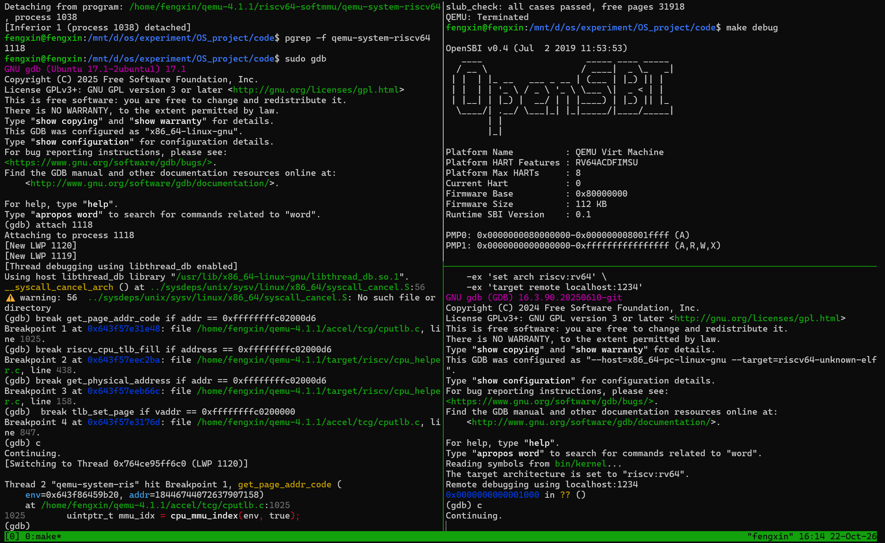
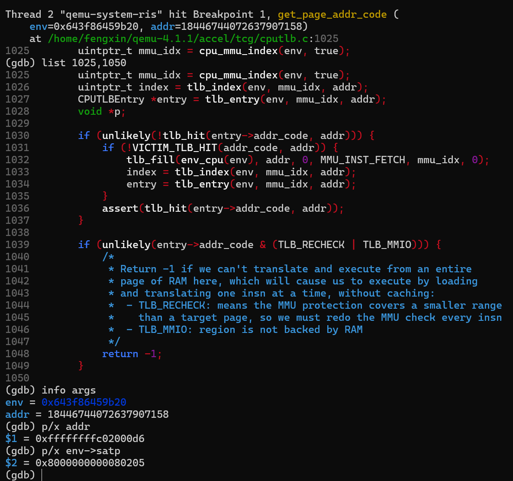

继续单步执行，发现TLB查找未命中，然后遇到断点停在riscv_cpu_tlb_fill的位置。执行调试指令info args，可以得到以下输出，得知access_type = MMU_INST_FETCH 表示当前MMU在执行取指翻译，mmu_idx = 1 表示处于 S 模式（内核态）。

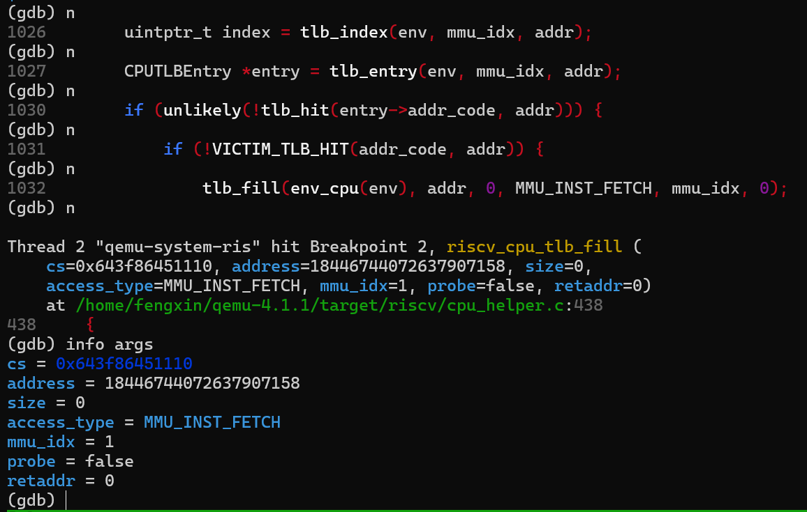

tlb miss后，cpu会遍历页表查询地址。继续执行，调用get_physical_address并触发断点。执行info args和backtrace，观察到调用链为：get_page_addr_code ->tlb_fill ->riscv_cpu_tlb_fill ->get_physical_address。

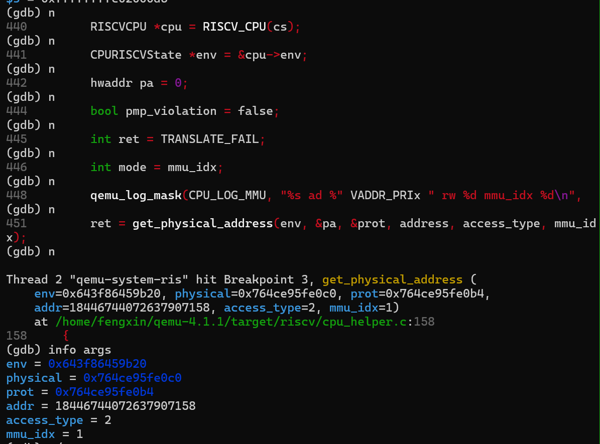
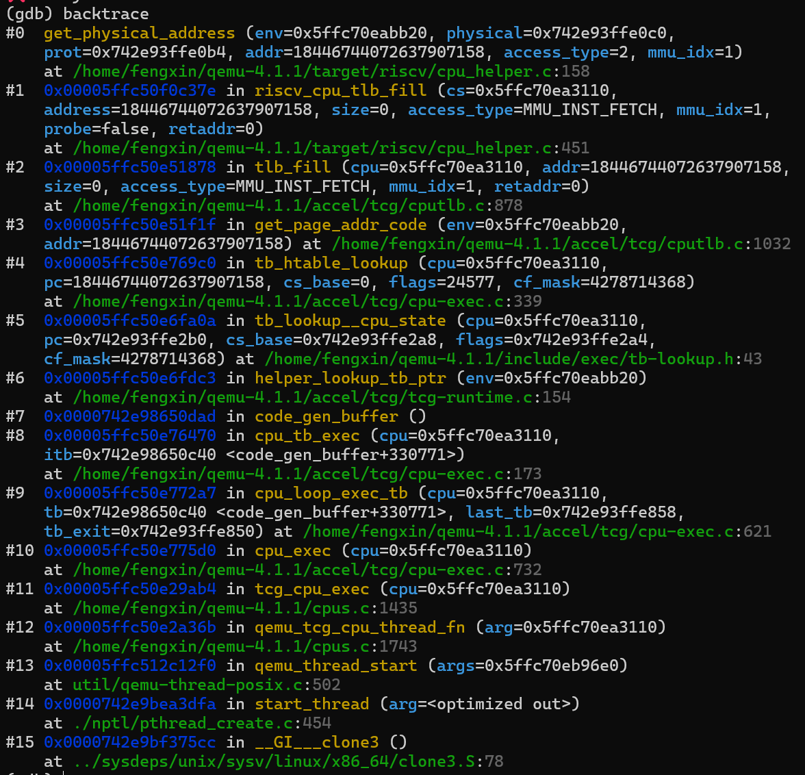

进入get_physical_address执行next单步调试，观察页表查询获取物理地址的过程。以下是页表遍历和翻译的部分代码：

```c
int mode = mmu_idx;    // 特权级： S 模式

if (mode == PRV_M || !riscv_feature(env, RISCV_FEATURE_MMU)) {    // M 模式/无 MMU：不查页表
    *physical = addr;

base = get_field(env->satp, SATP_PPN) << PGSHIFT;                 // 页表物理基址 = 0x80205000

vm = get_field(env->satp, SATP_MODE);                             // 8 = Sv39
switch (vm) {
    levels = 3; ptidxbits = 9; ptesize = 8; break;                // 三级、每级 9 位、表项 8 字节

int ptshift = (levels - 1) * ptidxbits;                           // 最高一级的右移量 = 18

for (i = 0; i < levels; i++, ptshift -= ptidxbits) {              // 从 1 GiB 页开始逐级下降

    target_ulong idx = (addr >> (PGSHIFT + ptshift)) &            // 当前级的 9 位索引
                       ((1 << ptidxbits) - 1);                

    target_ulong pte_addr = base + idx * ptesize;                 // 页表项物理地址

    target_ulong pte = ldq_phys(cs->as, pte_addr);                // 读出页表项
    target_ulong ppn = pte >> PTE_PPN_SHIFT;                      // 物理页号

    if (!(pte & PTE_V)) {                                         // 无效项
    } else if (!(pte & (PTE_R | PTE_W | PTE_X))) {                // 非叶子，进入下一级
        base = ppn << PGSHIFT;
    } else if (ppn & ((1ULL << ptshift) - 1)) {                   // 叶子，页号对齐

    target_ulong vpn = addr >> PGSHIFT;                           // 虚拟页号
    *physical = (ppn | (vpn & ((1L << ptshift) - 1))) << PGSHIFT; // 拼出页基址

    return TRANSLATE_SUCCESS;                                     // 翻译完成
}   

```

get_physical_address 查找到物理页号，拼出物理地址后，cpu就成功将内核入口的虚拟地址翻译为了物理地址。

然后返回到 riscv_cpu_tlb_fill，此时 QEMU 会调用 tlb_set_page 把地址映射所在页写入 TLB。打印参数信息以及地址，发现vaddr = 0xffffffffc0200000，paddr = 0x80200000，说明0xffffffffc02000d6所在页基址为0xffffffffc0200000，cpu将该页填入TLB；size = 4096 说明回填的页大小为 4KB。

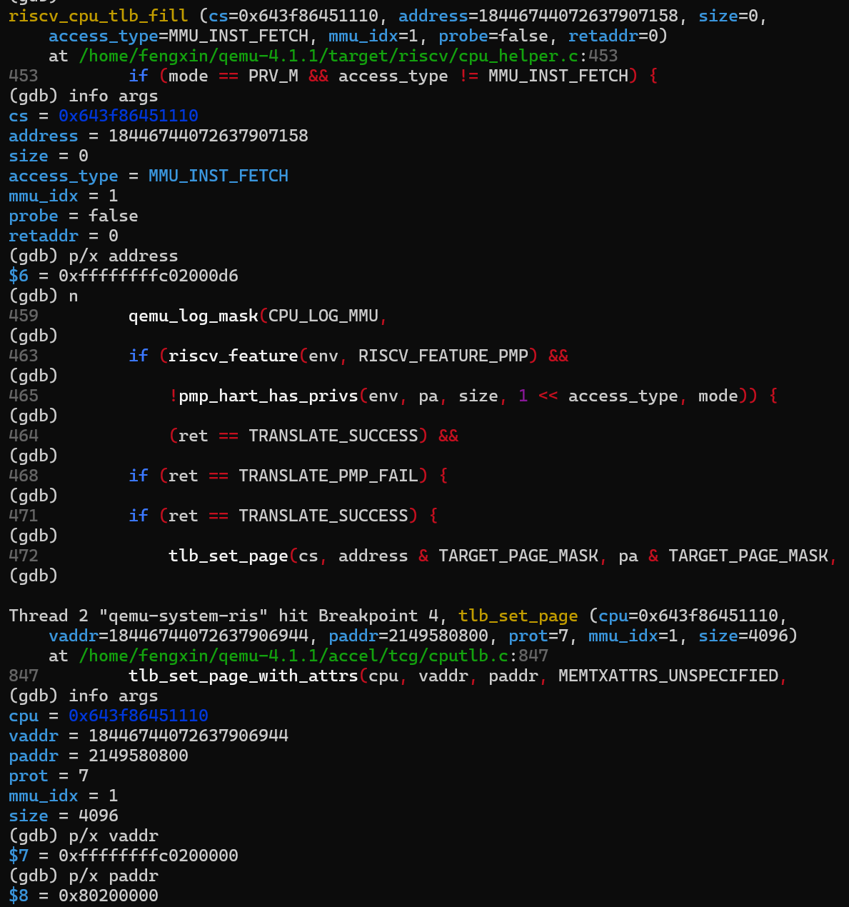

继续执行，调用返回到get_page_addr_code，重新执行访存，TLB 命中，本次取指完成。


#### 调试问题解答

1. 结合关键调用路径以及分支语句，通过调试演示某个访存指令访问的虚拟地址是如何被翻译成一个物理地址的。

答：get_page_addr_code（MMU查询TLB）→ tlb_fill（tlb miss） → riscv_cpu_tlb_fill → get_physical_address（循环查询三级页表获取物理页号，与页内偏移拼接得到物理地址），成功后返回 riscv_cpu_tlb_fill 并由 tlb_set_page 将表项所在4KB页回填到TLB中。具体调试过程已在上一小节中说明。

2. 单步调试页表翻译的部分，解释关键的操作流程。

答：get_physical_address中首先通过env->satp获取根页表基址，然后进入Sv39页表对应的分支：for循环三次遍历三级页表，pteshift 从 18 到 9 到 0 分别对应 1 GB、2 MB、4 KB的页表。每轮 idx 取当前级9位 VPN，pte_addr = base + idx * 8 算出页表项物理地址，读出表项并取 ppn；非叶子则 base = ppn << 12 进下一级，叶子则拼出 *physical。对于 0xffffffffc02000d6，i = 0 已是叶子，所以只循环一次。

3. 在qemu-4.1.1的源码中找到模拟cpu查找tlb的C代码，通过调试说明其中的细节。

答：取指的 TLB 查找在 get_page_addr_code 中：tlb_hit(entry->addr_code, addr) 比较页地址，miss 后调用 tlb_fill 进入 riscv_cpu_tlb_fill。获取页表回填后重新执行取指，同一表项的 addr_code 变为 0xffffffffc0200000，再次访问即命中、不再需要查询页表。

4. qemu中模拟出来的tlb和我们真实cpu中的tlb有什么逻辑上的区别？

答：可以对比虚拟地址开启前后的两次取指。第一次取指 0x80200000 时 satp = 0（Bare），调用链同样经过 get_page_addr_code → tlb_fill → riscv_cpu_tlb_fill，但 get_physical_address 走 Bare 分支直接令 *physical = addr，不读页表，而 tlb_set_page 仍然把这条映射填进 TLB；执行 csrw satp 与 sfence.vma 之后，取指 0x802000d6 才需要遍历页表。这说明 QEMU 的 TLB 是访存必经的软件缓存层，和是否开启分页无关；真实 CPU 的 TLB 只在分页开启时才参与翻译。

另外，真实 TLB 容量有限、有相联度和替换策略，表项由硬件页表遍历器填充，大页可用一个表项覆盖 1GB；QEMU 的 TLB 是一个 CPUTLBEntry 数组，按页号直接索引，没有相联度和替换算法，靠 satp 写入和 sfence.vma 刷新，且 size = 4096 表明它固定按4KB页回填，即使 PTE 是 1GB 大页也只缓存当前这一页。


#### 遇到的问题与细节

1. 最开始把终端二的断点打在0xffffffffc0200000，发现没有触发中断。原因是 0x80200000 是 kern_entry 的物理地址，此时还未开启虚拟地址空间，satp 还是 Bare，因此 QEMU 直接返回物理地址、不做页表遍历。把断点地址改为0xffffffffc02000d6，成功进入调试。

2. 单步调试时使用了si指令，结果难以调试。原因是 QEMU 以 -O2 编译，这些内联函数仍带行号信息，si会进入执行内联函数。因此改用next和条件断点。

3. 单步调试get_page_addr_code时发现 TLB 未命中后并没有立刻调用 tlb_fill，而是先执行 VICTIM_TLB_HIT，victim TLB 也不中才查询页表，所以QEMU模拟器的 TLB 其实是主表加 victim 表。
   
4. 最初调试时从riscv_cpu_tlb_fill开始，跳过了TLB的查询和调用，过程不完整；通过backtrace指令查询调用链，发现应该从get_page_addr_code开始调试。

---

## 五、测试与验证

### 功能模块一：page_init初始化验证

首先通过命令行临时排除未完成的 Best-Fit 编译单元：

```bash
source ~/compiler-lab/env.sh
cd ~/os-lab/lab2-member-a/code
filter='listf_cc=$(filter-out kern/mm/best_fit_pmm.c,$(call listf,$(1),$(CTYPE)))'
make -B "$filter"
timeout --signal=TERM --kill-after=2s 10s make qemu \
  QEMU="$HOME/os-lab/tools/qemu-4.1.1/bin/qemu-system-riscv64" "$filter"
```

执行make qemu，交叉编译、链接及 `objcopy` 均成功，实际日志中的关键结果如下：

```text
memory management: default_pmm_manager
Physical memory detected: [0x0000000080000000, 0x0000000088000000), size 0x0000000008000000
Manageable physical memory end: 0x0000000088000000, descriptors: 32768
Page descriptors: VA 0xffffffffc0207000, PA [0x0000000080207000, 0x0000000080347000)
Initial free pages: 31929, aligned start PA 0x0000000080347000
check_alloc_page() succeeded!
```

物理内存初始化成功，有 31929 个初始空闲页，实际布局输出及原有 First-Fit 检查通过。

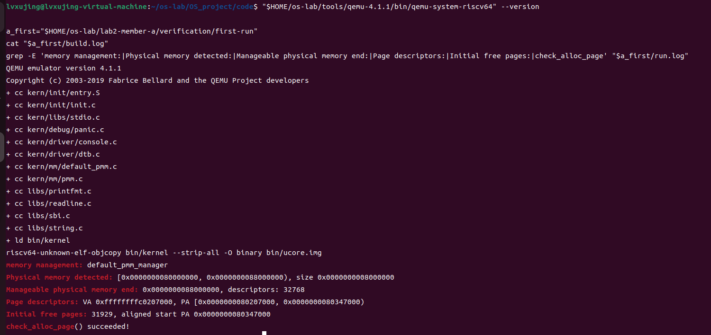


### 模块二任务二：Best-Fit 分配器验证

首先执行make qemu，编译成功，通过basic_check验证。

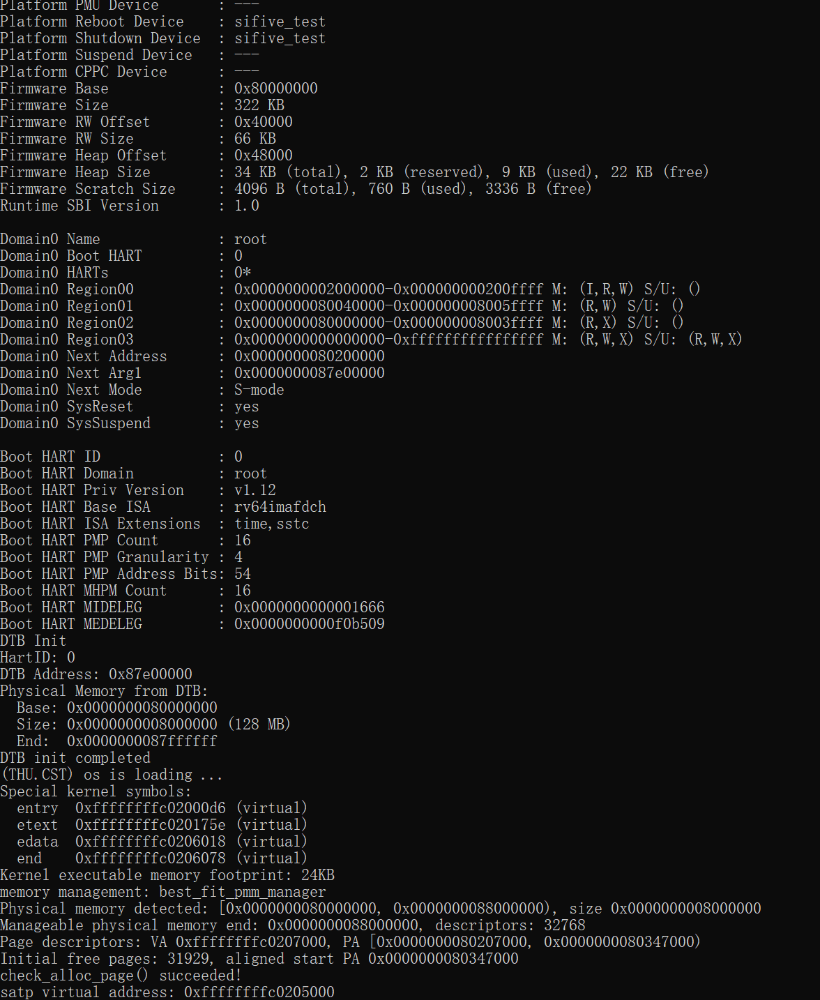

用 `make clean && make test` 编译并运行带 `-D ucore_test` 的镜像，逐行评分为：

```text
memory management: best_fit_pmm_manager
grading: 1 / 6 points
grading: 2 / 6 points
grading: 3 / 6 points
grading: 4 / 6 points
grading: 5 / 6 points
grading: 6 / 6 points
check_alloc_page() succeeded!
```

`grading: 6 / 6 points` 说明 Best-Fit 分配器通过全部评分点；`memory management: best_fit_pmm_manager` 确认 `init_pmm_manager()` 已切换到 Best-Fit；`check_alloc_page() succeeded!` 说明 `best_fit_check()` 通过，其中区分 Best-Fit 与 First-Fit 的关键断言 `p0 + 4 == p1` 成立，证明分配器确实选择了满足需求且剩余最小的空闲块，而非 First-Fit 的第一个足够大的块。

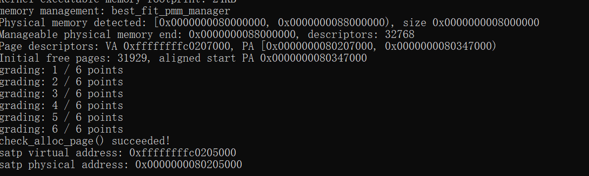


### 模块二任务三：Buddy System验证

伙伴系统实现后运行make qemu验证，pmm_init() 调用 check_alloc_page() 自动执行buddy_check()，编译成功且测试用例全部通过，共初始化31929个空闲页。

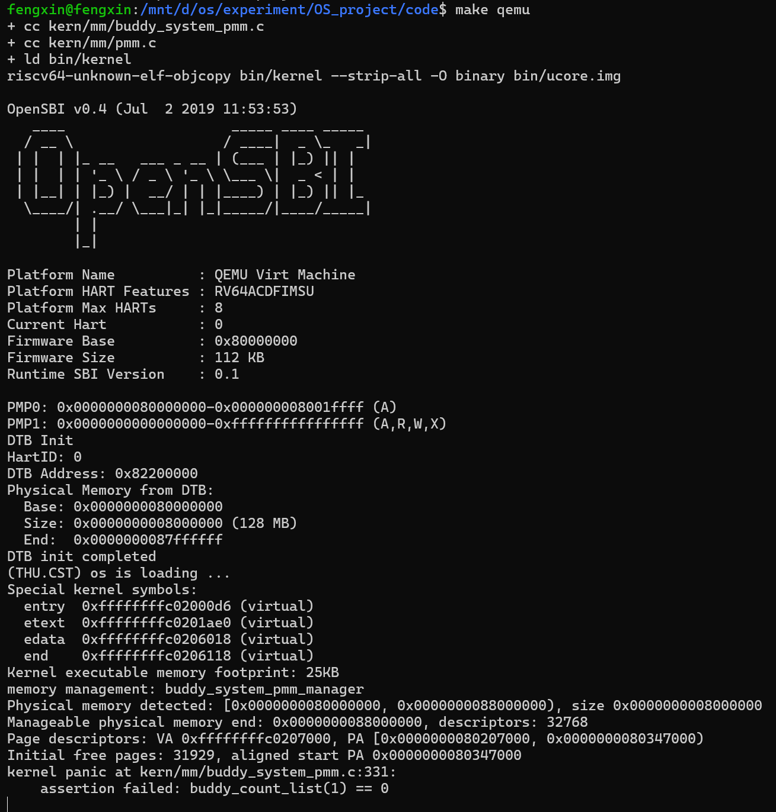

本测试从初始状态一致性开始，遍历所有 order 空闲链表，检查每个节点首页 PageProperty 为真、property 等于所在 order、首页页号按 order 对齐，且所有链表累加的块大小与 nr_free_pages() 一致，以此作为后续测试的基础；随后只通过 alloc_pages、free_pages、nr_free_pages 三个公共接口，依次验证基本分配、非 2 的幂分配、分裂、伙伴合并、递归合并、空闲不足和多次分配释放后的计数一致性等核心行为。

这些测试覆盖的边界情况包括：请求页数不是 2 的幂、目标 order 没有空闲块必须分裂、伙伴不空闲不能合并、伙伴空闲需要合并、合并后还能继续向上合并需要递归、空闲不足必须失败且不破坏状态、块首页必须按 order 对齐等。测试只依赖公共接口，并且每条测试都有明确断言，细致检验管理器功能以及反馈错误，因此具备有效性。


### 模块二challenge：slub算法验证

在buddy system的基础上加入slub算法后，运行qemu验证，init.c调用pmm_init()后还会调用slub_check()进行测试。发现编译成功，测试用例全部通过。初始空闲页为 31928 页，比其余测试少一页是因为伙伴系统加入slub后内核镜像大小超过页边界，因此描述符数组整体后移一页，导致多占了一页。

slub_check后空闲页减少，因为SLUB从Buddy申请了slab：8个较小 size class 各1页，4096档对象加上8字节头部后为4104字节，占2页，合计10页；Case 3 中32字节档连续分配103个对象，超过了单页切出的 102 个，因此新建一个slab，共11页。因此最终计数为31917页。

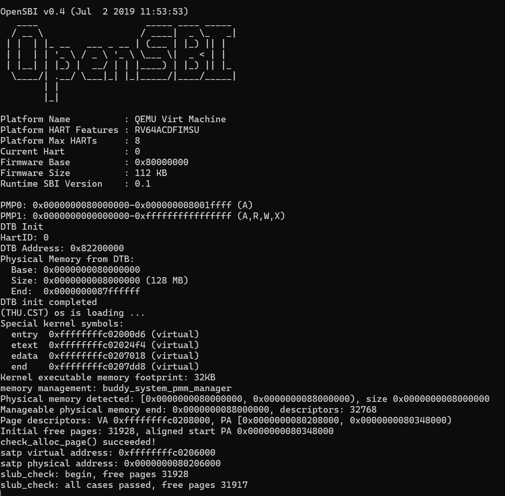

另外将buddy system替换为first-fit和best-fit分配管理器，同样通过测试，进一步验证了slub算法只进行对象级分配，并不直接进行页管理，因此不依赖具体的页管理器。

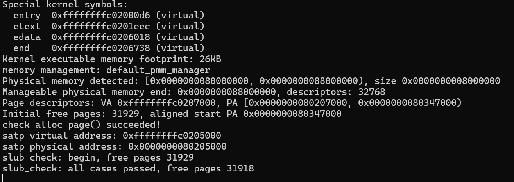
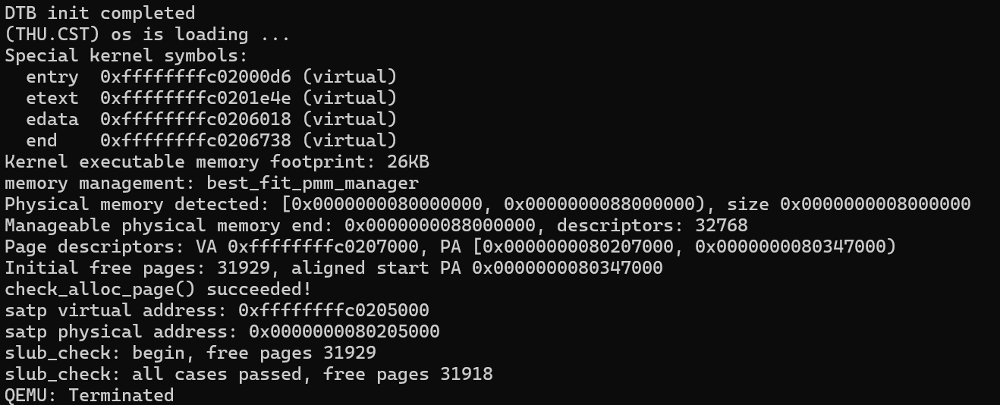

slub_check()测试对 16 到 4096 的全部 size class 逐一分配对象，验证每个尺寸档从分配、释放到复用的完整往返；再连续分配 16、64、256、1024、4096 字节对象并保持存活，检查地址互不重叠、写入不同特征值后互不覆盖、释放其中一个不影响其他对象，验证多个 size class 在内存中共存时的隔离性；随后对 32 字节档连续分配超过 objects_per_slab 个对象，检查分配仍成功且页级空闲计数相应减少，验证 freelist 耗尽时向 pmm_manager 申请新页的路径；最后检查 0 字节和 8192 字节等边界情况，覆盖非法输入边界。

测试只通过 slub_alloc、slub_free、nr_free_pages 三个公共接口访问，覆盖了正常分配、释放复用、size class 隔离、freelist 耗尽、非法输入等情况，并且为每种情况设置相应断言，失败时能直接定位问题，通过时也不会破坏后续内核初始化状态。

---

## 六、实验总结与收获

### 对操作系统的理解

**实验内容与对应的OS原理知识点：**

| 实验内容 | 与 OS 原理的对应关系 |
|------------|---------------------|
| 读取设备树内存范围 | OS 需要获得硬件资源信息，本实验通过已有设备树解析接口获取单段 RAM |
| 虚实地址转换 | 内核通过已有映射访问物理内存；本模块使用偏移关系实现映射 |
| 物理内存分配 | 初始化提供可用资源，分配器决定如何分配和回收，体现接口与具体策略的分工 |
| 分配策略 | 同一分配/回收接口下可以有不同策略，只修改 alloc_pages 的选择，体现接口与实现的分离 |
| 内存管理与回收 | 通过优化分配算法避免空闲内存碎片化，是连续分配算法能否长期可用的关键 |


**OS原理中本实验没有对应上的知识点：**

1. 进程、线程与地址空间隔离。本实验没有进程/线程控制块，所有代码都运行在 S 模式并共享一个内核地址空间。
   
2. 按需分页与缺页异常。物理页在启动时一次性登记完，没有 page fault 处理、lazy allocation、写时复制等。
   
3. 页面置换、回收与交换。没有实现页面置换算法，只实现了页面分配。
   
4. 虚拟内存区域管理。 没有 VMA、地址空间布局等概念，虚拟地址只有固定偏移的直接映射这一种形态。

5. 缺少中断、异常与系统调用框架。


## AI 协作开发的经验

1. 先检查工程，再按实际接口提出需求，随后分别进行运行验证和边界验证。提示词中把修改范围、异常处理和成功状态写清楚，便于检查生成代码是否符合预期。例如，区分 npage 与页面总数、要求先检查整个描述符数组能否放下、要求无空闲页时不调用 init_memmap()，都能对应到具体检查。

2. 不能只依据 AI 的说明或 QEMU 的退出码判断结果。实际核对源码、日志、函数体哈希和测试驱动后，才将本轮场景记录为通过，后续测试对规格的补充也应与正式代码修改次数分开记录。

3. 先让 AI 阅读理解框架，再在四段式提示词里把需求写清楚报错时把现象 + 出错地址 + 环境信息一起给 AI，比只贴日志更容易定位，并且方便区分代码问题和构建/环境问题。

