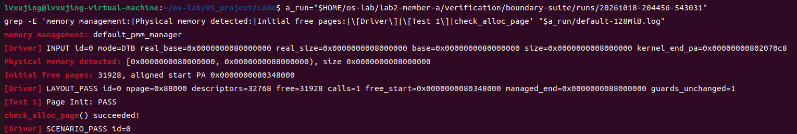

# 操作系统实验报告

## 实验基本信息

| 项目 | 内容 |
|------|------|
| **实验名称** | Lab 2: 物理内存和页表 |
| **小组成员** | 2413396-范珂祎、2413406-黄婉文、2413671-吕旭婧 |
| **完成日期** | 待全组完成后填写 |

本稿记录成员 A 已实现和验证的内容。其他成员已有信息与章节予以保留，未填写的模板部分不表示任务已经完成。

### 小组分工

实验任务分工：

| 成员 | 负责的练习/模块 |
|------|----------------|
| 2413396-范珂祎 | [练习或模块名称] |
| 2413406-黄婉文 | 功能模块二任务三，模块二扩展任务challenge，分支任务gdb调试 |
| 2413671-吕旭婧 | 模块一物理内存初始化，以及后续报告整合 |

实验报告分工：

| 成员 | 负责的部分 |
|------|----------------|
| 2413396-范珂祎 | [练习或模块名称] |
| 2413406-黄婉文 | 实验目的，模块二任务三、扩展任务，分支任务 |
| 2413671-吕旭婧 | 模块一说明、规格与提示词、验证、模块一 Challenge，以及全章材料整合 |

---

## 一、实验目的

<!-- 说明本次实验的主要目标和预期成果 -->

本实验的主要目的是：

1. 目的1：理解页表的建立和使用方法
2. 目的2：理解物理内存的管理方法
3. 目的3：理解页面分配算法

---

## 二、实验环境

你们使用的 AI 工具

| 成员 | AI 编程工具 | 底层模型 | 备注 |
|------|------------|---------|------|
| 2413396-范珂祎 | [例如：Cline（VS Code插件） / Claude Code（终端 Agent） / DeepSeek Harness等] | [例如：Claude Sonnet 4.5 / GPT-5.5 / DeepSeek-V4-Flash等] | [可选：特殊配置等] |
| 2413406-黄婉文 | Codex CLI + VS Code | DeepSeek-V4.1-Flash | 无 |
| 2413671-吕旭婧 | Codex Desktop | GPT-6 | 通过 SSH 操作 Ubuntu 虚拟机；本次实验未更换模型 |

**说明：**
- **AI 编程工具**：指具体使用的终端工具、编辑器插件、桌面应用或浏览器界面
- **底层模型**：指该工具使用的大语言模型及版本

成员 A 实际使用的运行环境如下，不代表其他成员的环境配置：

| 项目 | 成员 A 的实际配置 |
|------|------------------|
| 系统 | VMware 中的 Ubuntu 22.04.5 LTS，x86_64 |
| 构建工具 | RISC-V GCC 15.1.0，GNU Make |
| 模拟器 | QEMU 4.1.1，路径为 `~/os-lab/tools/qemu-4.1.1/bin/qemu-system-riscv64` |
| 页大小 | 4096 字节，即 4 KiB |
| 默认 RAM | 128 MiB，由设备树实际报告；另用 64 MiB、256 MiB 验证 |
| 当前分配器 | 框架已有的 `default_pmm_manager`，即 First-Fit |
| 开发基线 | 远端 `lab2` 的 `bca7fff`，成员 A 分支为 `member-a-lab2-init` |

成员 A 的正式代码改动仅为在 `pmm.c` 的模块一标记位置增加实现。验证驱动放在独立副本中，未修改正式 Makefile、公共接口、地址宏和其他分配器；本次材料整理没有新增代码修改。

---

## 三、实验整体逻辑分析

### 3.1 本章节的逻辑主线

本实验围绕物理内存的发现、组织和分配展开。内核首先要知道机器提供了哪些内存，再排除已经占用的部分，为物理页建立描述信息，最后才能把空闲页交给分配器使用。

框架已经提供设备树解析、启动页表和 First-Fit 算法。成员 A 的任务是实现连接设备树信息与分配器的 `page_init()`；Best-Fit、Buddy 等任务建立在初始化结果之上。它们的具体实现与验证由负责成员补充，本节仅说明依赖顺序。

### 3.2 功能的逐步实现

1. 框架的 `dtb_init()` 读取设备树并保存内存起点、大小。初始化函数据此判断可管理范围，而不是把默认内存大小写死。
2. `init_pmm_manager()` 初始化当前分配器的内部状态。成员 A 验证时保持 First-Fit。
3. `page_init()` 建立页描述符，保留内核及管理数据占用的空间，再通过 `init_memmap()` 注册空闲页。这是后续分配算法共用的基础。
4. 在此基础上理解和实现不同分配策略，分别验证分配、释放与合并行为。各算法完成后再做全组集成。
5. 页表查询调试等分支任务结合已有映射理解地址转换；相关操作与结论由负责成员提供。

---

## 四、实验内容与实现

<!-- 
说明：本部分按照 exercises 文档中的练习顺序组织
每个功能模块或者练习中可能包含多项任务，请根据实际情况调整
-->

### 功能模块一：物理内存初始化功能

**负责人：** 2413671-吕旭婧

#### 模块功能描述

**需要实现/修改的函数：**

```c
static void page_init(void);
```

**功能说明：**

实现位于 [code/kern/mm/pmm.c](../code/kern/mm/pmm.c)，保留 `lab2` 注释并将本模块的 `YOUR CODE` 替换为学号 `2413671`。

`page_init()` 不接收参数，也没有返回值。它读取设备树接口保存的内存信息，安排物理页描述符的存放位置，排除不能分配的区域，再把空闲页交给当前分配器。调用关系为：

```text
kern_init() → dtb_init() → pmm_init()
                             ├─ init_pmm_manager()
                             ├─ page_init() → init_memmap()
                             └─ check_alloc_page()
```

设备树解析和 First-Fit 分配、回收算法均由框架提供。本模块使用它们的接口，没有重新实现这些功能。

#### 地址与管理数据的含义

框架的 `dtb_init()` 先解析内存节点并保存起点、大小，`page_init()` 再通过 `get_memory_base()`、`get_memory_size()` 读取结果。解析失败时可能得到零值，因此初始化不能直接假设内存信息有效。

| 名称 | 本实现中的含义 |
|------|----------------|
| 物理地址 | RAM 中的位置，例如内核物理起点 `0x80200000` |
| 虚拟地址 | 内核代码使用的地址，经现有页表映射到物理内存，例如内核虚拟起点 `0xFFFFFFFFC0200000` |
| 物理页号 | 物理地址除以 4096 的结果，不是该地址本身 |
| `struct Page` | 描述一个物理页的管理数据，记录引用计数、状态、空闲块长度和链表连接信息 |
| `va_pa_offset` | 内核直接映射的虚实地址偏移，使用已有的 `PHYSICAL_MEMORY_OFFSET = 0xFFFFFFFF40000000` |
| `nbase` | DRAM 起点对应的物理页号，固定为 `0x80000000 / 4096 = 0x80000` |
| `npage` | 可管理物理页号的上界，不能直接当作物理页总数 |
| `pages` | 描述符数组的虚拟地址，`pages[i]` 描述物理页号 `nbase + i` 的页面 |

描述符数量为 `npage - nbase`。`pages` 自身指向的是管理数据，描述符所在的物理地址通过 `PADDR(pages)` 获取；`page2pa(pages)` 得到的是第一个描述符所描述的物理页地址，二者不能混用。

#### 需求规格如何确定

先结合指导书与已有宏、接口明确范围：输入来自已解析的设备树，输出是可供当前分配器使用的描述符和初始空闲区。然后将要求写成可以检查的状态，而不是只要求“完成函数”或逐行指定实现步骤。

| 需求 | 对应的检查依据 |
|------|----------------|
| 内存信息有效 | 起点、大小非零，加法不溢出，起点符合当前固定 DRAM 映射 |
| 不超出实际内存和工程上界 | 取设备树末端与 `PHYSICAL_MEMORY_END` 的较小值，再向下按页对齐 |
| 描述符能完整放下 | 写入数组前检查内核末端、数组大小和可管理末端 |
| 占用区不进入分配器 | 所有描述符先标记为保留，只注册数组之后的完整页 |
| 没有完整空闲页时不注册 | 用独立测试记录 `init_memmap()` 调用次数，应为零 |
| 成功状态可观察 | 输出实际内存范围、描述符位置和初始空闲页数量 |

当前 `pa2page()` 没有检查低于 DRAM 起点的物理地址，所以调用方也必须保证传入地址位于有效区间。设备树基址与固定映射不兼容时，本实现明确 panic，不尝试支持框架之外的布局。

#### 核心实现说明

1. 检查起点、大小以及范围加法，拒绝无效输入。计算末端前先判断溢出，避免先溢出再使用错误结果。
2. 使用工程已有偏移设置 `va_pa_offset`。可管理末端受实际 RAM 和 `0x88000000` 上界共同限制，因此 256 MiB RAM 并不意味着本工程可以分配全部 256 MiB。
3. 将内核末端向上按页对齐，作为描述符数组的起点。数组大小为 `(npage - nbase) * sizeof(struct Page)`，在整体容量检查通过后才写入数组。
4. 描述符数组本身也存放在 RAM 中，不能被分配出去。因此 OpenSBI、内核镜像、描述符数组及相关对齐空间均保持保留状态。
5. 把数组末端向上对齐，作为候选空闲区起点。只有它低于可管理末端时才调用 `init_memmap()`；末尾不足一页的空间不加入空闲区。

`init_memmap()` 是分配器接口的包装函数，会转交给当前 `pmm_manager->init_memmap()`。本轮使用原有 First-Fit，由它建立空闲链表并更新空闲页数量。后续切换其他分配器仍可复用模块一提供的初始化结果。

#### 最终提示词

本模块使用一版实现提示词，没有代码修复迭代。以下原样引用实际提示词的四段正文；前导说明、首次验证要求和交付要求见 [prompt.md 中的 A-2 完整原文](./prompt.md#member-a-prompt-implementation)。

````text
[PROMPT]

我的任务是实现物理内存初始化，为后续分配器提供正确的页描述符和初始空闲页。

请从远端最新 lab2 建立成员 A 的独立开发分支和工作目录。已有合适目录时可以复用。保留当前 lab1 的提交和文件，解压源码作为原始参考，后续以仓库中的 code/ 为开发版本。

在 code/kern/mm/pmm.c 的模块一标记位置实现 static void page_init(void)。保留 lab2 注释，只将本模块的 YOUR CODE 替换为我的学号 2413671。

本轮不实现 Best-Fit、Buddy，不切换当前的 default_pmm_manager，不修改已有测试函数、公共接口、结构体和地址宏。暂不推送 GitHub。

[RELY]

请以指导书和当前工程定义为准，使用已有的：

- get_memory_base()、get_memory_size()；
- struct Page、pages、npage、nbase、va_pa_offset；
- 内存上界、映射偏移、页大小、地址转换和对齐宏；
- 链接符号 end、页面状态宏、init_memmap()；
- panic()、cprintf()。

dtb_init() 在 pmm_init() 之前执行。npage 表示物理页号上界，pages 是描述符数组的虚拟地址，每个描述符对应的物理页号从 nbase 开始。

[GUARANTEE]

交付可编译的 page_init() 实现。成功初始化后，内核能够查询物理内存布局，并使用现有 First-Fit 分配和回收页面。

只修改本模块所需的位置。若发现必须修改范围以外的文件，请说明原因，不要顺带修补其他成员的任务。

[SPECIFICATION]

1. 设备树内存信息必须有效。零大小、地址范围计算溢出，以及与本工程固定映射假设不兼容的范围，不能继续用于初始化，应给出明确的错误信息并终止。

2. va_pa_offset 与工程已有映射关系一致。可管理范围不能超过设备树报告的实际内存，也不能超过工程规定的物理内存上界，不把默认 128 MiB 当作探测结果写死。

3. pages 位于内核 end 之后并按页对齐，数组覆盖 [nbase, npage) 对应的物理页。应确认数组能够完整放入有效内存，避免在发现越界前就写入数组。

4. 尚未交给分配器的页面应保持保留状态。OpenSBI、内核镜像、描述符数组及相关对齐占用空间，不能进入空闲区。

5. 只把描述符数组之后、有效内存范围内的完整页面交给 init_memmap()。不足一页的尾部空间不能加入；没有完整空闲页时，不调用 init_memmap()。

6. 正确区分虚拟地址、物理地址、物理页号和描述符地址，保证地址转换不会产生越界描述符。

7. 输出探测到的物理内存范围，便于核对初始化结果。

````

#### 实现迭代过程

实际过程为一次实现、两轮验证：

1. **工程检查。** 确认设备树接口、固定映射和已有测试。发现原始 Best-Fit 骨架尚未完成，但默认构建会把它一起编译，因此需要隔离该编译单元。
2. **实现与首次验证。** 在独立的 `member-a-lab2-init` 分支中增加 `page_init()`，使用命令行构建参数临时排除 `best_fit_pmm.c`。QEMU 4.1.1 默认 128 MiB 下构建成功，并通过已有 First-Fit 检查。
3. **专项验证。** 在独立副本中接入原始 `test_page_init()`，再对不同 RAM 大小、无效接口值和空间边界做 13 个场景的检查。本轮场景通过，未发现需要修改正式实现的问题。

Best-Fit 的编译依赖问题属于验证安排，不是 `page_init()` 的算法错误。没有通过修改断言、补写其他分配器或伪造输出完成验证。正式代码没有经历错误修复轮次；检查、实现、专项验证和材料整理的实际提示词见 [prompt.md](./prompt.md)。

---

### 扩展任务 Challenge：硬件的可用物理内存范围的获取方法（思考题）

**负责人：** 2413671-吕旭婧

OS 可以通过启动时由固件或引导程序提供的硬件描述，获取内存布局，而不必提前知道机器安装了多少 RAM。

本实验采用设备树。QEMU 准备 DTB，启动链通过参数传入其物理地址，框架的 `dtb_init()` 解析内存节点的 `reg` 属性并保存起点、大小。`page_init()` 使用这两个接口值，进一步排除已占用区域。设备树规范中的内存节点用于描述物理内存布局，`reg` 中包含地址和长度；这也解释了为什么改变 QEMU 的 RAM 大小时不应修改初始化算法。[设备树规范：内存节点](https://devicetree-specification.readthedocs.io/en/v0.3/devicenodes.html)

其他平台也可以由固件或引导程序传递内存布局。例如，UEFI 平台可通过 `GetMemoryMap()` 将内存资源信息提供给 OS 加载器，再由启动过程交给内核。[UEFI GetMemoryMap 接口说明](https://uefi.org/htmlspecs/ACPI_Spec_6_4_html/15_System_Address_Map_Interfaces/uefi-getmemorymap-boot-services-function.html)

获取到 RAM 范围不等于其中每一页都可分配。内核还需要识别保留区和已占用区，检查范围有效性，并按页组织剩余内存。本实验采用固定 DRAM 基址和单段内存的简化框架，不等同于实现了通用平台的全部内存探测方法。

---


### 功能模块二：物理内存分配功能

### 任务一：理解first-fit 连续物理内存分配算法

**负责人：** 2413396-范珂祎

本任务是理解题，不涉及代码修改与提示词生成。通过阅读 [code/kern/mm/default_pmm.c](../code/kern/mm/default_pmm.c)，理解 First-Fit 分配器如何初始化空闲页、分配连续物理页、回收页面并合并相邻空闲块。

#### 模块功能描述

First-Fit 用一条按物理地址升序排列的双向链表 `free_list` 组织所有空闲块，并用 `nr_free` 记录空闲页总数。每个空闲块由地址最低的 `Page`（头页）代表：头页的 `PG_property` 标志位为 1，`property` 字段记录本块包含的页数；块内其余页的 `property` 恒为 0。链表按地址升序，是为了让回收时能在 O(1) 内定位相邻块进行合并。

#### 核心函数说明

**`default_init`：初始化分配器状态。**
`list_init(&free_list)` 将空闲链表初始化为空，`nr_free` 置 0。它由 `init_pmm_manager()` 在 `page_init()` 之前调用，让分配器处于「没有任何空闲页」的初始状态。

**`default_init_memmap`：登记一段连续空闲区。**
`page_init()` 建立页描述符后，把描述符数组之后的连续空闲页交给 `init_memmap(base, n)`。它逐页断言这些页已被标记为保留（这是 `page_init` 设置的），然后清空 `flags`、`property` 与 `ref`；只把头页的 `property` 设为 `n` 并打上 `PG_property`，其余页保持 `property = 0`；最后按地址升序插入 `free_list`，`nr_free += n`。

**`default_alloc_pages`：First-Fit 分配。**
这是「first」的体现。它先判断 `n > nr_free` 则返回 NULL；否则从头遍历 `free_list`，取第一个 `property >= n` 的空闲块，不比较哪个更合适。若块大小正好等于 `n`，整块从链表删除；若块比需求大，把低地址端 `n` 页分配出去，剩余 `property - n` 页在 `page + n` 处成为新块，插回原位置保持地址升序。最后 `nr_free -= n`、`ClearPageProperty(返回头页)`。

**`default_free_pages`：回收并合并相邻空闲块。**
它逐页断言「非保留、非空闲块头」后清空标志，把头页 `property` 设为 `n` 并插入链表，`nr_free += n`。随后先与低地址邻块合并（若 `p + p->property == base`，说明两段物理地址相邻），再与高地址邻块合并（若 `base + base->property == p`），被并进的头页 `ClearPageProperty` 并从链表删除。用指针差判断相邻利用了 `Page` 数组连续分配这一事实。

#### First-Fit 是否有进一步的改进空间？（思考题回答）

有，主要体现在外部碎片与查找开销：

1. **外部碎片**：每次从低地址端切割，反复分配与释放后，低地址区域堆积大量「切剩的小碎块」，导致后续大块分配需要扫描更远，甚至总量足够却找不到连续块。
2. **查找是 O(n) 线性扫描**：空闲块越多，分配越慢。可用按地址或大小索引的平衡树把查找降到 O(log n)，或采用分离空闲链表（segregated free lists）按大小分级。
3. **头部磨损与局部性差**：每次都从链表头开始找，头部区域被反复切割，碎片集中且缓存局部性不佳。

可选的改进方向包括 Best-Fit（选最贴合、剩余最小的块）、Next-Fit（从上次位置继续搜索）、Buddy System（按 2 的幂拆分与快速合并，从根本上控制外部碎片）以及 SLUB（对小对象单独管理，避免页级浪费）。本实验后续任务二实现 Best-Fit，正是对 First-Fit 选择策略的一次改进。

---

### 任务二：实现 Best-Fit 连续物理内存分配算法

**负责人：** [学号-姓名]

#### 模块功能描述

**需要实现/修改的函数：**

```c
// 列出本模块涉及的所有函数签名
void example_function(void);
int another_function(int arg);
```

**功能说明：**

[简要描述该模块的功能，包括：
- 该模块在整个系统中的作用
- 需要处理的主要场景
- 与其他模块的交互关系]

#### 最终提示词

以下是经过迭代优化后，最终成功实现该功能的提示词：

````markdown

[按照提示词模板，给出具体的提示词]

````

#### 实现迭代过程

本模块的实现经历了 [N] 次迭代，过程如下：

---

##### 第一次迭代

如果设计的prompt生成代码后出现问题：

**遇到的问题：**
- 问题1：问题描述、错误信息和原因分析
- 问题2：问题描述、错误信息和原因分析

**问题解决策略：**
- 针对问题1：[说明如何修改提示词]
- 针对问题2：[说明如何修改提示词]

如果没有问题：

**最终结果：**

经过 [N] 次迭代，该模块最终：
- ✅ 编译通过
- ✅ 所有相关测试通过
- ✅ 功能符合预期

**关键改进点总结（如有）：**
1. [改进点1：例如，在 [RELY] 中补充了完整的系统调用号定义]
2. [改进点2：例如，在 [SPECIFICATION] 中明确了异常处理的边界条件]
3. [改进点3：例如，增加了对用户指针合法性检查的要求]

---

##### 第二次迭代（如有）

[按照和第一次迭代相同的格式]

---

##### 第三次迭代（如有）

[按照和第一次迭代相同的格式]

---


### 任务三：buddy system（伙伴系统）分配算法

**负责人：** 2413406-黄婉文

#### 模块功能描述

**需要实现/修改的函数：**

```c
// 列出本模块涉及的所有函数签名
void example_function(void);
int another_function(int arg);
```

**功能说明：**

[简要描述该模块的功能，包括：
- 该模块在整个系统中的作用
- 需要处理的主要场景
- 与其他模块的交互关系]

#### 最终提示词

以下是经过迭代优化后，最终成功实现该功能的提示词：

````markdown

[按照提示词模板，给出具体的提示词]

````

#### 实现迭代过程

本模块的实现经历了 [N] 次迭代，过程如下：

---

##### 第一次迭代

如果设计的prompt生成代码后出现问题：

**遇到的问题：**
- 问题1：问题描述、错误信息和原因分析
- 问题2：问题描述、错误信息和原因分析

**问题解决策略：**
- 针对问题1：[说明如何修改提示词]
- 针对问题2：[说明如何修改提示词]

如果没有问题：

**最终结果：**

经过 [N] 次迭代，该模块最终：
- ✅ 编译通过
- ✅ 所有相关测试通过
- ✅ 功能符合预期

**关键改进点总结（如有）：**
1. [改进点1：例如，在 [RELY] 中补充了完整的系统调用号定义]
2. [改进点2：例如，在 [SPECIFICATION] 中明确了异常处理的边界条件]
3. [改进点3：例如，增加了对用户指针合法性检查的要求]

---

##### 第二次迭代（如有）

[按照和第一次迭代相同的格式]

---

##### 第三次迭代（如有）

[按照和第一次迭代相同的格式]

---


### Challenge：任意大小的内存单元 slub 分配算法

**负责人：** 2413406-黄婉文

[按照Challenge的具体要求进行解答]

---


### 分支任务：gdb 调试页表查询过程

**负责人：** 2413406-黄婉文


---

## 五、测试与验证

### 5.1 成员 A：首次构建与运行

首次使用正式实现，未接入专项驱动。通过命令行临时排除未完成的 Best-Fit 编译单元，没有修改 Makefile 或测试断言：

```bash
source ~/compiler-lab/env.sh
cd ~/os-lab/lab2-member-a/code
filter='listf_cc=$(filter-out kern/mm/best_fit_pmm.c,$(call listf,$(1),$(CTYPE)))'
make -B "$filter"
timeout --signal=TERM --kill-after=2s 10s make qemu \
  QEMU="$HOME/os-lab/tools/qemu-4.1.1/bin/qemu-system-riscv64" "$filter"
```

交叉编译、链接及 `objcopy` 均成功，实际日志中的关键结果如下：

```text
memory management: default_pmm_manager
Physical memory detected: [0x0000000080000000, 0x0000000088000000), size 0x0000000008000000
Manageable physical memory end: 0x0000000088000000, descriptors: 32768
Page descriptors: VA 0xffffffffc0207000, PA [0x0000000080207000, 0x0000000080347000)
Initial free pages: 31929, aligned start PA 0x0000000080347000
check_alloc_page() succeeded!
```

首次运行有 **31929 个初始空闲页**。结果依据是实际布局输出及原有 First-Fit 检查通过；退出码 124 只是内核进入循环后由超时终止 QEMU，不能单独作为成功依据。


*首次构建与运行日志回看*

原始材料：[构建日志](./verification/member-a/first-run/build.log)、[运行日志](./verification/member-a/first-run/run.log)、[执行命令与输出](./verification/member-a/first-run/session.log)。

### 5.2 成员 A：原始专项测试与边界场景

在独立副本中增加测试接入点，实际 `page_init()` 函数体保持不变。默认场景在 `page_init()` 返回后、First-Fit 检查之前调用原 `test_page_init()`，测试条件未修改，输出为：

```text
[Test 1] Page Init: PASS
check_alloc_page() succeeded!
```



*模块一专项测试日志回看*

两张图均为已保存的真实运行日志回看，分别对应首次正式镜像和专项测试副本，没有重新运行实验。

本轮 13 个动态场景均由 QEMU 4.1.1 执行。前三项读取真实设备树信息，其余在接口处注入返回值，没有另写初始化算法代替实际函数。

| 场景 | 验证方式 | 预期结果 | 本轮实际结果 |
|------|----------|----------|--------------|
| 默认 128 MiB | 真实 DTB；原始专项测试 | 原测试和 First-Fit 通过 | 通过；32768 个描述符、31928 个空闲页 |
| 64 MiB | `-m 64M`；独立布局检查 | 使用实际范围，不超过 RAM 末端 | 通过；末端 `0x84000000`，16384 个描述符、15704 个空闲页；First-Fit 通过 |
| 256 MiB | `-m 256M`；独立布局检查 | 不超过工程管理上界 | 通过；探测到 256 MiB，管理末端 `0x88000000`，32768 个描述符、31928 个空闲页；First-Fit 通过 |
| 起点为零 | 接口返回值注入 | 明确 panic，不注册空闲页 | 符合预期；候选区与哨兵检查通过 |
| 大小为零 | 接口返回值注入 | 同上 | 符合预期 |
| 起点加大小溢出 | 接口返回值注入 | 在溢出加法前拒绝 | 符合预期 |
| 内存基址不兼容 | 接口返回值注入 | 拒绝当前映射不支持的基址 | 符合预期 |
| 内存无法覆盖内核起点 | 接口返回值注入 | 终止初始化，不写描述符 | 符合预期 |
| 内存无法覆盖内核尾部 | 接口返回值注入 | 同上 | 符合预期 |
| 描述符数组放不下 | 接口返回值注入 | 写入数组前拒绝 | 符合预期；`pages` 仍为 NULL |
| 数组放得下，但无完整空闲页 | 注入带非对齐末端的范围 | 正常返回，不调用 `init_memmap()` | 通过；空闲页为 0，调用次数为 0 |
| 无空闲页，末端恰好页对齐 | 接口返回值注入 | 同上 | 通过；调用次数为 0 |
| 64 MiB 加 123 字节 | 接口返回值注入 | 不把尾部不足一页的空间加入分配器 | 通过；管理末端仍为 `0x84000000`，First-Fit 通过 |

异常场景先检查预期错误信息、注册次数和哨兵，再进入框架原有的 `__panic()`。其中的 panic 是预期结果；这些 QEMU 进程最终由超时结束。无空闲页场景只在测试副本中跳过后续要求分配成功的 First-Fit 检查，没有改动原检查函数。

专项测试加入驱动后，内核末端从首次运行的 `0xFFFFFFFFC0206078` 变为 `0xFFFFFFFFC02070C8`，对齐后的描述符起点向后移动一页。因此专项默认运行的空闲页是 **31928**，与首次正式运行的 **31929** 分别记录。

证据：[默认专项日志](./verification/member-a/boundaries/logs/default-128MiB.log)、[256 MiB 日志](./verification/member-a/boundaries/logs/native-256MiB.log)、[无完整空闲页日志](./verification/member-a/boundaries/logs/no-free-partial-tail.log)、[13 场景结果与日志索引](./verification/member-a/boundaries/logs/results.md)。

### 5.3 验证范围与材料

静态检查核对了范围加法、描述符容量检查、循环上界、页对齐和 `pa2page()` 的调用条件。动态检查核对了实际输出、逐页状态和地址转换、注册区间、调用计数及监控区域的哨兵。哨兵未变化只说明监控区域未被破坏，不是对任意地址和所有输入的形式化证明。

正式函数体与测试副本函数体哈希一致，原始测试文件与接入副本也一致；执行前后正式源码哈希未变化，记录见 [manifest.json](./verification/member-a/boundaries/logs/manifest.json)。本轮没有修改正式实现，不存在代码修复后的复验轮次。

未验证损坏 DTB 原始数据的解析、其他硬件映射、Best-Fit、Buddy 或完整 Lab2 评分。未执行包含批量删除命令的 `clean`、`grade` 流程，也不将本轮结果写成完整评分通过。

必要日志、驱动和使用方法见 [成员 A 验证材料说明](./verification/member-a/README.md)。首次运行和原始专项测试的两张真实截图已补齐；[截图状态与回看命令](./verification/member-a/screenshots.md) 保留对应路径和可选展示项。其他成员的测试结论与截图由负责成员补充。

---

## 六、实验总结与收获

### 对操作系统的理解

以下为成员 A 的模块一总结，其他成员可继续补充各自模块。

| 模块一内容 | 与 OS 原理的对应关系 |
|------------|---------------------|
| 读取设备树内存范围 | OS 需要获得硬件资源信息；本实验通过已有设备树解析接口获取单段 RAM，并非通用硬件探测实现 |
| 为物理页建立 `Page` 描述符 | 用软件数据结构记录物理资源的状态；描述符是管理数据，不是物理页本身，也不是页表项 |
| 保留内核和描述符数组 | 已占用内存不能重新分配，管理数据本身同样需要占用资源 |
| 虚实地址转换 | 内核通过已有映射访问物理内存；本模块使用偏移关系，没有实现新的页表映射 |
| 页面对齐和空闲区注册 | 页级分配只接收完整页面，必须排除首尾对齐空间和超出管理上界的部分 |
| 通过 `pmm_manager` 交接 | 初始化提供可用资源，分配器决定如何分配和回收，体现接口与具体策略的分工 |

本模块尚未实现进程地址空间、按需分页、缺页处理、页面置换、交换、并发分配保护和完整的多段内存管理。启动页表和分配算法虽然是依赖条件，但不能算作成员 A 新实现的内容。

### AI 协作开发的经验

成员 A 先要求检查工程，再按实际接口提出需求，随后分别进行运行验证和边界验证。提示词中把修改范围、异常处理和成功状态写清楚，便于检查生成代码是否符合预期。例如，区分 `npage` 与页面总数、要求先检查整个描述符数组能否放下、要求无空闲页时不调用 `init_memmap()`，都能对应到具体检查。

不能只依据 AI 的说明或 QEMU 的退出码判断结果。实际核对源码、日志、函数体哈希和测试驱动后，才将本轮场景记录为通过。实现一次通过不需要编造错误修复；后续测试对规格的补充也应与正式代码修改次数分开记录。其他成员的协作经验由各自补充。

### 待补事项

成员 A：模块一代码、报告、实际提示词、验证材料和两张必要截图已整理，工具与模型信息已确认，个人模块具备提交条件。后续仍需履行统筹职责，整合其他成员材料；256 MiB 和异常场景截图为可选项。

全组：由其他成员补充自己的算法说明、实际提示词、问题与验证记录，核对个人工具信息；完成集成验证并统一报告与分工；全部完成后填写日期，按小组要求整理到 `lab2` 分支。本稿不提前认定这些项目已完成。

---

