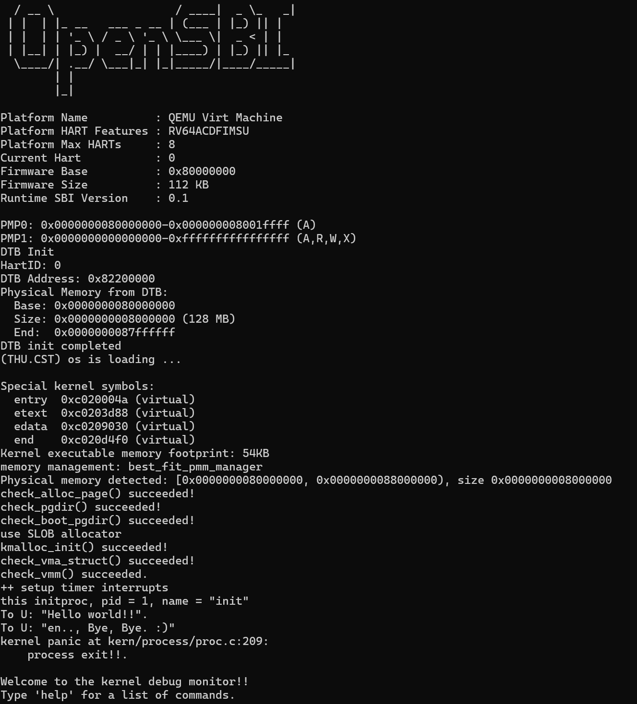
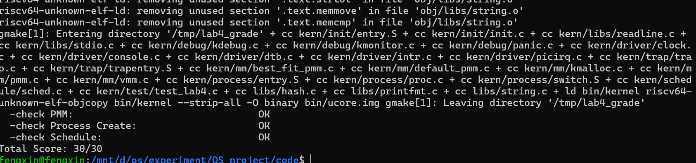

# 操作系统实验报告

## 实验基本信息

| 项目 | 内容 |
|------|------|
| **实验名称** | Lab 4: 进程管理 |
| **小组成员** | 2413406-黄婉文、2413396-范珂祎、2413671-吕旭婧 |
| **完成日期** | YYYY-MM-DD |

### 小组分工

练习如何分工？

| 成员 | 负责的练习/模块 |
|------|----------------|
| 2413671-吕旭婧 | 功能模块一：虚拟内存页操作 |
| 2413406-黄婉文 | lab2/lab3代码迁移，功能模块二：进程创建及初始化功能，challenge |
| 2413396-范珂祎 | 功能模块三：进程调度 |

实验报告如何分工？

| 成员 | 负责的报告部分 |
|------|----------------|
| 2413671-吕旭婧 | 功能模块一，实验总结与收获 |
| 2413406-黄婉文 | 逻辑主线分析，功能模块二、challenge，测试验证，实验总结与收获 |
| 2413396-范珂祎 | 功能模块三，实验总结与收获 |


---

## 一、实验目的

<!-- 说明本次实验的主要目标和预期成果 -->

本实验的主要目的是：

1. 了解虚拟内存管理的基本结构，掌握虚拟内存的组织与管理方式；
2. 了解内核线程创建/执行的管理过程；
3. 了解内核线程的切换和基本调度过程。

---

## 二、实验环境

你们使用的 AI 工具

| 成员 | AI 编程工具 | 底层模型 | 备注 |
|------|------------|---------|------|
| 2413406-黄婉文 | DeepSeek Harness | DeepSeek-Flash | |
| 2413396-范珂祎 | Claude Code（VS Code 扩展）| DeepSeek-V4-Pro | |
| 2413671-吕旭婧 | Codex Desktop | GPT-6 | |

**说明：**
- **AI 编程工具**：指具体使用的终端工具、编辑器插件、桌面应用或浏览器界面
- **底层模型**：指该工具使用的大语言模型及版本

---

## 三、实验整体逻辑分析

### 2.1 本章节的逻辑主线

本章围绕内核线程管理展开，通过完善虚拟内存管理和引入内核线程机制，使系统从单一执行流的内核发展为支持多线程调度的内核，并完成基本的虚拟内存环境框架搭建，为后续实现用户进程、系统调用、缺页异常处理和页面置换等功能奠定基础。主要内容包括：

1. 完善虚拟内存管理，实现基本的地址空间结构。通过引入虚拟内存描述结构，管理进程或线程的虚拟地址空间布局，为每个执行实体提供逻辑上的运行空间。
   
2. 引入内核线程机制，实现多执行流并发运行能力。实现线程控制块、上下文切换和调度器等内容，从而实现多线程并发执行，使内核能够调度多个执行实体轮流使用 CPU 运行。

### 2.2 功能的逐步实现

1. 首先实现虚拟内存页操作功能。完成多级页表框架下最基本的映射维护，实现page_insert() 和 page_remove()，其中page_insert() 负责把物理页挂到指定线性地址上，并同步权限位、引用计数和 TLB；page_remove() 负责安全撤销映射。后续线程运行、页表切换、后续用户进程地址空间都依赖页表映射的正确性。
   
2. 接着再完善实现进程创建及初始化功能。在建立可靠的页表映射后，实现 alloc_proc()、proc_init()、kernel_thread()、do_fork()、copy_thread()、copy_mm()，让内核能够创建并登记内核线程，才能实现后续的内核线程调度切换。
   
3. 最后完成进程调度功能。在已有可运行内核线程的基础上，实现 cpu_idle()、schedule()、proc_run()、switch_to()，把线程交给 CPU 执行并完成上下文切换，让线程能够轮流使用CPU。

---

## 四、实验内容与实现

<!-- 
说明：本部分按照 exercises 文档中的练习顺序组织
每个功能模块或者练习中可能包含多项任务，请根据实际情况调整
-->

### 环境准备

**负责人：** 2413406-黄婉文

本实验需要在完成lab2/lab3的物理内存管理和中断异常处理的基础上进行。根据lab2/lab3的提示词生成相应实验代码，并将结果填写到本实验代码中“lab2”/“lab3”注释的对应位置，确保代码能够正确编译。以下为新增/修改的函数或文件：

```c
// kern/mm/pmm.c
static void page_init(void);         
static void init_pmm_manager(void);   

// kern/mm/best_fit_pmm.c
static void best_fit_init(void);
static void best_fit_init_memmap(struct Page *base, size_t n);
static struct Page *best_fit_alloc_pages(size_t n);
static void best_fit_free_pages(struct Page *base, size_t n);
static size_t best_fit_nr_free_pages(void);
static void basic_check(void);
static void best_fit_check(void);
const struct pmm_manager best_fit_pmm_manager;

// kern/mm/best_fit_pmm.h
extern const struct pmm_manager best_fit_pmm_manager;

// kern/trap/trap.c
void interrupt_handler(struct trapframe *tf);  
void exception_handler(struct trapframe *tf); 

// kern/trap/trapentry.S
RESTORE_ALL   
__alltraps    
```


### 功能模块一：虚拟内存页操作功能

**负责人：** 2413671-吕旭婧

#### 模块功能描述

**实现位置与接口**

实现在 `code/kern/mm/pmm.c` 的 LAB4 function1。

```c
int page_insert(pde_t *pgdir, struct Page *page, uintptr_t la, uint32_t perm);
void page_remove(pde_t *pgdir, uintptr_t la);
```

`page_insert()` 负责在 Sv39 页表中建立或更新 4 KiB 映射，`page_remove()` 撤销映射。两个接口一起维护末级 PTE、数据页引用计数与当前 hart 的地址翻译缓存。启动阶段的 `pmm_init()` 先运行页表自检，之后才进入虚拟内存与进程管理初始化。

- **新建与同页映射。** `page_insert()` 先用 `get_pte(pgdir, la, 0)` 查找槽位，缺表时才允许创建；写入的 PTE 由 `pte_create(page2ppn(page), perm)` 构造，包含物理页号、有效位和调用者原样传入的权限；新增映射使目标页引用加一。如果原地址已经映射到同一物理页，则引用计数保持不变，但可能要更新 PTE 的权限位。
- **换页与删除。** 更改映射需要增加新页的引用并发布新 PTE，如果原地址已经映射到其他物理页还需删除原映射。先用 get_pte 查找该 PTE，缺项或无效时直接返回，有效时将 PTE 清零，旧页引用计数减1，如果旧页引用归零就回收页；然后更新PTE，增加新页引用计数；普通删除保留中间页表。
- **TLB 失效。** 只更新末级 PTE 时，由 `tlb_invalidate()` 执行针对目标虚拟地址的 `sfence.vma`；走可能新增中间级页表页时，用 flush_tlb() 执行本 hart 的全地址 fence；封装函数在 fence 前后放置编译器内存屏障，保证 PTE 写入先于 TLB 失效、物理页回收后于 TLB 失效。
- **分配失败。** get_pte 补建中间页表页失败时返回 -E_NO_MEM；已挂接的部分中间页表页可复用；不修改目标数据页引用计数。

#### 最终提示词

本模块提示词包括两部分，首先进行只读检查，然后实现模块功能：PROMPT 限定改动位置和交付范围，RELY 指定复用仓库现有接口与上级表分配语义，SPECIFICATION 逐项规定新建、同页改权、换页、删除、失败返回及 TLB 失效。最后单独编译运行验证，补充实际访存、别名和分配失败重试等验收场景。 

1. 只读检查

[PROMPT：任务与范围]\
\
我负责 uCore Lab4 模块一：虚拟内存页操作。请先只读检查小组仓库的 lab4 分支，明确实现范围和验证办法。\
\
仓库：https\://github.com/fky-1029/OS_project.git\
指导书：D:\lvxujing\Download\CodexHomework\操作系统\lab4 进程管理.txt\
\
先核对远端实际提交号。讨论窗口看到的版本是 e314eca，请以本轮查询为准。建议一个独立的 Lab4 开发目录，不切换 Lab1–Lab3 现有工作区。本轮不修改源码、报告或配置，不提交、不推送。\
\
[RELY：以实际工程为准]\
\
检查 code/kern/mm/pmm.c、pmm.h 和相关页表定义。重点看 page_insert()、page_remove() 的标记及声明，以及 get_pte()、pte_create()、页引用计数、free_page()、tlb_invalidate() 的现有行为。若工程还有其他 Lab 留下的待补项，单独列出来，不混进模块一。\
\
[GUARANTEE：本轮交付]\
\
说明模块一还缺什么、建议改哪里、哪些依赖已经具备；给出单独验证模块一和全组集成验证的可行路线。区分已核实的事实、需要运行才能确认的结果和待组内决定的问题。\
\
[SPECIFICATION：检查重点]\
\
1\. 逐项说明新建映射、给同一物理页更新权限、替换成另一物理页、删除有效映射及重复删除时，PTE、引用计数和 TLB 应分别是什么状态。\
2\. 查看 get_pte(..., 1) 分配失败时有哪些副作用，区分末级映射与中间页表。如果需要改公共接口才能满足更严格的回滚要求，先报告，不直接扩大修改范围。\
3\. 核对 check_pgdir()、check_boot_pgdir() 的调用位置和实际断言，说明它们覆盖了什么、没有覆盖什么。其他模块没齐时，说明如何在独立副本验证我的代码，不改组员代码或已有断言。\
4\. 检查已有 Ubuntu 工具链和 QEMU 是否可用，核对当前 Makefile 的启动和测试入口。不安装软件，不改环境，不执行带批量清理的 clean 或 grade。

2. 实现与单独编译

[PROMPT：任务与范围]\
\
根据上一轮检查，实现 Lab4 模块一的 page_insert() 和 page_remove()。\
\
请从小组仓库的 lab4 分支建立独立开发目录：\
D:\lvxujing\Download\CodexHomework\操作系统\lab4\OS_project-lab4-module1\
\
仓库：https\://github.com/fky-1029/OS_project.git\
上一轮核对的基线是 e314eca。先确认远端是否有新提交；保留组员的改动。如果模块一已经有人实现，先说明现状，不覆盖。不要切换 Lab1–Lab3 的目录。\
\
只在 code/kern/mm/pmm.c 的 LAB4 function1 标记区实现两个接口。保留标记，把本处 YOUR CODE 改成我的学号 2413671。需要共用的内部小函数可以放在同一实现区。不改公共 helper、现有测试、其他模块和报告，不提交或推送。\
\
[RELY：已有接口]\
\
以实际工程的 get_pte()、pte_create()、page2ppn()、pte2page()、引用计数接口、free_page()、tlb_invalidate() 和 flush_tlb() 为准。保留现有接口签名和调用者传入的权限语义，不擅自补权限或改测试条件。\
\
get_pte() 在允许创建时可能分配中间页表。它在第二级分配失败时可能保留第一级已挂接的空表，这是现有框架行为。本轮不修改 get_pte() 或承诺完整回滚中间结构；若发现指导书或新版本明确要求完整回滚，先说明差异。\
\
[GUARANTEE：本轮交付]\
\
给出模块一代码差异、实际编译命令和结果，并解释同页改权、换页、撤销映射和分配失败时，PTE、引用计数和 TLB 分别如何处理。说明是否有未通过或未运行的检查。\
\
[SPECIFICATION：行为与验收]\
\
1\. 新建映射成功后，末级 PTE 指向目标物理页，包含有效位和调用者要求的权限，目标页引用计数加一。\
2\. 已经映射到同一物理页时，更新权限但不改变引用计数，不让该页经过回收。换成另一页时，新增新页引用、移除旧页引用；旧页仍被其他地址引用就保留，归零才回收。\
3\. 找不到末级槽位时返回 -E_NO_MEM，不写入末级映射，不改变目标数据页引用计数。说明在分配中间表失败的情况下，框架可能留下什么。\
4\. 删除时只查找，不创建页表。缺表或 PTE 无效时直接返回。删除有效映射后清除 PTE、减少原页引用，归零才回收；普通删除不回收中间页表页。\
5\. 页表更新后处理 TLB 失效，保证旧映射被回收前不再被本 hart 继续使用。区分只修改末级 PTE 与新增非叶表项；新增非叶表项时使用全地址 fence。说明所选的失效策略，不只满足软件断言。\
6\. 在 Ubuntu 的独立 Lab4 目录沿用已有工具链，按 Makefile 的实际参数单独编译 pmm.c 对应的目标文件。保存实际命令和日志。若遇到框架或其他模块的编译问题，只记录，不修改组员代码来绕过。禁止批量删除，不运行带批量清理的 clean 或 grade。\
\
本轮以代码实现和单独编译为验收。


#### 实现迭代过程

AI 生成的初版使用了工程未定义的 true 和 false，首次编译退出码为 2；改用项目已有的 1 和 0 后，编译退出码为 0。

---


### 功能模块二：进程创建及初始化功能

**负责人：** 2413406-黄婉文

#### 模块功能描述

**需要实现/修改的函数：**

```c
static struct proc_struct *alloc_proc(void);
void proc_init(void);
int kernel_thread(int (*fn)(void *), void *arg, uint32_t clone_flags);
int do_fork(uint32_t clone_flags, uintptr_t stack, struct trapframe *tf);
static void copy_thread(struct proc_struct *proc, uintptr_t esp, struct trapframe *tf);
static int copy_mm(uint32_t clone_flags, struct proc_struct *proc);
```

**功能说明：**

本模块位于 kern/process/proc.c，负责把内核从“只能运行单一执行流”推进到“能够创建、登记并启动多个内核线程”。模块完成后，系统中至少存在 idleproc 和 initproc 两个内核线程，current、proc_list、hash_list、nr_process 等全局结构进入可用状态，initproc 在后续调度中能够被真正切换执行。

1. PCB 安全初始化：alloc_proc() 分配 PCB 后必须把所有字段置于安全空白状态（state = PROC_UNINIT、pid = -1、mm = NULL、tf = NULL、context 清零等），避免后续 do_fork() 或调度代码误用未初始化字段。
2. 创建 idleproc：特殊的空闲线程 idleproc 通过直接复用当前执行现场包装而成，PID 为 0，内核栈复用启动栈，need_resched = 1，并成为初始 current 进程块。
3. 创建 initproc：通过 kernel_thread(init_main, NULL, 0) 走 kernel_thread → do_fork 路径创建，PID 为 1，状态为 PROC_RUNNABLE，并登记到 proc_list 和 hash_list。
4. 首次运行现场的构造：kernel_thread() 构造临时 trapframe（sepc = kernel_thread_entry、设置 sstatus、fn 放 s0、arg 放 s1），copy_thread() 把它复制到新线程内核栈，并设置 context.ra = forkret、context.sp 指向 tf，保证 forkret → forkrets → __trapret → sret 启动链正确。
5. fork创建子进程：do_fork() 按顺序组合 PCB、内核栈、地址空间、trapframe/context、PID、链表节点和状态位；任何一步失败都要回滚已占用资源，避免 PCB 泄漏、内核栈泄漏或半挂接节点。
6. 地址空间占位处理：当前创建的是内核线程，current->mm 为 NULL，copy_mm() 作为占位接口直接返回成功，不复制用户地址空间，但保留完整函数形态，便于 lab5 扩展为用户进程地址空间复制。


#### 最终提示词

以下是经过迭代优化后，最终成功实现该功能的提示词：

````markdown

[PROMPT]
**任务**：修改文件 kern/process/proc.c，实现或修改进程创建及初始化模块，包括以下函数：alloc_proc()、proc_init()、kernel_thread()、do_fork()、copy_thread()、copy_mm()。

该模块负责使系统内核能够创建并登记多个内核线程。具体分工如下：
- alloc_proc 负责得到一个干净的进程控制块；
- proc_init 负责把当前执行现场包装成 idleproc，并创建第一个真正的内核线程 initproc；
- kernel_thread 负责把函数入口和参数整理成线程首次运行所需的临时上下文；
- do_fork 负责把线程信息、内核栈、PID、链表、状态位等资源真正组合成一个可运行实体；
- copy_thread 负责把 trapframe 和 context 安放到新线程自己的内核栈上；
- copy_mm 在当前实验阶段承担地址空间处理接口的占位作用。

这个模块完成后，系统里至少要存在 idleproc 和 initproc 两个关键内核线程，current、proc_list、hash_list、nr_process 等全局结构处于可用状态，并且 initproc 需要能够在后续调度中被真正切换执行。

**操作要求**：你必须在项目中修改实际文件，而不是仅展示代码。保留文件中的现有代码，只在需要实现或补全的位置修改；不要删除既有逻辑，不要引入与当前实验无关的功能。需要完整实现函数主体、必要的静态辅助函数、模块内部静态变量等。

**输出要求**：直接进行文件操作。使用下面 [RELY]、[GUARANTEE]、[SPECIFICATION] 中的信息；以工程真实代码为准，不要凭记忆臆造宏名、结构体字段或函数签名。实现应能通过编译，并满足本实验对内核线程创建与初始化的行为要求。

**注意事项**：
- 必须保证 PCB 状态、内核栈、PID、链表节点、哈希表节点和唤醒顺序一致。
- alloc_proc 必须把 PCB 置于安全空白状态，避免后续代码误用未初始化字段。
- proc_init 中的 idleproc 并不是普通 fork 出来的线程，而是直接复用当前执行现场，所以它的 PID、内核栈、调度标记和 current 位置都带有特殊含义。
- kernel_thread 与 copy_thread 必须配合 forkret、forkrets、__trapret 形成正确的首次运行链路。
- do_fork 必须正确处理失败清理、PID 分配、链表挂接和唤醒顺序，否则会出现资源泄漏、僵尸结构或线程状态错误。
- 当前阶段的 copy_mm 不做真正的用户地址空间复制，但仍需要维持函数形态完整，方便后续实验继续扩展。

**模块对外接口要求**：
- alloc_proc 应返回一个已完成基础字段初始化的 PCB。
- proc_init 执行后应保证进程管理全局结构、idleproc、current 和 initproc 都处于可用状态。
- kernel_thread 应把普通函数包装成可创建线程的上下文，并返回新线程 PID。
- do_fork 应返回新线程 PID 或负错误码。
- copy_thread 与 copy_mm 作为内部辅助接口，分别负责首次运行现场和地址空间处理。

[RELY]
// 关键宏与常量
KSTACKSIZE、PGSIZE、PROC_NAME_LEN
MAX_PID、MAX_PROCESS
SSTATUS_SPP、SSTATUS_SPIE、SSTATUS_SIE
PROC_UNINIT、PROC_RUNNABLE、PROC_SLEEPING、PROC_ZOMBIE

// 关键数据结构
struct proc_struct：包含 state、pid、runs、kstack、need_resched、parent、mm、context、tf、pgdir、flags、name、list_link、hash_link
struct context：保存 ra、sp、s0~s11 等被调用者保存寄存器
struct trapframe：保存通用寄存器以及 sepc、sstatus、scause、stval 等陷阱相关 CSR 子集
list_entry_t、proc_list、hash_list
全局变量：current、idleproc、initproc、nr_process

// 可调用的已有函数/符号
内存与字符串：kmalloc()、kfree()、memset()、memcpy()、alloc_pages()、free_pages()、page2kva()、kva2page()
进程管理：set_proc_name()、find_proc()、get_pid()、wakeup_proc()、hash_list_add()、list_init()、list_add()
地址空间/页表：boot_pgdir_pa、boot_pgdir_va、copy_mm() 相关接口
启动与首次运行链路：bootstack、read_csr(sstatus)、kernel_thread_entry、forkret、forkrets
错误码：-E_NO_MEM、-E_INVAL 等，以工程 error.h 为准

[GUARANTEE]
必须实现或修改的接口：

```c
static struct proc_struct *alloc_proc(void);
void proc_init(void);
int kernel_thread(int (*fn)(void *), void *arg, uint32_t clone_flags);
int do_fork(uint32_t clone_flags, uintptr_t stack, struct trapframe *tf);
static void copy_thread(struct proc_struct *proc, uintptr_t esp, struct trapframe *tf);
static int copy_mm(uint32_t clone_flags, struct proc_struct *proc);

你可以根据需要添加：
- 辅助函数（建议设为 static，仅在本模块内部使用，不改变公开接口）
- 模块内部使用的宏定义
- 模块内部的静态变量

[SPECIFICATION]

## alloc_proc

**Pre-Condition**：系统处于可以分配内核内存的初始化或运行阶段，期望得到一个可供后续初始化的 PCB。

**Post-Condition**：
- 成功时返回一个已分配且字段处于安全空白状态的 struct proc_struct *。
- 失败时返回 NULL，且不留下未释放的资源。

**Case 1**：kmalloc() 分配 PCB 成功。
- 将 PCB 的字段初始化为安全空白状态，至少包括：
  - state = PROC_UNINIT
  - pid = -1
  - runs = 0
  - kstack = 0
  - need_resched = 0
  - parent = NULL
  - mm = NULL
  - context 清零
  - tf = NULL
  - pgdir = NULL 或按工程约定设置
  - flags = 0
  - name 清零
  - list_link、hash_link 清零或按工程约定初始化
- 返回 PCB 指针。

**Case 2**：kmalloc() 失败。
- 返回 NULL，不修改任何全局状态。

**Requirements**：
- alloc_proc() 不得把 PCB 留在“部分字段未初始化”的状态，避免后续 do_fork() 或调度代码误用未初始化字段。
- 不得在 alloc_proc() 中分配内核栈、PID 或挂接链表；这些由 do_fork() 等上层函数完成。

## proc_init

**Pre-Condition**：pmm_init()、vmm_init() 等基础初始化已经完成。

**Post-Condition**：
- proc_list、hash_list 等全局结构已初始化。
- idleproc 已创建并成为当前线程，current == idleproc。
- idleproc 的关键字段符合特殊语义：PID 为 0，内核栈复用当前启动栈（如 bootstack），状态为 PROC_RUNNABLE，need_resched 置为 1，parent = NULL，mm = NULL，pgdir 指向内核页表根。
- 通过 kernel_thread() 创建了 initproc，其 PID 为 1，状态为 PROC_RUNNABLE，并已登记到进程链表/哈希表。
- nr_process 正确反映当前已登记线程数。

**Case 1**：idleproc 初始化。
- 直接复用当前执行现场创建 idleproc，而不是通过普通 do_fork()。
- 设置 idleproc->pid = 0、idleproc->kstack = 当前启动栈、idleproc->state = PROC_RUNNABLE、idleproc->need_resched = 1、idleproc->parent = NULL、idleproc->mm = NULL、idleproc->pgdir = boot_pgdir_pa 或工程约定值。
- 设置 current = idleproc，将 idleproc 挂接到 proc_list 和 hash_list。
- 设置进程名，如 "idle"。

**Case 2**：创建 initproc。
- 调用 kernel_thread(init_main, NULL, 0) 或工程约定的初始化函数创建第一个真正内核线程。
- 若创建失败，应按工程约定 panic() 或报告错误，因为系统至少需要一个可运行线程。
- 成功后将 initproc 指向新线程，设置名称如 "init"，并保证其已登记到 proc_list 和 hash_list。

**Requirements**：
- idleproc 不是普通 fork 出来的线程，其 PID、内核栈、调度标记和 current 位置具有特殊含义。
- proc_init() 完成后，idleproc 和 initproc 必须都处于 PROC_RUNNABLE，且 idleproc->need_resched 为 1，以便后续 cpu_idle() 触发第一次调度。
- 全局链表和哈希表的一致性必须保持。

## kernel_thread

**Pre-Condition**：系统已经能够进行内核栈分配和 PCB 分配，希望以函数 fn 和参数 arg 创建一个新的内核线程。

**Post-Condition**：
- 成功时返回新线程的 PID（正整数）。
- 失败时返回负错误码。
- 新线程的首次运行上下文已通过 do_fork() 和 copy_thread() 构造完成。

**Case 1**：正常创建。
- 构造一个临时的 struct trapframe tf，清零后设置：
  - tf.sepc = (uintptr_t)kernel_thread_entry
  - tf.sstatus 按 RISC-V 要求设置：读取当前 sstatus，设置 SPP 和 SPIE，清除 SIE，以表示返回到内核态并保持中断使能状态。
  - 将 fn 放入 tf 中对应被调用函数入口的寄存器（如 s0），将 arg 放入参数寄存器（如 s1）。
- 调用 do_fork(clone_flags, 0, &tf)。
- 返回 do_fork() 的返回值。

**Case 2**：do_fork() 失败。
- 返回 do_fork() 返回的负错误码，不留下临时资源。

**Requirements**：
- kernel_thread() 只负责构造首次运行所需的临时 trapframe 并调用 do_fork()；不直接分配内核栈、不直接挂接链表。
- 设置的 tf.sstatus 必须保证新线程首次通过 sret 返回后处于内核态（S 态），且中断状态符合工程约定。

## do_fork

**Pre-Condition**：
- alloc_proc()、内核栈分配、copy_mm()、copy_thread() 等依赖接口可用。
- 调用者提供 clone_flags、stack 和可选的 tf。

**Post-Condition**：
- 成功时返回新线程/进程的 PID，新 PCB 已初始化、内核栈已分配、上下文和 trapframe 已构造、已挂接到 proc_list 和 hash_list，状态为 PROC_RUNNABLE。
- 失败时返回负错误码，并释放已经占用的资源，不留下半初始化 PCB 或泄漏的内核栈。

按顺序完成：
1. 调用 alloc_proc() 分配并初始化 PCB；失败返回 -E_NO_MEM。
2. 为 PCB 分配内核栈；失败则释放 PCB 并返回 -E_NO_MEM。
3. 调用 copy_mm(clone_flags, proc) 处理地址空间；当前实验阶段 copy_mm() 为占位，通常直接成功。
4. 调用 copy_thread(proc, stack, tf) 设置新线程的 trapframe 和 context。
5. 为新 PCB 分配 PID（如 get_pid()），设置 proc->pid。
6. 将 PCB 挂接到 proc_list 和 hash_list，增加 nr_process。
7. 将新线程状态设为 PROC_RUNNABLE，必要时调用 wakeup_proc()。
8. 返回新线程 PID。

**Requirements**：
- 失败路径必须成对清理：PCB、内核栈、已挂接的链表节点、已分配的 PID 等，不能泄漏。
- 新 PCB 在完全初始化并挂接之前，不得被调度器选中。
- do_fork() 返回的 PID 必须是正整数；失败返回负错误码。
- 当前实验阶段 copy_mm() 不进行真正的用户地址空间复制，因为内核线程的 current->mm 为 NULL，proc->mm 描述的用户地址空间留待后续实验。

## copy_thread

**Pre-Condition**： proc 已分配 PCB 和内核栈；tf 可能是 kernel_thread() 构造的临时 trapframe，也可能是其他调用者提供的 trapframe。

**Post-Condition**：
- 在新线程自己的内核栈上分配并构造了 proc->tf。
- proc->context 已设置，使得 switch_to() 恢复该线程后能通过 forkret -> forkrets -> __trapret 首次运行。
- proc->tf 中的返回值和参数符合“新线程”的语义。

按顺序完成：
- 在新内核栈顶分配 struct trapframe 空间，令 proc->tf 指向它。
- 若传入 tf 非 NULL，将其内容复制到新 trapframe；否则清零初始化。
- 设置新 trapframe 的返回值寄存器（如 a0）为 0，表示子线程/子进程返回值。
- 设置 proc->context.ra = (uintptr_t)forkret。
- 设置 proc->context.sp 指向新 trapframe 或按工程约定指向内核栈顶。
- 保证 trapframe 中的 sepc 和 sstatus 能通过 sret 跳到 kernel_thread_entry 并以 S 态运行。

**Requirements**：
- copy_thread() 必须把 trapframe 放在新线程自己的内核栈上，而不是复用父线程的栈。
- context.ra 必须指向 forkret，context.sp 必须与 trapframe 布局配合，保证 forkret -> forkrets -> __trapret 链路正确。
- 不得直接修改父线程的 trapframe 或 context。

## copy_mm

当前实验阶段不进行真正的用户地址空间复制，proc->mm 保持 NULL，函数返回 0。只为后续实验保留完整函数形态，便于扩展为用户地址空间复制。不得因为 current->mm == NULL 而崩溃或返回错误，应安全地作为占位接口返回成功；不得在 copy_mm() 中分配或复制用户页表。

````

#### 实现迭代过程

本模块的实现经历了 1 次迭代，过程如下：

---

##### 第一次迭代

完成模块二后，运行make grade发现报错：
```text
error: passing argument 1 of 'kernel_thread' from incompatible pointer type [-Wincompatible-pointer-types]
```

原因是框架测试的函数指针类型和 kernel_thread 声明不一致，而 GCC 14 开始把 -Wincompatible-pointer-types 从警告升级为默认错误，所以编译 test_lab4.o 时失败。在Makefile的CFLAGS 区域加一行编译选项：
```text
CFLAGS  += -Wno-error=incompatible-pointer-types
```

修改后相关文件编译链接通过。

---


### 功能模块三：进程调度

**负责人：** 2413396-范珂祎

#### 模块功能描述

**实现位置与接口**

实现在 `code/kern/process/proc.c`、`code/kern/schedule/sched.c` 与 `code/kern/process/switch.S` 的 `LAB4 function3` 标记区，声明沿用 `proc.h`、`sched.h`。 

```c
void cpu_idle(void);                                       // kern/process/proc.c
void schedule(void);                                       // kern/schedule/sched.c
void proc_run(struct proc_struct *proc);                   // kern/process/proc.c
void switch_to(struct context *from, struct context *to);  // kern/process/switch.S
```

`cpu_idle()` 是 idleproc 的执行主体，持续检测 `need_resched` 并在需要时触发调度；`schedule()` 从 `proc_list` 选出第一个 `PROC_RUNNABLE` 线程，无可用线程时退回 `idleproc`；`proc_run()` 在关中断临界区内更新 `current`、切换 satp 页表并刷新 TLB，再调用 `switch_to()` 完成现场切换；`switch_to()` 只按 `struct context` 布局搬运 `ra/sp/s0~s11`，不做任何调度决策。新线程首次被切上 CPU 时经 `forkret -> forkrets -> __trapret` 链路回到正确入口。

- **职责分层。** cpu_idle 只发现"该调度了"，把选择与切换交给 schedule/proc_run；schedule 只决策"选谁"；proc_run 只执行"换页表 + 换现场"；switch_to 只做"搬寄存器"。四者互不越界。
- **切换原子性。** schedule 的"选择 + proc_run"与 proc_run 的"current/页表/现场"更新都包在 local_intr_save/restore 临界区内，避免选出 next 之后被中断打断，造成 current、页表与实际执行现场三者不一致。
- **页表切换。** satp 按 Sv39 构造 `SATP_MODE_SV39 | (pgdir >> RISCV_PGSHIFT)`，参照 pmm.c 的 enable_paging() 写法，未使用 Sv32 遗留的 lsatp()；写完 satp 立即 flush_tlb() 使旧翻译失效。
- **首次运行链路。** 新线程的 context.ra 已由 copy_thread 预置为 forkret，switch_to 恢复现场后跳入 forkret，沿 forkret -> forkrets -> __trapret 伪造一次"从中断返回"。
- **上下文布局。** switch_to 逐字段核对 struct context 的字段顺序（ra、sp、s0~s11）与偏移，只保存/恢复 callee-saved 寄存器，遵守 RISC-V 调用约定，不读写全局变量、不调用函数。


#### 最终提示词

以下为本模块最终采用的提示词原文。

```text
[PROMPT：任务与操作要求]

请基于 uCore/RISC-V 实验框架，实现"进程调度"功能模块中的四个函数，使其能把已创建的内核线程真正交给 CPU 执行，并完成上下文切换。需要实现的函数如下：
1. void cpu_idle(void);（kern/process/proc.c）
2. void schedule(void);（kern/schedule/sched.c）
3. void proc_run(struct proc_struct *proc);（kern/process/proc.c）
4. void switch_to(struct context *from, struct context *to);（kern/process/switch.S，汇编实现）

整体功能要求：cpu_idle 作为空闲线程（idleproc）的执行主体，持续检测 need_resched 并在需要时调用 schedule；schedule 从 proc_list 中挑选下一个处于 PROC_RUNNABLE 状态的线程，若没有可运行线程则退回 idleproc，并在临界区内完成选择后调用 proc_run；proc_run 在关中断的临界区内更新 current、切换 satp 页表寄存器、刷新 TLB，并调用 switch_to 完成执行现场切换；switch_to 只负责按 struct context 布局保存旧线程的 ra/sp/s0~s11 并恢复新线程的对应寄存器，不做任何调度策略判断。切换完成后，新线程第一次运行应能经由上一模块预先布置的 context.ra = forkret，沿 forkret -> forkrets -> __trapret 链路回到正确入口。

[RELY：已有条件]

本模块可直接依赖以下已有接口、结构体、全局变量与符号，无需重新实现：
- 结构体与全局：struct proc_struct、struct context（字段含 ra/sp/s0~s11）、PROC_RUNNABLE/PROC_UNINIT 等状态宏、current、idleproc、initproc、proc_list、need_resched、nr_process；以上均在 kern/process/proc.h 中声明。
- 中断控制：local_intr_save(intr_flag) / local_intr_restore(intr_flag)（kern/sync/sync.h），用于构造关中断临界区。
- CSR 与页表：read_csr()/write_csr()、SATP_MODE_SV39、RISCV_PGSHIFT、SSTATUS_SIE（libs/riscv.h）；注意 lsatp() 为 Sv32 遗留不可用，需仿照 kern/mm/pmm.c 中 enable_paging() 的写法构造 Sv39 的 satp 值。
- TLB：flush_tlb()（kern/mm/pmm.h）。
- 调度相关声明：schedule()/wakeup_proc() 声明于 kern/schedule/sched.h；列表操作 list_next()、le2proc() 等来自链表与进程管理宏。
- 首次运行恢复链路符号：forkret、forkrets、__trapret。
- 汇编侧：switch_to 需遵守 RISC-V 调用约定，struct context 布局由 proc.h 给出，偏移量须与 C 结构体逐字段一致。

[GUARANTEE：交付内容]

1. cpu_idle 必须是一个不返回的死循环：每轮检查 need_resched，为真则调用 schedule()；不得在其中直接操作 current 或执行切换。
2. schedule 的选择逻辑必须正确：遍历 proc_list 找到第一个 PROC_RUNNABLE 线程；若无则选 idleproc；选择与 proc_run 调用必须在 local_intr_save/restore 保护的临界区内完成。
3. proc_run 必须先判断目标是否已是 current（相同则直接返回）；切换时依次完成：更新 current、写 satp 切换页表、flush_tlb()、调用 switch_to(&prev->context, &next->context)；整个过程处于关中断状态。
4. switch_to 只做寄存器搬运：按 struct context 字段顺序（ra, sp, s0~s11）保存 from 到结构体、从 to 恢复；不得读写任何全局变量、不得调用函数、不得改变调度语义。
5. 不允许引入未在 RELY 中列出的新依赖；不得修改 struct context 的字段顺序或语义。
6. 代码需能在现有实验框架下正确编译，且 initproc 能从 idleproc 手中接管 CPU 并正常运行。

[SPECIFICATION：行为与验收]

接口与行为约定：
- void cpu_idle(void)：永不返回；循环体为"若 need_resched 则 schedule()"。
- void schedule(void)：无返回值；负责一次合法调度选择并触发 proc_run，临界区自洽。
- void proc_run(struct proc_struct *proc)：无返回值；使 proc 成为 current 并完成页表与上下文切换；对 proc == current 做短路返回。
- void switch_to(struct context *from, struct context *to)：汇编实现；严格按 struct context 布局保存/恢复 ra、sp、s0~s11，遵循 RISC-V 调用约定。
```

#### 实现迭代过程

用 Makefile 自身规则单独编译 obj/kern/process/proc.o、switch.o、sched.o 三个目标代码本身一次通过，无需迭代。

---


### 扩展练习 Challenge

**负责人：** 2413406-黄婉文

1. 说明语句 local_intr_save(intr_flag); ... local_intr_restore(intr_flag); 是如何实现开关中断的。

**答：** 两个函数在sync.h中声明，调用__intr_save(void)、__intr_restore(bool flag)；后者再分别调用intr_disable()、intr_enable()，通过原子操作set_csr、clear_csr实现开关中断。
local_intr_save(intr_flag) 先读取当前 sstatus 的 SIE 位，把中断原本的开关状态保存到 intr_flag，如果原本开启则清除 SIE 关闭中断并返回1，否则直接返回0；local_intr_restore(intr_flag) 再根据 intr_flag 恢复 SIE，如果为1则开启中断。在分配、回收页，以及执行 schedule、proc_run 时可以通过调用这两个函数防止临界区内的代码被中断打断，保证当前线程、页表和实际执行现场的一致。

2. 深入理解不同分页模式的工作原理（思考题）。
   
**答：** Sv32、Sv39、Sv48 模式都是多级页表逐级索引：虚拟地址被拆成若干级 VPN 加页内偏移，每一级用对应的 VPN 从当前页表页中取出 PTE，若 PTE 有效且是非叶项，就取出它指向的下一级页表页继续；最后一级 PTE 给出物理页号，再拼上页内偏移得到物理地址。但是三者级数和位宽不同：Sv32 是 32 位虚拟地址、两级页表、每级 10 位索引、4 KiB 页、32 位 PTE；Sv39 是 39 位虚拟地址、三级页表、每级 9 位索引、4 KiB 页、64 位 PTE；Sv48 是 48 位虚拟地址、四级页表、每级 9 位索引、4 KiB 页、64 位 PTE。级数越多能覆盖的虚拟地址空间越大，但每一级的遍历动作是相同的。

3. get_pte() 函数位于 kern/mm/pmm.c，用于在页表中查找或创建页表项，从而实现对指定线性地址对应的物理页的访问和映射操作。这在操作系统的分页机制下，是虚拟内存与物理内存建立映射关系的关键基础。

（1）get_pte() 函数中有两段形式类似的代码，结合 sv32、sv39、sv48 的异同，解释这两段代码为什么如此相像。

**答：** Sv32/Sv39/Sv48 的每一级页表有共享遍历逻辑：用当前级索引从当前页表页中定位 PTE，检查 PTE_V，无效时按 create 决定是否分配下一级页表页并挂接，有效时用 PTE_ADDR 取出下一级页表页基址，再进入下一级。ucore 实现的是 Sv39 三级页表，前两级都是中间页表，页表项结构完全一致，都指向下一级页表页，需要检查有效位、可能需要补建；所以这两段代码几乎一样，本质是同一遍历逻辑在不同层级上的重复，只是索引从 PDX1 换成 PDX0；最后一级用 PTX 定位并直接返回末级 PTE。

（2）目前 get_pte() 函数将页表项查找和页表页分配合并在一个函数里，你认为这种写法好吗？有没有必要把两个功能拆开？

**答：** 合并页表项查找和分配的主要优点是调用方便：page_insert 只需调用一次 get_pte(pgdir, la, 1) 就能拿到最终 PTE，不必自己处理中间页表页的补建；缺点是必须通过 create 参数控制是否分配，否则可能会意外分配页表页，而且分配过程不够明确。如果拆成只读查找和分配两个函数，更便于测试、复用和路径还原，缺点是增加函数调用次数和代码量。个人认为拆分成两个函数更合理，职责分离使得代码的可读性和可维护性更高，不过在目前阶段合并也不会有太大影响。

---


## 五、测试与验证

<!-- 根据该实验的具体情况，提供完整的测试运行截图，应包含：
- 编译及运行成功的输出（make qemu），可能有多个
- 测试通过的结果（make grade），只有一个
-->

首先运行make qemu，编译成功并输出启动信息，通过分页检查、vma检查等，切换initproc内核线程并输出后成功退出。



然后运行make grade，成功通过 PMM、Process Create 以及 Schedule 验证，最终得分30/30。




## 六、实验总结与收获

### 对操作系统的理解

1. 列出你们认为本实验中重要的知识点，以及与对应的 OS 原理中的知识点，并简要说明二者的含义、关系和差异。

本实验涉及的核心知识点包括：Sv39 三级页表的映射维护、页表项建立与删除、TLB 地址翻译缓存、内核线程调度等，以及进程上下文 context 与 RISC-V 调用约定的对应关系。对应到 OS 原理，涉及的知识点包括多级页表与虚拟地址翻译、物理页生命周期管理、TLB 对应地址翻译缓存与一致性维护、进程切换，以及上下文保存/恢复。

本实验把 OS 原理中的抽象机制落到具体数据结构与函数接口上，例如 page_insert/page_remove 体现映射建立与撤销，page_ref_inc/page_ref_dec 体现引用计数决定物理页回收，用 tlb_invalidate/flush_tlb 体现页表与TLB同步。差异在于：本实验采用预映射方式，只练习映射的预先建立与撤销，不涉及按需分页和页面置换；调度部分只实现简化的 FIFO 选择与上下文切换，不涉及多核、优先级、时间片和复杂调度策略；临界区只通过开关中断保护单核切换，不涉及多核锁和内存序问题。


2. 列出你们认为 OS 原理中很重要、但在本实验中没有对应上的知识点。

本实验只覆盖了多级页表映射维护、内核线程创建与 FIFO 调度、单核临界区保护等基础环节，未涉及的知识点包括按需分页与缺页异常处理、页面置换算法、写时复制、内存映射文件、进程间通信、文件系统与 VFS、进程优先级与实时调度、公平调度与多级反馈队列、进程退出与资源回收的完整生命周期等。


### AI 协作开发的经验

1. 先确认上下文，用只读提示词确认仓库中真实的函数签名、结构体字段、调用约定和测试断言，再在实现提示词中引用这些已确认的信息，让AI生成或修改代码。
2. 提示词不只是功能描述，还要写出边界情况。 例如 page_insert 还涉及引用计数增减、get_pte 分配失败时的 OOM 清理、同一物理页重复映射时权限是否更新、TLB fence 覆盖范围等。把这些边界写进 [SPECIFICATION] 的 Case 和 Requirements，才能让生成代码覆盖失败路径和特殊状态。
3. 区分框架问题和生成代码问题。 全量构建失败时，错误可能来自框架自身的工具链兼容问题，用 Makefile 自身规则单独编译目标文件，可以把两者分开，避免把环境问题误归因于代码。
4. 概念不清楚时，先把知识点理清楚，再写提示词。 例如线程与进程的区别、context 与 trapframe 的分工、switch_to 与 forkret 链路、get_pte 的查找/创建语义等，都要先梳理确认理解，再写提示词。

---

