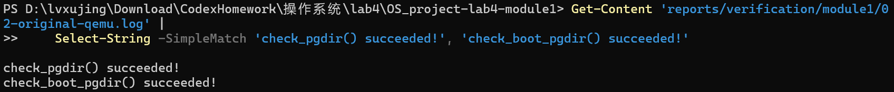
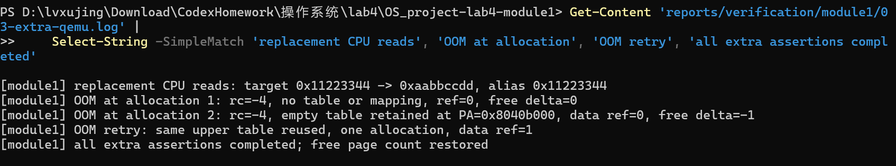

# 操作系统实验报告

## 实验基本信息

| 项目 | 内容 |
|------|------|
| **实验名称** | Lab 4: 进程管理 |
| **小组成员** | 2413406-黄婉文、2413396-范珂祎、2413671-吕旭婧 |
| **完成日期** | YYYY-MM-DD |

### 小组分工

练习如何分工？

| 成员 | 负责的练习/模块 |
|------|----------------|
| 2413671-吕旭婧 | 功能模块一：虚拟内存页操作 |
| 2413406-黄婉文 | lab2/lab3代码迁移，功能模块二：进程创建及初始化功能，challenge |
| 2413396-范珂祎 | 功能模块三：进程调度 |

实验报告如何分工？

| 成员 | 负责的报告部分 |
|------|----------------|
| 2413671-吕旭婧 | 功能模块一的实现说明、提示词、验证记录与心得 |
| 2413406-黄婉文 | 环境准备，逻辑主线分析，功能模块二 |
| 2413396-范珂祎 | 功能模块三 |


---

## 一、实验目的

<!-- 说明本次实验的主要目标和预期成果 -->

本实验的主要目的是：

1. 了解虚拟内存管理的基本结构，掌握虚拟内存的组织与管理方式；
2. 了解内核线程创建/执行的管理过程；
3. 了解内核线程的切换和基本调度过程。

---

## 二、实验环境

你们使用的 AI 工具

| 成员 | AI 编程工具 | 底层模型 | 备注 |
|------|------------|---------|------|
| 2413406-黄婉文 | DeepSeek Harness | DeepSeek-Flash | 无 |
| 2413396-范珂祎 | [例如：Cline（VS Code插件） / Claude Code（终端 Agent） / DeepSeek Harness等] | [例如：Claude Sonnet 4.5 / GPT-5.5 / DeepSeek-V4-Flash等] | [可选：特殊配置等] |
| 2413671-吕旭婧 | Codex Desktop | | 通过 SSH 使用已有 Ubuntu 虚拟机 |

**说明：**
- **AI 编程工具**：指具体使用的终端工具、编辑器插件、桌面应用或浏览器界面
- **底层模型**：指该工具使用的大语言模型及版本

**模块一构建与验证环境（2413671-吕旭婧）**

Ubuntu 22.04.5 LTS（x86_64），使用已有的 `~/compiler-lab/env.sh` 加载 RV64 交叉工具链。编译器为 `riscv64-unknown-elf-gcc` 15.1.0，Binutils 2.45，GNU Make 4.3，模拟器为 QEMU 4.1.1。开发和运行验证分别使用独立的 Lab4 目录，基线提交为 `e314eca5641bff8fbefe92c78fa615fb544223bc`。 [构建日志](verification/module1/lab4-module1-build.log)

---

## 三、实验整体逻辑分析

### 2.1 本章节的逻辑主线

本章围绕内核线程管理展开，通过完善虚拟内存管理和引入内核线程机制，使系统从单一执行流的内核发展为支持多线程调度的内核，并完成基本的虚拟内存环境框架搭建，为后续实现用户进程、系统调用、缺页异常处理和页面置换等功能奠定基础。主要内容包括：

1. 完善虚拟内存管理，实现基本的地址空间结构。通过引入虚拟内存描述结构，管理进程或线程的虚拟地址空间布局，为每个执行实体提供逻辑上的运行空间。
   
2. 引入内核线程机制，实现多执行流并发运行能力。实现线程控制块、上下文切换和调度器等内容，从而实现多线程并发执行，使内核能够调度多个执行实体轮流使用 CPU 运行。

### 2.2 功能的逐步实现

1. 首先实现虚拟内存页操作功能。完成多级页表框架下最基本的映射维护，实现page_insert() 和 page_remove()，其中page_insert() 负责把物理页挂到指定线性地址上，并同步权限位、引用计数和 TLB；page_remove() 负责安全撤销映射。后续线程运行、页表切换、后续用户进程地址空间都依赖页表映射的正确性。
   
2. 接着再完善实现进程创建及初始化功能。在建立可靠的页表映射后，实现 alloc_proc()、proc_init()、kernel_thread()、do_fork()、copy_thread()、copy_mm()，让内核能够创建并登记内核线程，才能实现后续的内核线程调度切换。
   
3. 最后完成进程调度功能。在已有可运行内核线程的基础上，实现 cpu_idle()、schedule()、proc_run()、switch_to()，把线程交给 CPU 执行并完成上下文切换，让线程能够轮流使用CPU。

---

## 四、实验内容与实现

<!-- 
说明：本部分按照 exercises 文档中的练习顺序组织
每个功能模块或者练习中可能包含多项任务，请根据实际情况调整
-->

### 环境准备

**负责人：** 2413406-黄婉文

本实验需要在完成lab2/lab3的物理内存管理和中断异常处理的基础上进行。根据lab2/lab3的提示词生成相应实验代码，并将结果填写到本实验代码中“lab2”/“lab3”注释的对应位置，确保代码能够正确编译。以下为新增/修改的函数或文件：

```c
// kern/mm/pmm.c
static void page_init(void);         
static void init_pmm_manager(void);   

// kern/mm/best_fit_pmm.c
static void best_fit_init(void);
static void best_fit_init_memmap(struct Page *base, size_t n);
static struct Page *best_fit_alloc_pages(size_t n);
static void best_fit_free_pages(struct Page *base, size_t n);
static size_t best_fit_nr_free_pages(void);
static void basic_check(void);
static void best_fit_check(void);
const struct pmm_manager best_fit_pmm_manager;

// kern/mm/best_fit_pmm.h
extern const struct pmm_manager best_fit_pmm_manager;

// kern/trap/trap.c
void interrupt_handler(struct trapframe *tf);  
void exception_handler(struct trapframe *tf); 

// kern/trap/trapentry.S
RESTORE_ALL   
__alltraps    
```


### 功能模块一：虚拟内存页操作功能

**负责人：** 2413671-吕旭婧

#### 模块功能描述

**实现位置与接口**

实现在 `code/kern/mm/pmm.c` 的 `LAB4 function1 2413671` 标记区，声明沿用 `pmm.h`。 [实现源码](../code/kern/mm/pmm.c) · [接口声明](../code/kern/mm/pmm.h)

```c
int page_insert(pde_t *pgdir, struct Page *page, uintptr_t la, uint32_t perm);
void page_remove(pde_t *pgdir, uintptr_t la);
```

`page_insert()` 负责在 Sv39 页表中建立或更新 4 KiB 映射，`page_remove()` 撤销映射。两个接口一起维护末级 PTE、数据页引用计数与当前 hart 的地址翻译缓存。启动阶段的 `pmm_init()` 先运行页表自检，之后才进入虚拟内存与进程管理初始化。

- **新建与同页改权。** `page_insert()` 先用 `get_pte(pgdir, la, 0)` 查找槽位，缺表时才允许创建。写入的 PTE 由 `pte_create(page2ppn(page), perm)` 构造，包含物理页号、有效位和调用者原样传入的权限。新增映射使目标页引用加一。同页改权时，原映射与新映射占的是同一个槽位，指向同一页，引入和移除的引用相互抵消，所以直接改写 PTE，引用计数从头到尾保持不变。
- **换页与删除。** 换页先增加新页的引用并发布新 PTE。删除使用 `create=0` 查找，缺表或 PTE 无效时直接返回，有效时将 PTE 清零。两条路径均在更新 PTE 后失效旧翻译，再减少旧页引用，归零才回收。若先回收，当前 hart 可能仍用缓存的旧翻译访问已交给其他用途的页。普通删除保留中间页表。
- **TLB 失效范围。** 只更新末级 PTE 时，由 `tlb_invalidate()` 执行针对目标虚拟地址的 `sfence.vma`。走过可能新增非叶项的路径时，调用 `flush_tlb()` 执行本 hart 的全地址 fence。封装函数在 fence 前后放置编译器内存屏障，约束 PTE 写入和物理页回收的顺序。
- **分配失败。** 第一次表页分配失败时，根目录尚未挂接新表。第一次成功、第二次失败时，`get_pte()` 已挂接第一张空表，空闲页数暂少一张，重试可以复用。两种情况都返回 `-E_NO_MEM`，均未建立有效末级映射或修改目标数据页引用。失败路径仍执行全地址 fence，以覆盖已经发布非叶项的情况。

#### 最终提示词

实现轮的 `PROMPT` 限定改动位置和交付范围，`RELY` 指定复用仓库现有接口与上级表分配语义，`SPECIFICATION` 逐项规定新建、同页改权、换页、删除、失败返回及 TLB 失效。运行验证轮补充实际访存、别名和分配失败重试等验收场景。 [实现轮原文](prompt.md#module1-implementation) · [运行验证轮原文](prompt.md#module1-validation)

#### 实现迭代过程

1. **单独编译。** AI 生成的初版使用了工程未定义的 `true` 和 `false`。`make V= obj/kern/mm/pmm.o` 首次退出码为 `2`。改用项目已有的 `1` 和 `0` 后，同一目标重编退出码为 `0`。反汇编检查了单地址和全地址两种 `sfence.vma`，并核对了换页和删除路径中 PTE 写入、fence、减引用及回收的指令顺序。 [单独编译原始日志](verification/module1/lab4-module1-build.log)
2. **运行验证。** 独立测试副本的普通构建停在框架 `kmalloc.c:92`。GCC 15 将传给 `kva2page()` 的整数到指针转换诊断为错误。仅在测试构建命令中用 `DEFS=-Wno-error=int-conversion` 将该诊断降为警告，框架源码与断言保持原样。该报错发生在模块一代码之外。随后构建成功，依次执行原有自检和额外测试。 [首次失败日志](verification/module1/01-original-build.log#L37) · [重建日志](verification/module1/02-original-build.log#L37)

---


### 功能模块二：进程创建及初始化功能

**负责人：** 2413406-黄婉文

#### 模块功能描述

**需要实现/修改的函数：**

```c
// 列出本模块涉及的所有函数签名
void example_function(void);
int another_function(int arg);
```

**功能说明：**

[简要描述该模块的功能，包括：
- 该模块在整个系统中的作用
- 需要处理的主要场景
- 与其他模块的交互关系]

#### 最终提示词

以下是经过迭代优化后，最终成功实现该功能的提示词：

````markdown

[按照提示词模板，给出具体的提示词]

````

#### 实现迭代过程

本模块的实现经历了 [N] 次迭代，过程如下：

---

##### 第一次迭代

如果设计的prompt生成代码后出现问题：

**遇到的问题：**
- 问题1：问题描述、错误信息和原因分析
- 问题2：问题描述、错误信息和原因分析

**问题解决策略：**
- 针对问题1：[说明如何修改提示词]
- 针对问题2：[说明如何修改提示词]

如果没有问题：

**最终结果：**

经过 [N] 次迭代，该模块最终：
- ✅ 编译通过
- ✅ 所有相关测试通过
- ✅ 功能符合预期

**关键改进点总结（如有）：**
1. [改进点1：例如，在 [RELY] 中补充了完整的系统调用号定义]
2. [改进点2：例如，在 [SPECIFICATION] 中明确了异常处理的边界条件]
3. [改进点3：例如，增加了对用户指针合法性检查的要求]

---

##### 第二次迭代（如有）

[按照和第一次迭代相同的格式]

---

##### 第三次迭代（如有）

[按照和第一次迭代相同的格式]

---


### 功能模块三：进程调度

**负责人：** 2413396-范珂祎

#### 模块功能描述

**需要实现/修改的函数：**

```c
// 列出本模块涉及的所有函数签名
void example_function(void);
int another_function(int arg);
```

**功能说明：**

[简要描述该模块的功能，包括：
- 该模块在整个系统中的作用
- 需要处理的主要场景
- 与其他模块的交互关系]

#### 最终提示词

以下是经过迭代优化后，最终成功实现该功能的提示词：

````markdown

[按照提示词模板，给出具体的提示词]

````

#### 实现迭代过程

本模块的实现经历了 [N] 次迭代，过程如下：

---

##### 第一次迭代

如果设计的prompt生成代码后出现问题：

**遇到的问题：**
- 问题1：问题描述、错误信息和原因分析
- 问题2：问题描述、错误信息和原因分析

**问题解决策略：**
- 针对问题1：[说明如何修改提示词]
- 针对问题2：[说明如何修改提示词]

如果没有问题：

**最终结果：**

经过 [N] 次迭代，该模块最终：
- ✅ 编译通过
- ✅ 所有相关测试通过
- ✅ 功能符合预期

**关键改进点总结（如有）：**
1. [改进点1：例如，在 [RELY] 中补充了完整的系统调用号定义]
2. [改进点2：例如，在 [SPECIFICATION] 中明确了异常处理的边界条件]
3. [改进点3：例如，增加了对用户指针合法性检查的要求]

---

##### 第二次迭代（如有）

[按照和第一次迭代相同的格式]

---

##### 第三次迭代（如有）

[按照和第一次迭代相同的格式]

---


### Challenge：[Challenge标题]

**负责人：** [学号-姓名]

[按照Challenge的具体要求进行解答]

---


## 五、测试与验证

<!-- 根据该实验的具体情况，提供完整的测试运行截图，应包含：
- 编译及运行成功的输出（make qemu），可能有多个
- 测试通过的结果（make grade），只有一个
-->

### 功能模块一验证（2413671-吕旭婧）

测试副本的 `pmm.c` 与正式开发目录的 Git 内容哈希一致。第一轮只启用独立入口，保留启动汇编、设备树解析和原样的 `pmm_init()`，串口输出 `check_pgdir() succeeded!` 和 `check_boot_pgdir() succeeded!`，随后正常退出。第二轮加入额外断言，再次通过两项原有自检并完成下表测试。两次 QEMU 退出码均为 `0`。 [原有自检日志](verification/module1/02-original-qemu.log#L41) · [首轮退出码](verification/module1/02-original-qemu.exit) · [额外测试日志](verification/module1/03-extra-qemu.log#L46) · [第二轮退出码](verification/module1/03-extra-qemu.exit)



图 1：QEMU 4.1.1 原有页表自检日志回看，两项自检均通过。

| 额外测试 | 结果 |
|---|---|
| 同页降权 | `PTE_W` 清除，PPN 不变，引用计数保持 `1`，空闲页数不变。另行读取同一 VA，读到原值 `0x11223344`。 |
| 实际换页与别名 | 同一 VA 从 `0x11223344` 变为 `0xaabbccdd`，旧页别名仍读到 `0x11223344`。换页后旧页引用为 `1`，空闲页数不变。撤销最后一个别名后，旧页引用归零，空闲页数加 `1`。 |
| 有效删除、重复删除与缺表删除 | 有效删除清零 PTE，数据页引用归零，空闲页数加 `1`，两级中间表保留。重复删除没有再次减少引用。缺根项和缺下一级表两种情况下均未创建页表，空闲页数不变。 |
| 两次分配失败与重试 | 两次均返回 `-E_NO_MEM`（`-4`），没有末级映射，目标数据页引用仍为 `0`。第一次失败未留下表页。第二次保留一张空表，空闲页数减 `1`，重试沿用该表，只再分配一张表页便成功。 |

额外断言全部执行完毕，清理测试用页表后空闲页数恢复。降权后的写入异常、撤销映射后的访问异常，以及进程创建、调度和完整评分均未运行。 [测试代码及复现说明](verification/module1/README.md)



图 2：QEMU 4.1.1 额外测试日志回看。同一虚拟地址换页后读到新值；第二次表页分配失败后，重试复用已挂接的空表，额外断言全部执行完毕。

---

## 六、实验总结与收获

### 对操作系统的理解

1. 列出你们认为本实验中重要的知识点，以及与对应的 OS 原理中的知识点，并简要说明二者的含义、关系和差异
2. 列出你们认为 OS 原理中很重要、但在本实验中没有对应上的知识点

**模块一心得（2413671-吕旭婧）**

Sv39 的页表记录映射，引用计数记录数据页还有多少个映射，TLB 缓存已经完成的地址翻译。换页时通过同一 VA 读到新值，说明此次运行中硬件使用了新翻译。旧页仍可经别名访问，直到最后一个别名撤销才归还分配器。这里练习的是预先建立和撤销映射，按需分页和页面置换属于后续实验内容。

### AI 协作开发的经验

[写出你们在与 AI 协作过程中实际收获的经验或者感悟]

**模块一心得（2413671-吕旭婧）**

本次用 Codex Desktop 协助检查框架、生成并修改模块一实现、编写独立测试和整理结果。先用只读提示词确认本仓库的接口和断言，再在实现提示词里明确引用计数、OOM 副作用与 fence 的范围。单独编译暴露了 AI 代码使用未定义布尔字面量的问题，独立启动则区分了框架的工具链兼容问题和页表操作本身的行为。分配回调注入使第二次失败留下空表的行为可以实测，实际换页读取也补上了只查 PTE 和计数无法覆盖的验证。 [完整提示词记录](prompt.md)

---

